# Istio Hybrid: Multi-Cluster and VMs in a Service Mesh

Workshop on Istio in sidecar mode with the classic Istio APIs (VirtualService, DestinationRule, ServiceEntry, Gateway):
several Kubernetes clusters and virtual machines in one shared mesh, on an IPv6-only network.

All material in this repository is in English.


## Agenda
  1. Fundamentals: service mesh and Istio
     * [What is a service mesh, and what is Istio? Sidecar and ambient](#what-is-a-service-mesh-and-what-is-istio-sidecar-and-ambient)
     * [Why a service mesh?](#why-a-service-mesh)
     * [Challenges and benefits](#challenges-and-benefits)
     * [Istio architecture and components](#istio-architecture-and-components)
     * [Istio ingress gateway vs. Kubernetes Gateway API](#istio-ingress-gateway-vs-kubernetes-gateway-api)
  
  1. Explore the lab
     * [Look around the lab: nodes, pods, sidecar, `istioctl proxy-status`](#look-around-the-lab-nodes-pods-sidecar-`istioctl-proxy-status`)

  1. Ingress gateway on IPv6
     * [Expose Bookinfo through the ingress gateway over IPv6](#expose-bookinfo-through-the-ingress-gateway-over-ipv6)
        
  1. Two clusters, one mesh
     * [Check the link between two clusters: `istioctl remote-clusters`](#check-the-link-between-two-clusters-`istioctl-remote-clusters`)
     * [Answer requests with pods from the other cluster](#answer-requests-with-pods-from-the-other-cluster)
      
  1. Virtual machines in the mesh
     * [WorkloadGroup, WorkloadEntry and EndpointSlice: who is who](#workloadgroup-workloadentry-and-endpointslice-who-is-who)
     * [Dual stack on the VM: what to set (`DUAL_STACK` and `ISTIO_DUAL_STACK`)](#dual-stack-on-the-vm-what-to-set-`dual_stack`-and-`istio_dual_stack`)
     * [Add a virtual machine to the mesh (IPv6 only)](#add-a-virtual-machine-to-the-mesh-ipv6-only)
     * [Ports of istiod and of the sidecar on the VM](#ports-of-istiod-and-of-the-sidecar-on-the-vm)
     * [Reference: Dual stack on the VM: details and measurements](#reference-dual-stack-on-the-vm-details-and-measurements)

<div class="page-break"></div>

## Fundamentals: service mesh and Istio

### What is a service mesh, and what is Istio? Sidecar and ambient


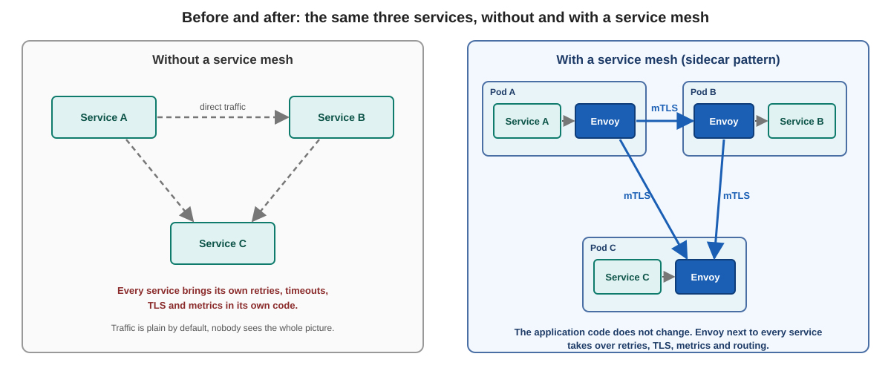

### Background

This page has no commands. It gives you the words for the rest of the course. You look at a real mesh in the exercise [Look around the lab](../explore-the-lab/01-look-around.md).

### What is a service mesh?

A service mesh is a layer of infrastructure that handles the communication between services:

* It sits **between** the services, as a transparent layer. The application code does not change.
* Retries, timeouts, encryption (mTLS), access rules and metrics are configured **in one place**, not in every service.
* It gives applications zero-trust security, observability and advanced traffic management without code changes.

### Istio in one paragraph

Istio is an open source service mesh. It was started by Google, IBM and Lyft. Its data path is made of **Envoy** proxies. In the classic model an Envoy runs next to every workload as a **sidecar** and catches all network traffic of that workload. A central control plane, **istiod**, tells every proxy what to do.

In this course you use Istio in **sidecar mode** with the classic Istio APIs (`VirtualService`, `DestinationRule`, `ServiceEntry`, `Gateway`).

### Two architectures: sidecar and ambient

Istio knows two data plane modes. They can run side by side in one cluster.

| | Sidecar mode | Ambient mode |
|---|---|---|
| Where is the proxy? | One Envoy **in every pod** | One `ztunnel` **per node** (layer 4), optional `waypoint` proxy (layer 7, usually one per namespace) |
| What the proxy does | Layer 4 and layer 7: mTLS, routing, retries, metrics | `ztunnel`: mTLS and layer 4 telemetry. `waypoint`: routing, retries, layer 7 rules |
| Cost | CPU and memory in every pod | Less overhead, because proxies are shared |
| Pod changes | The pod gets a sidecar (injection, restart needed) | No change to the pod |
| What it needs from the cluster | Nothing special | An Istio node agent on every node (Istio CNI, a privileged component) |
| In this course | **Taught and practised** | **Theory only, about 15 minutes, no lab** |

Why sidecar here: you work as a tenant and you cannot install a privileged component on every node. The sidecar needs nothing of that, and it is the model that is still in wide use. Ambient is worth knowing because it changes the data path, so you can judge it when the question comes up.

### What you should remember

* A mesh is a **control plane** (decides) and a **data plane** (the proxies that carry the traffic).
* In sidecar mode every pod has an Envoy next to the application.
* The mesh works at the network level, so it works for every language.

Next: [Why a service mesh?](02-why-a-service-mesh.md)

### Why a service mesh?


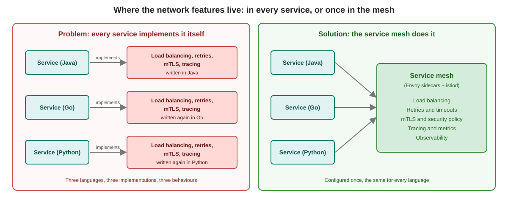

### Background

This page has no commands.

### The problem

With a few services, the network is easy. With dozens or hundreds of services, communication becomes the hard part. Every service needs:

* load balancing
* retries and timeouts
* circuit breaking
* mTLS encryption
* distributed tracing and metrics

If every service implements this itself, you get:

* **Different behaviour per language.** The Java service retries three times, the Go service never retries, the Python service retries forever.
* **High maintenance.** A change to the TLS settings means a new release of every service.
* **No overview.** Nobody can say which service talks to which, and whether the traffic is encrypted.

### The solution

The mesh moves this work **out of the application code into the infrastructure**:

| Who | What changes |
|---|---|
| Developers | Concentrate on the business logic |
| Platform team | Sets policy once (encryption, access, retries) for all services |
| Operations | Sees the same metrics for every service, whatever the language |

### The five things a mesh gives you

| Area | What it means |
|---|---|
| Observability | Metrics, traces and logs for all service-to-service traffic |
| Traffic management | Canary releases, weighted routing, load balancing |
| Resilience | Retries, timeouts, outlier detection |
| Security | mTLS between services, authentication and authorization policy |
| Service discovery | Services find each other, also when the system changes |

You will meet every row of this table in a later module.

Previous: [What is a service mesh?](01-what-is-a-service-mesh.md)
Next: [Challenges and benefits](03-challenges-and-benefits.md)

### Challenges and benefits


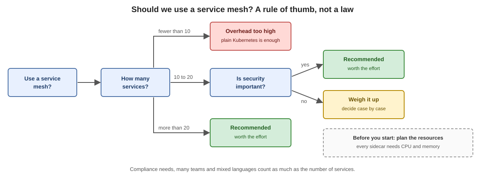

### Background

This page has no commands. A mesh is not free. Know both sides before you decide.

### Benefits

* **mTLS between all services**, automatic. The sidecars get certificates and rotate them.
* **Traffic control**: canary release, blue-green, A/B tests, weighted routing.
* **One view of everything**: metrics, traces and logs look the same for every service.
* **Central security policy**: who may call whom is a configuration, not code.
* **No code changes.**

### Challenges

| Challenge | What it means in practice |
|---|---|
| Resource overhead | Every sidecar needs CPU and memory. With many pods this adds up. You set requests and limits for the sidecar. |
| Extra latency | Every call goes through two proxies, the one of the caller and the one of the target. The delay is small, but it is there. |
| Learning curve | New objects, new terms, new places where a problem can hide. |
| Harder debugging | A failed call can be the application, the sidecar, the network or the mesh configuration. Tools like `istioctl proxy-status` help. |
| Another system to run | istiod, certificates, upgrades. |

### When is it worth it?

A rule of thumb, not a law:

* from about 20 to 30 services
* high requirements for security and compliance (for example encryption between all services, proof of who may call whom)
* many teams that use different languages

With fewer than 10 services the overhead usually outweighs the gain. Between 10 and 20 it depends mainly on how much security matters to you.

Previous: [Why a service mesh?](02-why-a-service-mesh.md)
Next: [Istio architecture and components](04-istio-architecture-and-components.md)

### Istio architecture and components


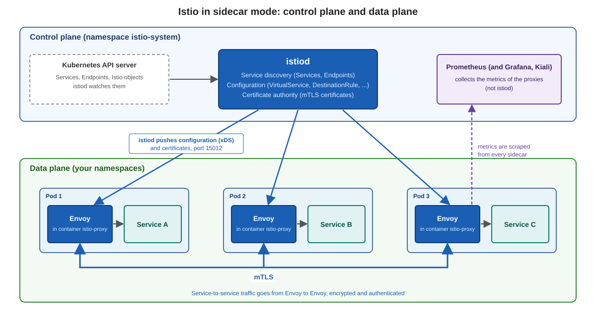

### Background

An Istio mesh has two parts:

| Part | What it is | Where in your lab |
|---|---|---|
| **Control plane** | `istiod`: one Deployment that decides | namespace `istio-system` |
| **Data plane** | The Envoy proxies that carry the traffic: one in every pod of the mesh, plus the gateways | the sidecar in every pod, the gateway in `istio-ingress` |

You can look at all of this in the exercise [Look around the lab](../explore-the-lab/01-look-around.md).

### The control plane: istiod

`istiod` is one process with several jobs:

* **Service discovery.** It watches the Kubernetes API for Services and Endpoints.
* **Configuration.** It reads the Istio objects (`VirtualService`, `DestinationRule`, `Gateway`, ...) and translates them into Envoy configuration.
* **Certificate authority.** It signs the workload certificates for mTLS. The identity of a workload is its Kubernetes ServiceAccount.
* **Distribution.** It pushes the configuration to all proxies over a gRPC connection (xDS, port 15012).

istiod does **not** carry any application traffic, and it does not collect metrics. The proxies expose their metrics, and Prometheus scrapes them.

### The data plane: Envoy

Envoy is a fast, generic proxy. In a pod it runs as the container `istio-proxy`. Inside this container two programs run:

| Program | Job |
|---|---|
| `pilot-agent` (process 1) | Connects to istiod, fetches the certificate, starts Envoy |
| `envoy` (child process) | Carries the traffic: routing, retries, mTLS, metrics |

Envoy does not talk to istiod directly. It talks to `pilot-agent` over a local Unix socket, and `pilot-agent` holds the connection to istiod. A small init container, `istio-init`, runs once at pod start and sets up iptables rules. These rules send all traffic of the pod through Envoy.

The messages that carry configuration are called **xDS**. You will see the names in `istioctl proxy-status`:

| Name | What istiod sends |
|---|---|
| CDS | clusters: the services a proxy can call |
| EDS | endpoints: the pod addresses behind a service |
| LDS | listeners: which ports the proxy listens on |
| RDS | routes: how requests are matched and where they go |
| NDS | names: the DNS table for the DNS proxy |

### Gateways

A gateway is an Envoy that runs **on its own**, without an application next to it. It stands at the edge of the mesh. The **ingress gateway** lets traffic in, an egress gateway lets traffic out in a controlled way. How an ingress gateway is configured is the topic of the next page.

### From configuration to traffic

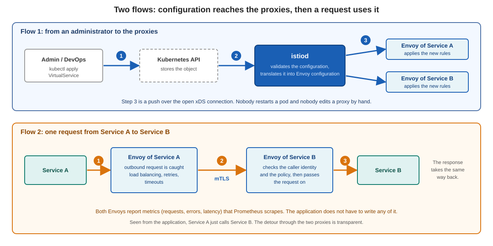

1. You apply a high level object, for example a `VirtualService`.
2. istiod validates it and translates it into Envoy configuration.
3. istiod pushes the result to every proxy that needs it. Nobody restarts a pod.
4. At run time the Envoy of the caller catches the outbound request, applies load balancing and retries, and sends it with mTLS to the Envoy of the target. That Envoy checks the identity and the policy and hands the request to the application.

### What you should remember

* istiod **decides**, Envoy **carries**.
* The configuration travels from istiod to Envoy, never the other way round. The connection always starts at the proxy.
* The proxies hold their last configuration. If istiod is down for a while, existing traffic keeps flowing, but changes and new certificates stop.

Previous: [Challenges and benefits](03-challenges-and-benefits.md)
Next: [Istio ingress gateway vs. Kubernetes Gateway API](05-ingress-gateway-vs-gateway-api.md)

### Istio ingress gateway vs. Kubernetes Gateway API


### Background

Traffic that comes **into** the cluster from outside is called north-south traffic. In Istio you have two ways to describe it:

* the **Istio APIs**: `Gateway` plus `VirtualService` (plus `DestinationRule`). This is what the exercise [Expose Bookinfo through the ingress gateway over IPv6](../ingress-gateway/01-expose-bookinfo-over-ipv6.md) uses.
* the **Kubernetes Gateway API**: `GatewayClass`, `Gateway` and `HTTPRoute`. It is a Kubernetes standard, not an Istio invention, and several products implement it.

This page has no commands. It shows how the two ideas differ, so you can read both.

### The Istio way

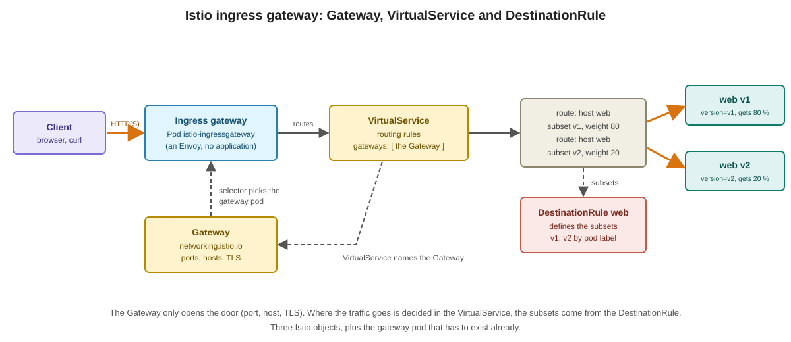

| Object | What it does |
|---|---|
| Ingress gateway pod | An Envoy without application. You run it yourself, in the lab as a Deployment with a Service of type `LoadBalancer` in `istio-ingress` |
| `Gateway` (`networking.istio.io`) | Opens the door on that pod: ports, hosts, TLS. A `selector` picks the gateway pods |
| `VirtualService` | The routing rules. It names the `Gateway` in its `gateways` field |
| `DestinationRule` | Defines **subsets** (for example `v1`, `v2` by pod label) and the policy for the target: load balancing, connection pool, outlier detection |

The same `VirtualService` and `DestinationRule` also work for traffic **inside** the mesh. That is why you learn them first.

### The Kubernetes Gateway API way

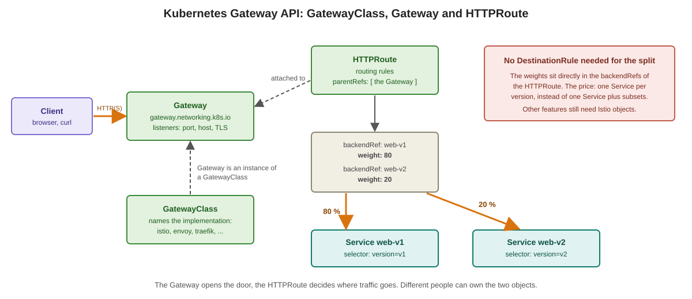

| Object | What it does |
|---|---|
| `GatewayClass` | Names the implementation (`istio`, `envoy`, `traefik`, ...). One per implementation, usually created by the platform |
| `Gateway` (`gateway.networking.k8s.io`) | An instance of a class: the listeners (port, host, TLS) |
| `HTTPRoute` | The routing rules. It attaches to a `Gateway` with `parentRefs` |

Two differences to remember:

* **The weights are in the route.** An `HTTPRoute` lists `backendRefs` with a `weight`. Each backend is a Service, so a canary needs one Service per version. No `DestinationRule` is needed for the split.
* **Istio can create the gateway pod for you.** With the Gateway API, a `Gateway` of class `istio` makes Istio create the Deployment and the Service itself. With the Istio `Gateway` you run the gateway pod yourself.

Other route types exist, for example `GRPCRoute` for gRPC.

### Side by side

| | Istio `Gateway` + `VirtualService` | Gateway API `Gateway` + `HTTPRoute` |
|---|---|---|
| Who defines it | Istio | Kubernetes SIG Network, many implementations |
| Door and routing | `Gateway` and `VirtualService` | `Gateway` and `HTTPRoute` |
| Link between them | `VirtualService.gateways` names the `Gateway` | `HTTPRoute.parentRefs` names the `Gateway` |
| Canary | weights over **subsets** (needs a `DestinationRule`) | weights over **Services** in `backendRefs` |
| Gateway pod | you run it | Istio can create it from the `Gateway` |
| Who may attach a route | a `VirtualService` that names the `Gateway` | the `Gateway` decides with `allowedRoutes` (namespaces, kinds) |
| Works with another product | no, Istio only | yes, same objects with another `GatewayClass` |
| Where it is installed | Istio brings the CRDs | The Gateway API CRDs are **not** part of Kubernetes, someone has to install them |

The last row matters if you are a tenant: installing CRDs is a cluster-wide act. Ask your trainer whether the Gateway API CRDs are installed in your lab.

### Which one to use?

* The Gateway API is the direction Istio is moving in. For **new ingress** configuration it is a good default when the CRDs are available.
* The Istio APIs stay important. Not every feature of `VirtualService` and `DestinationRule` has an equivalent in the Gateway API, for example fault injection, connection pool settings and outlier detection are still configured with the Istio objects. Existing setups are full of them, and many companies run the classic APIs.
* You can use both in one cluster, and you can move step by step.
* **One owner per Service.** Do not describe the routing of the same Service with an `HTTPRoute` and a `VirtualService` at the same time. Pick one.

In this course the focus is on the Istio APIs. You see the Gateway API as a short contrast.

Previous: [Istio architecture and components](04-istio-architecture-and-components.md)

## Explore the lab

### Look around the lab: nodes, pods, sidecar, `istioctl proxy-status`


### Background

Your lab already has Istio installed in sidecar mode. Nothing is left for you to install. In this exercise you look at what is running, and you learn the one command you will use all week: `istioctl proxy-status`.

The lab consists of:

| Part | What it is |
|---|---|
| Kubernetes cluster | one control-plane node and one worker node, IPv6 only |
| Istio | control plane `istiod` in the namespace `istio-system`, sidecar mode |
| Namespace `app` | two pods, `web` and `client`, both with a sidecar |
| Namespace `vm` | a virtual machine (`diameter-adapter`) that is part of the mesh |

All commands below run on your bastion host.

### Step 1: Look at the nodes

```
kubectl get nodes -o wide
```

Expected output (addresses differ in your lab):

```
NAME    STATUS   ROLES           AGE   VERSION    INTERNAL-IP
h6-cp   Ready    control-plane   ...   v1.35.10   2a01:4f8:c016:aa79::1
h6-w    Ready    <none>          ...   v1.35.10   2a01:4f8:c016:17b5::1
```

Note that the node addresses are IPv6 addresses. There is no IPv4 address inside the cluster.

### Step 2: Look at the pods in the mesh

```
kubectl get pods -n app -o wide
```

```
NAME     READY   STATUS    RESTARTS   AGE   IP
client   2/2     Running   0          ...   2a01:4f8:c016:aa79::1:e5c6
web      2/2     Running   0          ...   2a01:4f8:c016:aa79::1:e5c5
```

Both pods show `2/2`, although each pod has only one application container. The second container is the Istio sidecar (Envoy). Each pod has its own IPv6 address, there is no NAT between pods.

### Step 3: Find the sidecar

```
kubectl get pod web -n app -o jsonpath='{.spec.containers[*].name}'
```

```
web
```

The sidecar is not in this list. In this lab (Kubernetes 1.35) Istio runs the sidecar as a native sidecar: a container in `initContainers` that has `restartPolicy: Always`.

```
kubectl get pod web -n app -o jsonpath='{.spec.initContainers[*].name}'
```

```
istio-init istio-proxy
```

`istio-init` sets up the traffic redirection and ends. `istio-proxy` is the sidecar and keeps running.

### Step 4: Ask Istio who is connected

```
istioctl proxy-status
```

```
NAME           CLUSTER        ISTIOD                     VERSION     SUBSCRIBED TYPES
client.app     cluster-h6     istiod-8ff6d656c-v555p     1.29.9      5 (CDS,LDS,EDS,RDS,NDS)
h6-vm.vm       cluster-h6     istiod-8ff6d656c-v555p     1.29.9      5 (CDS,LDS,EDS,RDS,NDS)
web.app        cluster-h6     istiod-8ff6d656c-v555p     1.29.9      5 (CDS,LDS,EDS,RDS,NDS)
```

This is the list of all proxies that are currently connected to `istiod`. Read it column by column:

| Column | Meaning |
|---|---|
| NAME | the proxy: pod name (or VM name) and namespace |
| CLUSTER | the cluster it belongs to |
| ISTIOD | the `istiod` pod that serves it |
| VERSION | the proxy version, after an upgrade you see here who is still old |
| SUBSCRIBED TYPES | which configuration `istiod` pushes to it (see below) |

The abbreviations are the kinds of configuration Envoy receives from `istiod`:

| Abbreviation | Meaning |
|---|---|
| CDS | clusters: where can this proxy send traffic |
| LDS | listeners: on which ports does it listen |
| EDS | endpoints: which addresses are behind a service |
| RDS | routes: how are requests distributed |
| NDS | name table: used by the DNS proxy, for example on the VM |

Look for the VM: `h6-vm.vm` is in the list, so the virtual machine is part of the mesh like any pod.

### Step 5: See the VM as a mesh member

```
kubectl get workloadentry -n vm
```

```
NAME                                          AGE   ADDRESS
diameter-adapter-2a01-4f8-c016-dab1--1-net1   ...   2a01:4f8:c016:dab1::1
```

A `WorkloadEntry` is how Istio describes a workload that is not a pod. This one was created automatically when the VM connected.

### Step 6: Call the VM from a pod

```
kubectl exec -n app client -c client -- curl -s http://diameter-adapter.vm.svc.cluster.local:8000/ | head -1
```

```
VM diameter-adapter (IPv6), client=::6
```

The request goes from the sidecar of `client` to the sidecar of the VM, encrypted with mutual TLS. The program on the VM answers.

### Step 7: Watch a proxy appear and disappear

Start a new pod in a namespace with sidecar injection:

```
kubectl run extra -n app --image=nginx:1.27
kubectl wait -n app --for=condition=Ready pod/extra --timeout=120s
istioctl proxy-status
```

`extra.app` is now in the list.

Now start a pod in a namespace without sidecar injection and compare:

```
kubectl create namespace plain
kubectl run plain-web -n plain --image=nginx:1.27
kubectl wait -n plain --for=condition=Ready pod/plain-web --timeout=120s
kubectl get pod plain-web -n plain
istioctl proxy-status
```

The pod shows `1/1` and does not appear in `proxy-status`. It is not part of the mesh.

**Take-away:** `proxy-status` shows who is connected to `istiod`. It does not show whether everything works. A VM can be in the list and still not receive traffic, for example if its WorkloadEntry is missing. Later in the training you will use this list to find a VM that dropped out of the mesh.

### Clean up

```
kubectl delete pod extra -n app
kubectl delete namespace plain
```

### Summary

| Question | Command |
|---|---|
| Which proxies are connected to istiod? | `istioctl proxy-status` |
| Is this pod in the mesh? | `READY 2/2` and the pod is in `proxy-status` |
| Where is the sidecar container? | `initContainers`, name `istio-proxy` |
| Which non-pod workloads exist? | `kubectl get workloadentry -A` |

## Ingress gateway on IPv6

### Expose Bookinfo through the ingress gateway over IPv6


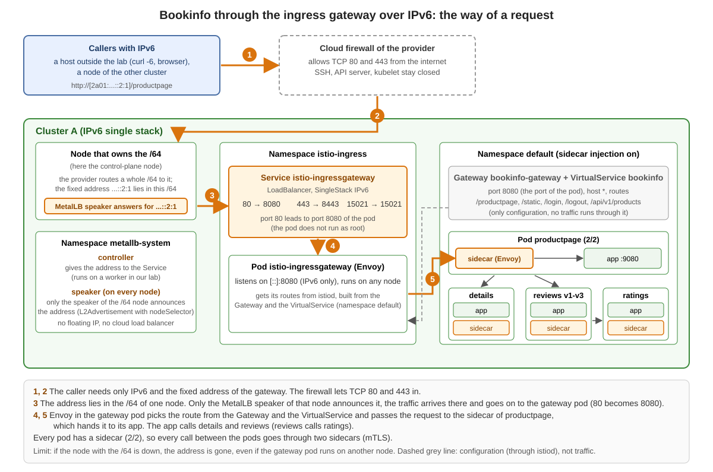

### Background

Your lab has an Istio ingress gateway in the namespace `istio-ingress`. It is a normal Kubernetes Service of type `LoadBalancer`, IPv6 single stack. Two things make it reachable from other clusters and from outside the lab:

| Part | What it does |
|---|---|
| Fixed address | Every lab server owns a whole `/64` network, routed to it by the provider. MetalLB hands out one fixed address from that `/64` to the gateway (`...::2:1`). No floating IP and no cloud load balancer is needed. |
| Cloud firewall | Allows TCP 80 and 443 from the internet. Everything else (SSH, API server, kubelet) stays closed. |

In this exercise you publish the demo application Bookinfo through this gateway and call it from different places.

All commands run on your bastion host, in cluster A. The sample files come from the Istio release folder (`istio-1.29.9/samples`).

### Step 1: Look at the gateway Service

```
kubectl get svc istio-ingressgateway -n istio-ingress
```

Expected output (addresses differ in your lab):

```
NAME                   TYPE           CLUSTER-IP          EXTERNAL-IP               PORT(S)
istio-ingressgateway   LoadBalancer   fd00:10:96::c:15b   2a01:4f8:c016:dab1::2:1   15021:31361/TCP,80:32665/TCP,443:31613/TCP
```

The EXTERNAL-IP is an IPv6 address. Check the address family and the target ports:

```
kubectl get svc istio-ingressgateway -n istio-ingress -o jsonpath='{.spec.ipFamilyPolicy} {.spec.ipFamilies}{"\n"}'
kubectl get svc istio-ingressgateway -n istio-ingress -o jsonpath='{.spec.ports[*].targetPort}{"\n"}'
```

```
SingleStack ["IPv6"]
15021 8080 8443
```

Port 80 of the Service leads to port **8080** of the gateway pod. The gateway pod does not run as root, so Envoy cannot listen on port 80 inside the pod. Keep this in mind, it matters in step 6.

### Step 2: Deploy Bookinfo

```
kubectl label namespace default istio-injection=enabled --overwrite
kubectl apply -f samples/bookinfo/platform/kube/bookinfo.yaml
kubectl wait --for=condition=Ready pod --all -n default --timeout=300s
```

Every pod shows `2/2` (application and sidecar):

```
kubectl get pods -n default
```

### Step 3: Publish it with a Gateway and a VirtualService

```
kubectl apply -f samples/bookinfo/networking/bookinfo-gateway.yaml
kubectl get gateway,virtualservice -n default
```

```
NAME                                           AGE
gateway.networking.istio.io/bookinfo-gateway   5s

NAME                                          GATEWAYS               HOSTS   AGE
virtualservice.networking.istio.io/bookinfo   ["bookinfo-gateway"]   ["*"]   5s
```

### Step 4: Call Bookinfo

```
export GATEWAY=$(kubectl get svc istio-ingressgateway -n istio-ingress -o jsonpath='{.status.loadBalancer.ingress[0].ip}')
echo $GATEWAY
curl -6 -s -o /dev/null -w "HTTP %{http_code}\n" "http://[$GATEWAY]/productpage"
```

```
HTTP 200
```

An IPv6 address in a URL needs square brackets. Without them `curl` reads the colons as a port.

Look at the content, the page shows the reviews and ratings that come from other pods:

```
curl -6 -s "http://[$GATEWAY]/productpage" | grep -E "<title>|Book Reviews|Reviewer"
```

### Step 5: See what the gateway listens on

```
export GWPOD=$(kubectl get pod -n istio-ingress -l istio=ingressgateway -o jsonpath='{.items[0].metadata.name}')
istioctl proxy-config listener $GWPOD.istio-ingress
```

```
ADDRESSES PORT  MATCH DESTINATION
::        8080  ALL   Route: http.8080
::        15021 ALL   Inline Route: /healthz/ready*
::        15090 ALL   Inline Route: /stats/prometheus*
```

The addresses are `::`, not `0.0.0.0`. Envoy in an IPv6 single stack cluster listens on IPv6 only. The listener for your Gateway resource is on 8080: the `Gateway` of the sample names port 8080, the port of the gateway pod, and the Service port 80 leads there (step 1).

### Step 6: Call it from other places

The gateway address is reachable from everywhere that has IPv6 connectivity to your lab:

| Caller | Command | Expected |
|---|---|---|
| A node of the other cluster (cluster B) | `curl -6 -s -o /dev/null -w "HTTP %{http_code}\n" "http://[$GATEWAY]/productpage"` | HTTP 200 |
| A host outside the lab with IPv6 (for example the trainer's machine) | the same command | HTTP 200 |
| A host with IPv4 only | cannot work, there is no IPv4 address anywhere in the lab | no connection |

If the call ends immediately with `Connection refused` although the Service has an endpoint, check the `targetPort` of the Service (step 1). With `targetPort` 80 the traffic arrives at a port where nothing listens. A quick test:

```
kubectl get endpointslice -n istio-ingress
```

The endpoint list is fine in that case, only the port is wrong. That is why this problem is easy to overlook.

### Limits to know

* The fixed address belongs to the `/64` of **one** node. If this node is down, the address is gone, even if the gateway pod runs on another node.
* `externalTrafficPolicy: Cluster` (the default) hides the real client address from the gateway (source NAT).

### Clean up

Keep Bookinfo, the next exercises use it. If you want to remove it:

```
kubectl delete -f samples/bookinfo/networking/bookinfo-gateway.yaml
kubectl delete -f samples/bookinfo/platform/kube/bookinfo.yaml
```

## Two clusters, one mesh

### Check the link between two clusters: `istioctl remote-clusters`


### Background

Two clusters form one mesh when each `istiod` can read the services and endpoints of the other cluster. For this, every cluster holds a **remote secret**: a small kubeconfig that gives its `istiod` read access to the API server of the other cluster.

If a remote secret is missing or broken, nothing fails loudly. The other cluster is simply not part of the mesh, and traffic stays local. The command that shows this is:

```
istioctl remote-clusters
```

In this exercise you read the output, break the link on purpose, see what happens, and repair it.

All commands run on your bastion host. Replace the contexts with the ones of your two clusters:

```
export CTX_A=<context of cluster A>
export CTX_B=<context of cluster B>
```

The cluster names in the outputs below (`cluster-h6`, `cluster-h6b`) are the names in our test lab. Yours may differ.

### Step 1: Prepare a test service in both clusters

`helloworld` runs in version v1 only in cluster A and in version v2 only in cluster B. Cluster A also gets a client pod (`sleep`). The sample files come from the Istio release folder (`istio-1.29.9/samples`).

```
for CTX in $CTX_A $CTX_B; do
  kubectl --context $CTX create namespace helloworld
  kubectl --context $CTX label namespace helloworld istio-injection=enabled
  kubectl --context $CTX apply -n helloworld -f samples/helloworld/helloworld.yaml -l service=helloworld
done
kubectl --context $CTX_A apply -n helloworld -f samples/helloworld/helloworld.yaml -l version=v1
kubectl --context $CTX_B apply -n helloworld -f samples/helloworld/helloworld.yaml -l version=v2
kubectl --context $CTX_A apply -n helloworld -f samples/sleep/sleep.yaml
kubectl --context $CTX_A wait -n helloworld --for=condition=Ready pod --all --timeout=180s
kubectl --context $CTX_B wait -n helloworld --for=condition=Ready pod --all --timeout=180s
```

### Step 2: Look at the link

```
istioctl --context $CTX_A remote-clusters
```

```
NAME            SECRET                                           STATUS     ISTIOD
cluster-h6                                                       synced     istiod-7b66fbd84c-g682b
cluster-h6b     istio-system/istio-remote-secret-cluster-h6b     synced     istiod-7b66fbd84c-g682b
```

Read it column by column:

| Column | Meaning |
|---|---|
| NAME | a cluster this `istiod` knows |
| SECRET | the remote secret it uses to reach that cluster. The first line is the local cluster and has no secret. |
| STATUS | `synced` means `istiod` has read the registry of that cluster |
| ISTIOD | the `istiod` pod that reports this |

Now look from cluster B:

```
istioctl --context $CTX_B remote-clusters
```

Each cluster needs a secret for the **other** one. Cluster A holds the secret for B, and cluster B holds the secret for A. Both lines must say `synced`.

### Step 3: See the effect on traffic

The client in cluster A calls `helloworld` 40 times:

```
kubectl --context $CTX_A exec -n helloworld deploy/sleep -c sleep -- sh -c 'for i in $(seq 1 40); do curl -s http://helloworld.helloworld:5000/hello; done | grep -o "version: v[12]" | sort | uniq -c'
```

```
     22 version: v1
     18 version: v2
```

Answers come from both clusters. The client sidecar knows an endpoint in each cluster:

```
istioctl --context $CTX_A proxy-config endpoints deploy/sleep.helloworld --cluster "outbound|5000||helloworld.helloworld.svc.cluster.local"
```

```
ENDPOINT                            STATUS      OUTLIER CHECK     CLUSTER
2a01:4f8:c016:17b5::1:9133:5000     HEALTHY     OK                outbound|5000||helloworld.helloworld.svc.cluster.local
2a01:4f8:c016:a758::1:a845:5000     HEALTHY     OK                outbound|5000||helloworld.helloworld.svc.cluster.local
```

Two addresses from two different networks: one pod in each cluster.

### Step 4: Break the link

Remove the secret in cluster A that gives it access to cluster B. Use the secret name from the `SECRET` column of step 2:

```
kubectl --context $CTX_A -n istio-system delete secret istio-remote-secret-cluster-h6b
```

Wait ten seconds and look again:

```
istioctl --context $CTX_A remote-clusters
```

```
NAME           SECRET     STATUS     ISTIOD
cluster-h6                synced     istiod-7b66fbd84c-g682b
```

The line for cluster B is gone. There is no error message anywhere. Repeat the calls of step 3:

```
     40 version: v1
```

All 40 answers come from v1 and the client knows only one endpoint. Cluster B is not part of the mesh any more.

**Take-away:** If traffic does not reach the other cluster and there is no error, run `istioctl remote-clusters` first. A missing line (or a status other than `synced`) shows that the link is the problem.

### Step 5: Repair the link

A remote secret for cluster B is created **in cluster B** (it needs the address and a reader account of that cluster) and applied **in cluster A**:

```
istioctl --context $CTX_B create-remote-secret --name=cluster-h6b | kubectl --context $CTX_A apply -f -
```

```
secret/istio-remote-secret-cluster-h6b created
```

The `--name` is the cluster name of B (the first column of step 2). After ten seconds:

```
istioctl --context $CTX_A remote-clusters
```

Both lines are back and say `synced`. Repeat the calls of step 3: answers from v1 and v2 again (for example 23 and 17).

### Clean up

```
kubectl --context $CTX_A delete namespace helloworld
kubectl --context $CTX_B delete namespace helloworld
```

### Summary

| Question | Command |
|---|---|
| Does this `istiod` see the other cluster? | `istioctl remote-clusters` |
| Which proxies are connected to `istiod`? | `istioctl proxy-status` |
| Which endpoints does a sidecar know? | `istioctl proxy-config endpoints <pod>` |
| How do I join a cluster? | `istioctl create-remote-secret` in the other cluster, applied here |

Keep the difference in mind: `remote-clusters` shows the link between the **control planes**, `proxy-status` shows which **proxies** are connected to each `istiod`.

### Answer requests with pods from the other cluster


### Background

In the previous exercise you checked the link between two clusters. Now you see what the link is good for: a request that enters cluster B can be answered by pods that run in cluster A, without a gateway between the clusters. The pods talk directly over IPv6, protected by mTLS.

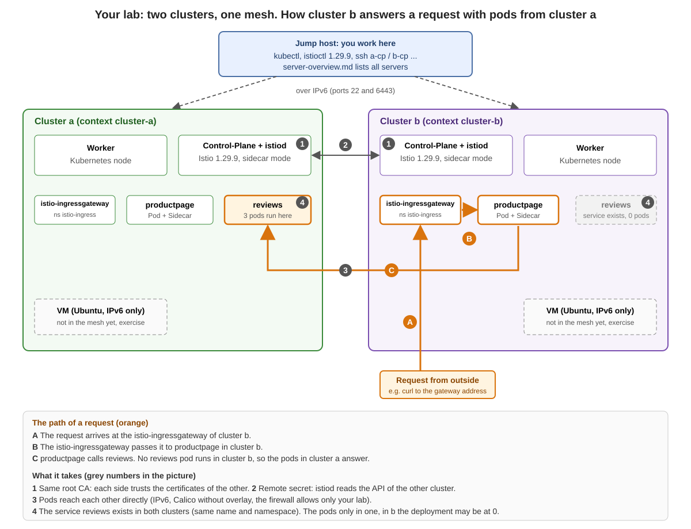

The orange arrows show the path of the request you follow in this exercise. The grey numbers are the four parts in the table below.

What makes this work:

| Part | Where to see it |
|---|---|
| Both clusters trust the same root CA | step 1 |
| Each `istiod` can read the other API server (remote secret) | `istioctl remote-clusters`, status `synced` |
| The pods of both clusters can reach each other (routed IPv6 network, same Istio `network`) | step 2 |
| The service exists in both clusters (same name, same namespace) | Bookinfo from the exercise "Expose Bookinfo through the ingress gateway over IPv6" |

Prerequisite: Bookinfo runs in **both** clusters and is published through both gateways (do the ingress gateway exercise in cluster A and in cluster B).

```
export CTX_A=<context of cluster A>
export CTX_B=<context of cluster B>
export GATEWAY_B=<external address of the ingress gateway in cluster B>
```

### Step 1: Compare the root certificates

```
for CTX in $CTX_A $CTX_B; do
  kubectl --context $CTX get cm istio-ca-root-cert -n default -o jsonpath='{.data.root-cert\.pem}' | openssl x509 -noout -fingerprint -sha256
done
```

Both lines must show the same fingerprint. If they differ, the clusters do not trust each other's certificates and cross-cluster traffic fails.

### Step 2: Look at the endpoints of `reviews`

The Envoy of `productpage` in cluster B knows all endpoints of the service `reviews`:

```
export PP_B=$(kubectl --context $CTX_B get pod -l app=productpage -o jsonpath='{.items[0].metadata.name}')
istioctl --context $CTX_B proxy-config endpoints $PP_B --cluster "outbound|9080||reviews.default.svc.cluster.local"
```

Expected output: six endpoints, three from the network of each cluster (addresses differ in your lab):

```
ENDPOINT                            STATUS      OUTLIER CHECK     CLUSTER
2a01:4f8:c016:a758::1:9110:9080     HEALTHY     OK                outbound|9080||reviews.default.svc.cluster.local
2a01:4f8:c016:a758::1:9111:9080     HEALTHY     OK                outbound|9080||reviews.default.svc.cluster.local
2a01:4f8:c016:a758::1:9112:9080     HEALTHY     OK                outbound|9080||reviews.default.svc.cluster.local
2a01:4f8:c016:aa79::1:a84e:9080     HEALTHY     OK                outbound|9080||reviews.default.svc.cluster.local
2a01:4f8:c016:aa79::1:a853:9080     HEALTHY     OK                outbound|9080||reviews.default.svc.cluster.local
2a01:4f8:c016:aa79::1:a854:9080     HEALTHY     OK                outbound|9080||reviews.default.svc.cluster.local
```

The first three belong to cluster A, the last three to cluster B. Compare with the pod addresses:

```
kubectl --context $CTX_A get pods -l app=reviews -o wide
kubectl --context $CTX_B get pods -l app=reviews -o wide
```

### Step 3: Take away the local pods

Scale `reviews` to zero in cluster B:

```
for D in reviews-v1 reviews-v2 reviews-v3; do kubectl --context $CTX_B scale deploy $D --replicas=0; done
kubectl --context $CTX_B wait --for=delete pod -l app=reviews --timeout=90s
kubectl --context $CTX_B get pods -l app=reviews
```

```
No resources found in default namespace.
```

Wait a few seconds, then look at the endpoints again:

```
istioctl --context $CTX_B proxy-config endpoints $PP_B --cluster "outbound|9080||reviews.default.svc.cluster.local"
```

Only the three endpoints of cluster A are left.

### Step 4: Call cluster B from outside

```
for i in 1 2 3 4 5 6; do
  curl -6 -s "http://[$GATEWAY_B]/productpage" | grep -c Reviewer1
done
```

```
1
1
1
1
1
1
```

Every answer contains the reviews, although cluster B has no `reviews` pod. The page of cluster B was built with pods of cluster A.

### Step 5: Repair

```
for D in reviews-v1 reviews-v2 reviews-v3; do kubectl --context $CTX_B scale deploy $D --replicas=1; done
kubectl --context $CTX_B get pods -l app=reviews
```

### Questions

* What would you see in step 2 if the remote secret of cluster B were missing in cluster A?
* The root CA must be the same in both clusters. What happens to the connection between pods of the two clusters if you replace the CA in only one cluster?

## Virtual machines in the mesh

### WorkloadGroup, WorkloadEntry and EndpointSlice: who is who


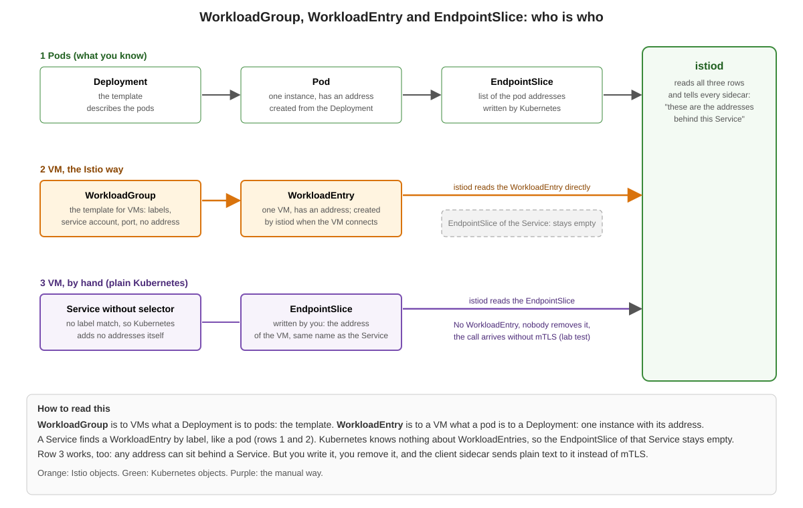

### Background

For pods, Kubernetes does the bookkeeping: a Deployment describes the pods, the pods have addresses, and Kubernetes writes the addresses of the pods behind a Service into an `EndpointSlice`. `istiod` reads these and tells every sidecar where a Service lives.

A virtual machine is not a pod. Kubernetes does not know it. Istio adds two objects so that a VM can be a part of the mesh like a pod:

| Object | Compare to | What it is | Who creates it |
|---|---|---|---|
| `WorkloadGroup` | Deployment | The template for VMs: labels, service account, port, network. It has no address. | You |
| `WorkloadEntry` | Pod | One VM with its address, labels and service account. | `istiod`, when the VM connects (auto-registration). You can write one by hand, too. |
| `EndpointSlice` | - | Plain Kubernetes: the list of addresses behind a Service. | Kubernetes, for pods that a Service selects. For anything else: you. |

A `Service` finds a `WorkloadEntry` by label, exactly as it finds a pod. `istiod` reads the `WorkloadEntry` directly. Kubernetes does not turn it into an `EndpointSlice`, so the `EndpointSlice` of that Service stays empty. This is normal.

### Two ways to put a VM behind a Service

| | `WorkloadEntry` (Istio way) | Own `EndpointSlice` (manual way) |
|---|---|---|
| Created by | `istiod`, when the VM connects | you |
| Removed | by `istiod`, shortly after the VM has gone (in our test: within 10 seconds after we stopped the sidecar) | never, you do it (in our test it was still there) |
| Address | the one the sidecar reports (`ISTIO_SVC_IP`, if set) | the one you write |
| Service | with selector (label of the `WorkloadGroup`) | without selector, `EndpointSlice` with the label `kubernetes.io/service-name` |
| Call from a pod | mTLS (we saw `x-forwarded-client-cert`) | in our test: plain text, no `x-forwarded-client-cert` |

### Step 1: Look at the objects

Do this after you have finished the exercise [Add a virtual machine to the mesh](01-add-a-vm-to-the-mesh.md) (the VM is in the mesh, the pod `client` runs).

```
export CTX_A=cluster-a
kubectl --context $CTX_A -n vm get workloadgroup,workloadentry
```

```
NAME                                                 AGE
workloadgroup.networking.istio.io/diameter-adapter   29s

NAME                                                                           AGE   ADDRESS
workloadentry.networking.istio.io/diameter-adapter-2a01-4f8-c013-541--1-net1   23s   2a01:4f8:c013:541::1
```

The name of the `WorkloadEntry` is the name of the `WorkloadGroup` plus the address of the VM. Now the `EndpointSlice` of the same Service:

```
kubectl --context $CTX_A -n vm get endpointslice
```

```
NAME                     ADDRESSTYPE   PORTS     ENDPOINTS   AGE
diameter-adapter-jmpcj   IPv6          <unset>   <unset>     29s
```

It is empty. Still the call from the pod works, because `istiod` knows the address from the `WorkloadEntry`.

### Step 2: Put the same VM behind a second Service by hand

A `Service` without selector and an `EndpointSlice` with the address of the VM. `VM_IP` is the IPv6 address of your VM (see `ssh a-vm1 ip -6 -br a show eth0`).

```
export VM_IP=<IPv6 address of the VM>
```

```
## vi 03-manual-endpointslice.yml
apiVersion: v1
kind: Service
metadata:
  name: diameter-manual
  namespace: vm
spec:
  ipFamilyPolicy: SingleStack
  ipFamilies: [IPv6]
  ports:
    - name: http
      port: 8000
      targetPort: 8000
---
apiVersion: discovery.k8s.io/v1
kind: EndpointSlice
metadata:
  name: diameter-manual-1
  namespace: vm
  labels:
    kubernetes.io/service-name: diameter-manual
addressType: IPv6
ports:
  - name: http
    port: 8000
    protocol: TCP
endpoints:
  - addresses:
      - "<IPv6 address of the VM>"
```

Put your address into the file (`sed -i "s/<IPv6 address of the VM>/$VM_IP/" 03-manual-endpointslice.yml`), then:

```
kubectl --context $CTX_A apply -f 03-manual-endpointslice.yml
```

### Step 3: Compare the two calls

Both Services lead to the same VM:

```
istioctl --context $CTX_A proxy-config endpoint deploy/client | grep -E "ENDPOINT|diameter"
```

```
ENDPOINT                    STATUS      OUTLIER CHECK     CLUSTER
2a01:4f8:c013:541::1:8000   HEALTHY     OK                outbound|8000||diameter-adapter.vm.svc.cluster.local
2a01:4f8:c013:541::1:8000   HEALTHY     OK                outbound|8000||diameter-manual.vm.svc.cluster.local
```

Call both and look for the header `x-forwarded-client-cert`:

```
kubectl --context $CTX_A exec deploy/client -c curl -- curl -s -m 8 http://diameter-adapter.vm.svc.cluster.local:8000/ | grep -E "VM diameter|x-forwarded-client-cert"
kubectl --context $CTX_A exec deploy/client -c curl -- curl -s -m 8 http://diameter-manual.vm.svc.cluster.local:8000/ | grep -E "VM diameter|x-forwarded-client-cert"
```

The first call shows the line with `x-forwarded-client-cert` (mTLS, both identities). The second call shows only `VM diameter-adapter (IPv6) ...`: the request arrived, but without mTLS.

### What to take with you

* `WorkloadGroup` is the template, `WorkloadEntry` is the instance. You write the first, `istiod` writes the second.
* The `EndpointSlice` of a Service with a `WorkloadEntry` stays empty. Do not look for the VM there.
* A hand-made `EndpointSlice` is plain Kubernetes. It works, but it does not give the VM the properties of a mesh workload (automatic registration and removal, mTLS from the client). If you see both objects for a VM in a real environment, ask why the `EndpointSlice` exists.

### Clean up

```
kubectl --context $CTX_A -n vm delete -f 03-manual-endpointslice.yml
```

### Dual stack on the VM: what to set (`DUAL_STACK` and `ISTIO_DUAL_STACK`)


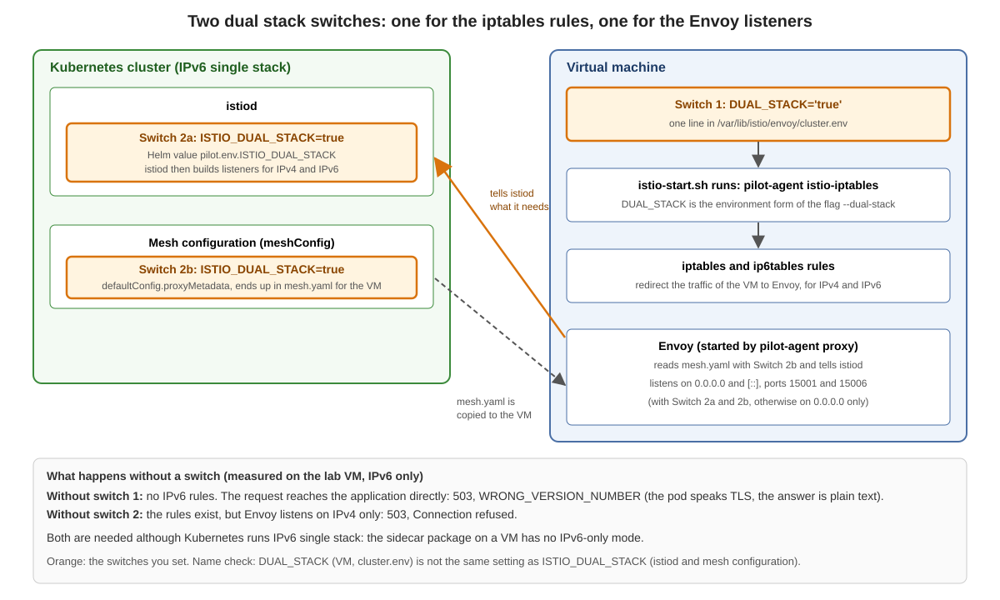

> **Attention:** When you use IPv6 only on the VMs (Istio hybrid), be sure that the IPv4 address on the VM is disabled. That is the best and easiest way. Otherwise you need to fiddle around (dual stack switches, `ISTIO_SVC_IP`, health `probe` workarounds).

### The rule

| The VM has | You set |
|---|---|
| **IPv6 only** | nothing |
| **IPv4 and IPv6** (our lab VM: IPv6 plus a private, not routed `100.65.x.x`) | one dual stack line in `/var/lib/istio/envoy/cluster.env`, and `ISTIO_SVC_IP` |

Why: A VM with IPv4 and IPv6 is a dual stack workload for Istio. Without a dual stack line, Istio sets the iptables rules only for IPv4. Traffic that arrives over IPv6 then bypasses the sidecar and reaches the application directly. The calling pod speaks mTLS, the application does not, and the call fails with `503`.

### Two names, two jobs

Both names are lines in `cluster.env`. Both switch on the IPv6 iptables rules. They differ in what else they change:

| | `DUAL_STACK='true'` | `ISTIO_DUAL_STACK='true'` |
|---|---|---|
| IPv6 rules (traffic goes through Envoy) | yes | yes |
| Envoy admin port `15000` | stays on `127.0.0.1` | moves to `[::1]` |
| Envoy metrics `15090` and readiness `15021` over IPv6 | **not reachable** | reachable |
| Health `probe` in the WorkloadGroup | **works** (with `host: 127.0.0.1`) | **does not work** |
| Who writes it | you (our script adds it) | `istioctl x workload entry configure`, if `istiod` has `ISTIO_DUAL_STACK=true` when you create the files (the Helm chart then puts it into the mesh configuration, `istioctl` copies it) |

### What do you want?

A word first: **scraping** means that Prometheus pulls metrics from a URL, for example `http://<VM>:15090/stats/prometheus`. The sidecar has two ports of its own for this: `15090` (the metrics of Envoy) and `15021` (the readiness of Envoy). In our lab only IPv6 reaches the VM, so these two ports must listen on IPv6 to be reachable from the cluster.

You have two choices:

* **You do not need a health `probe`:** keep what `istioctl` wrote, `ISTIO_DUAL_STACK`. Prometheus can scrape `15090`, and `15021` answers over IPv6. Nothing to do.
* **You need a health `probe` in the WorkloadGroup:** use `DUAL_STACK` and **delete the line `ISTIO_DUAL_STACK`** from `cluster.env`, then restart the sidecar. Add `host: 127.0.0.1` to the `probe`. The price: `15090` and `15021` listen on IPv4 only, so Prometheus cannot scrape the Envoy metrics and nothing can ask the Envoy readiness over IPv6. The metrics of the agent on port `15020` work with both names.

You cannot have both. The reason is that the health check of the agent talks IPv4 on a dual stack VM (`127.0.0.1` for Envoy, `127.0.0.6` as source address), while `ISTIO_DUAL_STACK` moves Envoy to IPv6. Details and measurements: [reference page](00-dual-stack-switches-details.md).

### The cluster side

`istiod` needs `ISTIO_DUAL_STACK=true` in its environment (Helm value `pilot.env.ISTIO_DUAL_STACK`). It decides whether Envoy listens on `[::]` for the traffic redirect (ports `15001`, `15006`). In a real environment this is part of the cluster provisioning. Without it, nothing on the VM helps.

### Look at your VM

```
ssh $VM "ip -o addr show scope global | awk '{print \$3, \$4}'"
ssh $VM "grep -E 'DUAL_STACK|ISTIO_SVC_IP' /var/lib/istio/envoy/cluster.env"
ssh $VM "echo \"IPv4 rules: \$(iptables-save -t nat | grep -c ISTIO)  IPv6 rules: \$(ip6tables-save -t nat | grep -c ISTIO)\""
ssh $VM "ss -ltnp | grep -E ':150[0-9][0-9] ' | awk '{print \$4}' | sort -u"
```

Healthy dual stack: 23 IPv4 rules and 19 IPv6 rules, and the listeners `[::]:15001` and `[::]:15006`. IPv4 rules are always set, the tool never sets IPv6 rules alone. If a call fails with `503`, look here first, then at the `ADDRESS` of the `WorkloadEntry`.

### If a call fails with 503

The text of the error comes from Envoy, the sidecar of the **calling pod** (response header `server: envoy`), not from the VM. The VM never answered.

| What the error says, or what you see | Cause | Fix |
|---|---|---|
| `... TLS_error ... WRONG_VERSION_NUMBER` | No IPv6 rules on the VM (0 instead of 19): the IPv6 traffic bypasses the sidecar, the application answers in plain text to a TLS client | dual stack line in `cluster.env`, restart the sidecar |
| `... delayed connect error: Connection refused` | The IPv6 rules exist, but Envoy has no listener on `[::]` | `ISTIO_DUAL_STACK=true` in `istiod` (cluster side) |
| `503`, and the `ADDRESS` of the `WorkloadEntry` is the IPv4 address (`100.65.x.x`) | `ISTIO_SVC_IP` is missing, the sidecar registered the wrong address | set `ISTIO_SVC_IP` to the IPv6 address, restart the sidecar |
| `503`, and the `WorkloadEntry` shows `Healthy=False` | The health `probe` fails (the application is down, or the `probe` does not fit the VM, see above) | `/var/log/istio/istio.log` on the VM shows why |

We measured the first two texts. For the other two rows we saw the status `503`, but we did not save the text.


### Add a virtual machine to the mesh (IPv6 only)


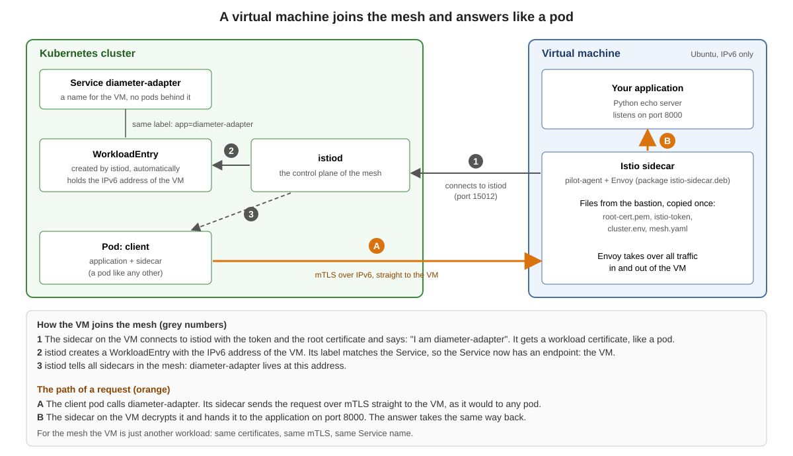

> **Attention:** When you use IPv6 only on the VMs (Istio hybrid), be sure that the IPv4 address on the VM is disabled. That is the best and easiest way. Otherwise you need to fiddle around (dual stack switches, `ISTIO_SVC_IP`, health `probe` workarounds).

### Background

A virtual machine joins the mesh with the Istio sidecar package (`istio-sidecar.deb`). The sidecar connects to `istiod`, gets a workload certificate and appears in the mesh like a pod. `istiod` creates a `WorkloadEntry` for it automatically (auto-registration). From then on a pod calls the VM through a normal Kubernetes `Service`, with mTLS.

What `WorkloadGroup`, `WorkloadEntry` and `EndpointSlice` are and how they differ: [who is who](00-workloadgroup-workloadentry-endpointslice.md).

The lab VM has an IPv6 address and a private IPv4 address (`100.65.x.x`, not routed). Kubernetes and Istio run as IPv6 single stack, but because the VM has two address families, the sidecar on it needs the dual stack switches (`ISTIO_DUAL_STACK` in `istiod`, a dual stack variable in `cluster.env` on the VM). We set them from the start. What the switches do and where you set them: [DUAL_STACK and ISTIO_DUAL_STACK](00-dual-stack-switches.md).

| Part | Name in this exercise |
|---|---|
| VM | `a-vm1` (reach it with `ssh a-vm1`) |
| Namespace, service account, workload group, service | `vm`, `diameter-adapter` |
| Application on the VM | a small Python echo server on port 8000 (`vm-echo-server.py`) |
| Address of `istiod` for the VM | a fixed `LoadBalancer` address (`istiod-lb`, port 15012) |

### How to do this exercise

We go through the steps one by one. For every step the trainer explains what happens and why. You do **not** type everything by hand: the script `vm-in-the-mesh.sh` (in the folder `virtual-machines` on your bastion host) runs the steps for you.

```
cd virtual-machines
./vm-in-the-mesh.sh
```

For every step the script prints the commands first and waits:

```
... to continue press ENTER
```

Press ENTER and the script runs exactly the commands you see. You can copy any of them and type it yourself. The run itself takes about one minute, plus the time for the explanations.

### The steps

#### Step 1: Settings

The script sets the contexts of both clusters, the name of the VM and the IPv6 address of the VM.

```
export CTX_A=cluster-a
export CTX_B=cluster-b
export VM=a-vm1
export VM_IP=$(ssh $VM "ip -6 -o addr show dev eth0 scope global" | awk '{print $4}' | cut -d/ -f1 | head -1)
```

#### Step 2: Make `istiod` ready for VMs

The VM is outside the cluster and must reach `istiod` from outside. The script does two things:

* It switches on auto-registration (`PILOT_ENABLE_WORKLOAD_ENTRY_AUTOREGISTRATION`), the DNS proxy and `ISTIO_DUAL_STACK` with `helm upgrade istiod ... --reuse-values`.
* It creates the Service `istiod-lb` of type `LoadBalancer` with a fixed IPv6 address (MetalLB), port 15012.

If your lab is already prepared, the script says so and skips the step.

```
kubectl --context $CTX_A -n istio-system get svc istiod-lb
```

```
NAME        TYPE           CLUSTER-IP          EXTERNAL-IP               PORT(S)
istiod-lb   LoadBalancer   fd00:10:96::d:ec63  2a01:4f8:1c17:5cbc::2:2   15012:32132/TCP
```

The VM uses the EXTERNAL-IP. The cluster IP (`fd00:...`) exists only inside the cluster.

#### Step 3: Create the objects for the VM

Namespace `vm`, service account `diameter-adapter` and the Service `diameter-adapter` in **both** clusters (so that cluster b finds the VM, too). The `WorkloadGroup` (the template for the VM) only in cluster a. The Service finds the VM by the label `app=diameter-adapter`. The script writes the two files `01-vm-objects.yml` and `02-workloadgroup.yml` and shows their content.

```
kubectl --context $CTX_A apply -f 01-vm-objects.yml -f 02-workloadgroup.yml
kubectl --context $CTX_B apply -f 01-vm-objects.yml
```

#### Step 4: Create the files for the VM

The command is `istioctl x workload entry configure` (`x` is short for `experimental`). It reads the `WorkloadGroup` and the mesh configuration of the cluster and writes everything the VM needs into a folder. Then the script copies the folder to the VM.

```
istioctl --context $CTX_A x workload entry configure -f 02-workloadgroup.yml -o vmfiles --clusterID cluster-a --ingressIP $ISTIOD_ADDR --autoregister
ls vmfiles
scp -q -r vmfiles vm-echo-server.py $VM:/root/
```

| Option | Meaning |
|---|---|
| `-f 02-workloadgroup.yml` | the `WorkloadGroup` of the VM (name, namespace, labels, service account, ports, network) |
| `-o vmfiles` | the folder for the files |
| `--clusterID cluster-a` | the name of the cluster the VM registers with |
| `--ingressIP $ISTIOD_ADDR` | the address of `istiod` that the VM can reach (our `istiod-lb`, see step 2) |
| `--autoregister` | `istiod` creates the `WorkloadEntry` when the VM connects. Without it the `WorkloadEntry` is missing |

The command writes five files:

```
cluster.env  hosts  istio-token  mesh.yaml  root-cert.pem
```

| File | Goes to (on the VM) | What is in it |
|---|---|---|
| `cluster.env` | `/var/lib/istio/envoy/cluster.env` | One `KEY='value'` line per setting. `istio-start.sh` reads it and every line becomes an environment variable of the sidecar. See below |
| `mesh.yaml` | `/etc/istio/config/mesh` | The mesh configuration for the agent: `discoveryAddress: istiod.istio-system.svc:15012`, `meshId`, and under `proxyMetadata` the same entries as in `cluster.env` |
| `hosts` | appended to `/etc/hosts` | One line: `<ISTIOD_ADDR> istiod.istio-system.svc`, so the VM finds `istiod` by name |
| `root-cert.pem` | `/etc/certs/root-cert.pem` | The root certificate of the mesh (in our lab `Lab Root CA tln1`), so the VM trusts `istiod` and the other workloads |
| `istio-token` | `/var/run/secrets/tokens/istio-token` | A token (JWT) of the service account `diameter-adapter` in the namespace `vm`. The agent uses it once to get its workload certificate. **Secret**, valid for a short time (one hour by default). Do not print it and do not commit it |

This is the `cluster.env` of our lab (lines in the order `istioctl` writes them):

```
CANONICAL_REVISION='latest'
CANONICAL_SERVICE='diameter-adapter'
ISTIO_DUAL_STACK='true'
ISTIO_INBOUND_PORTS='8000'
ISTIO_LOCAL_EXCLUDE_PORTS='22,15090,15021,15020'
ISTIO_METAJSON_LABELS='{"app":"diameter-adapter",...}'
ISTIO_META_AUTO_REGISTER_GROUP='diameter-adapter'
ISTIO_META_CLUSTER_ID='cluster-a'
ISTIO_META_DNS_AUTO_ALLOCATE='true'
ISTIO_META_DNS_CAPTURE='true'
ISTIO_META_MESH_ID='mesh-tln1'
ISTIO_META_NETWORK='net1'
ISTIO_META_POD_PORTS='[{"name":"http","containerPort":8000,"protocol":""}]'
ISTIO_META_WORKLOAD_NAME='diameter-adapter'
ISTIO_NAMESPACE='vm'
ISTIO_SERVICE='diameter-adapter.vm'
ISTIO_SERVICE_CIDR='*'
POD_NAMESPACE='vm'
SERVICE_ACCOUNT='diameter-adapter'
TRUST_DOMAIN='cluster.local'
```

Where the lines come from:

* **From the `WorkloadGroup`:** `ISTIO_NAMESPACE`, `POD_NAMESPACE`, `SERVICE_ACCOUNT`, `ISTIO_SERVICE`, `ISTIO_INBOUND_PORTS` (the ports of the `WorkloadGroup`), `ISTIO_METAJSON_LABELS` (its labels), `ISTIO_META_NETWORK` (its network), `ISTIO_META_POD_PORTS`.
* **From the options:** `ISTIO_META_CLUSTER_ID` (`--clusterID`), `ISTIO_META_AUTO_REGISTER_GROUP` (`--autoregister`).
* **From the mesh configuration of the cluster (`proxyMetadata` in the ConfigMap `istio` in `istio-system`):** every entry there, for example `ISTIO_DUAL_STACK`, `ISTIO_META_DNS_CAPTURE` and `ISTIO_META_DNS_AUTO_ALLOCATE`. They appear in `mesh.yaml` and in `cluster.env`. The `istiod` Helm chart adds `ISTIO_DUAL_STACK` to this ConfigMap by itself as soon as `pilot.env.ISTIO_DUAL_STACK=true` is set (we checked: with the entry removed from our own Helm values it was still there; with `pilot.env.ISTIO_DUAL_STACK=false` and no own entry it was gone, and so were the lines in the generated files).
* **Fixed by `istioctl`:** `ISTIO_LOCAL_EXCLUDE_PORTS='22,15090,15021,15020'`. These ports are not redirected to Envoy: SSH and the three ports of the sidecar itself.

The script **adds** two more lines to `cluster.env` on the VM, because `istioctl` does not write them: `ISTIO_SVC_IP` (the address of the VM, see below) and `DUAL_STACK='true'`.

#### Step 5: Install the sidecar on the VM and start it

The script logs in to the VM and does this: install `istio-sidecar.deb`, copy the files to the places the sidecar reads them from, add `ISTIO_SVC_IP` (the address of the VM) and `DUAL_STACK='true'` to `cluster.env`, start the sidecar and the echo server.

#### Step 6: Is the VM in the mesh?

```
istioctl --context $CTX_A proxy-status | grep -E "NAME|vm"
kubectl --context $CTX_A get workloadentry -n vm
```

```
NAME                 CLUSTER     ISTIOD                    VERSION   SUBSCRIBED TYPES
v6-tln1-a-vm1.vm     cluster-a   istiod-59c4f47fc9-b2vwb   1.29.9    5 (CDS,LDS,EDS,RDS,NDS)

NAME                                         AGE   ADDRESS
diameter-adapter-2a01-4f8-c013-541--1-net1   10s   2a01:4f8:c013:541::1
```

The VM is connected to `istiod`, and the `WorkloadEntry` holds the IPv6 address of the VM. This does not show yet that traffic works.

#### Step 7: Test in three directions

From a pod to the VM:

```
kubectl --context $CTX_A exec deploy/client -c curl -- curl -s -m 8 -w "\nHTTP %{http_code}\n" http://diameter-adapter.vm.svc.cluster.local:8000/
```

```
VM diameter-adapter (IPv6), client=::6
x-forwarded-client-cert: By=spiffe://cluster.local/ns/vm/sa/diameter-adapter;Hash=...;URI=spiffe://cluster.local/ns/default/sa/default
HTTP 200
```

The header `x-forwarded-client-cert` shows the identities of both sides: mTLS between the pod and the VM.

From the VM to a service in the cluster (the sidecar of the VM resolves the name, DNS proxy):

```
ssh $VM 'curl -s -m 8 -o /dev/null -w "HTTP %{http_code}\n" http://productpage.default.svc.cluster.local:9080/productpage'
```

From a pod in **cluster b** to the VM (the VM is registered in cluster a, cluster b finds it through the mesh link):

```
kubectl --context $CTX_B exec deploy/client -c curl -- curl -s -m 8 -w "\nHTTP %{http_code}\n" http://diameter-adapter.vm.svc.cluster.local:8000/
```

All three answer `HTTP 200`.

### Why `ISTIO_SVC_IP`?

`ISTIO_SVC_IP` is a variable in `/var/lib/istio/envoy/cluster.env` on the VM. It tells the sidecar which address to register with `istiod`. That address becomes the `ADDRESS` of the `WorkloadEntry`, and it is the address other pods use to call the VM.

The start script `/usr/local/bin/istio-start.sh` (part of `istio-sidecar.deb`) reads `cluster.env` and then does this:

```
if [ -z "${ISTIO_SVC_IP:-}" ]; then
  ISTIO_SVC_IP=$(hostname --all-ip-addresses | cut -d ' ' -f 1)
fi
```

So if you do not set the variable, the sidecar takes the **first** address the operating system lists. A VM with both IPv4 and IPv6 can list the IPv4 address first. In our lab the VM has a private IPv4 address (`100.65.9.93`) and an IPv6 address:

```
ssh $VM hostname --all-ip-addresses
```

```
100.65.9.93 2a01:4f8:c013:541::1
```

We measured both cases (the sidecar was restarted after changing `cluster.env`):

| `cluster.env` | `ADDRESS` of the `WorkloadEntry` | Call from a pod |
|---|---|---|
| `ISTIO_SVC_IP='2a01:4f8:c013:541::1'` | `2a01:4f8:c013:541::1` | `HTTP 200`, mTLS |
| no `ISTIO_SVC_IP` | `100.65.9.93` | `HTTP 503` (3 of 3 calls) |

In an IPv6 single stack cluster nobody can reach the IPv4 address, so the VM is "in the mesh" but unreachable.

The order of the addresses comes from the operating system, not from Istio. On another VM the IPv6 address may come first. Do not rely on it: **always set `ISTIO_SVC_IP`** to the address that the cluster must use, one value per VM. If you create `cluster.env` again (a new `istioctl x workload entry configure`), the variable is gone and you must add it again.

Always check the result:

```
kubectl --context $CTX_A get workloadentry -n vm
```

The column `ADDRESS` must show the IPv6 address you expect.

### If you leave out the dual stack switches

Without `ISTIO_DUAL_STACK` and `DUAL_STACK` the VM still joins the mesh and shows up in `proxy-status`, but the call from a pod fails. Measured on an earlier lab VM:

| Missing | Result of the call |
|---|---|
| neither `DUAL_STACK` nor `ISTIO_DUAL_STACK` in `cluster.env` on the VM | no iptables rules for IPv6, the request reaches the application directly: `503`, `WRONG_VERSION_NUMBER` (the pod speaks TLS, the answer is plain text) |
| `ISTIO_DUAL_STACK` in `istiod` | rules exist, but Envoy on the VM listens on IPv4 only: `503`, `Connection refused` |

### Good to know

* The sidecar service is not enabled at boot (`systemctl is-enabled istio` shows `disabled`). After a reboot of the VM the sidecar does not start by itself.
* While the sidecar redirects IPv6 traffic to a port where Envoy does not listen, the outgoing IPv6 traffic of the VM is disturbed, too (a download with `curl` fails). SSH keeps working (port 22 is excluded).
* The files in `vmfiles` contain a token. Do not share them.

### Clean up

```
./vm-in-the-mesh.sh cleanup
```

The script deletes the namespace `vm` in both clusters, the two test pods and the sidecar files on the VM. The settings of `istiod` stay.

### Ports of istiod and of the sidecar on the VM


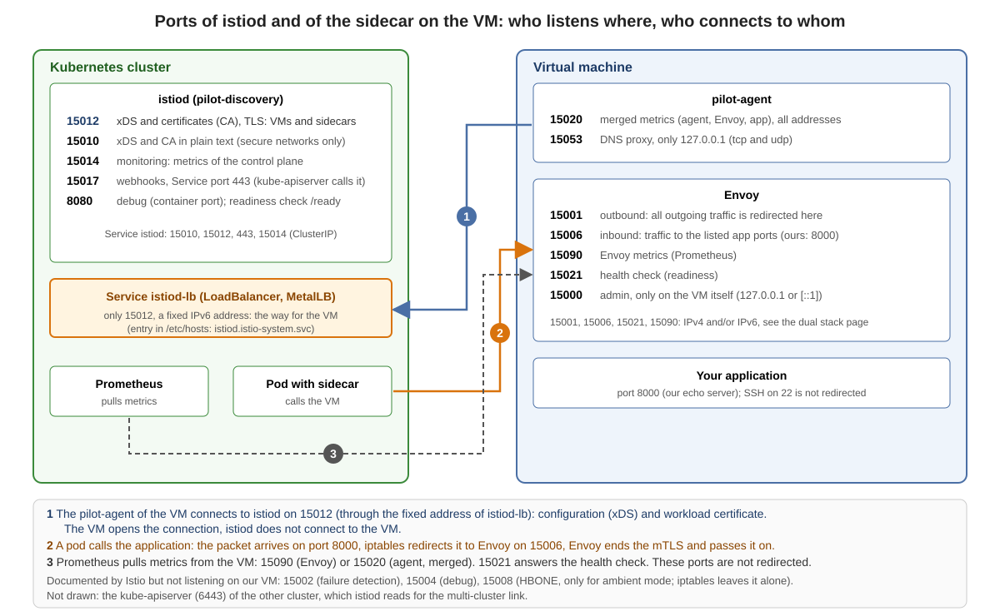

### Background

Two programs matter for a VM in the mesh:

* **`istiod`** (the program is called `pilot-discovery`) runs in the cluster. It gives the sidecars their configuration (xDS) and signs the workload certificates (CA).
* **The sidecar** runs on the VM: **`pilot-agent`** (the agent, it talks to `istiod`) and **Envoy** (the proxy, it carries the traffic).

The tables list every port. The column "Istio docs" is from the Istio documentation (*Ports used by Istio*), the column "Measured" is what we saw on our lab (Istio 1.29.9, `ss -ltnp` on the VM, `kubectl` for `istiod`).

### The sidecar on the VM

| Port | Who listens | Istio docs | Measured on our VM | Who connects |
|---|---|---|---|---|
| `15000` | Envoy | Envoy admin port (commands, diagnostics), pod-internal only | `127.0.0.1`, or `[::1]` with `ISTIO_DUAL_STACK` or on a VM with IPv6 only | only the VM itself (the agent asks it if Envoy is ready; you with `curl`) |
| `15001` | Envoy | Envoy outbound | `0.0.0.0` and `[::]` (IPv6 only: `[::]`) | iptables redirects all outgoing TCP traffic of the VM here |
| `15006` | Envoy | Envoy inbound | `0.0.0.0` and `[::]` (IPv6 only: `[::]`) | iptables redirects incoming traffic for the listed application ports here (ours: `8000`) |
| `15020` | `pilot-agent` | merged Prometheus telemetry from agent, Envoy and application | all addresses (`*`), IPv4 and IPv6, with every setting | Prometheus |
| `15021` | Envoy | health checks | `0.0.0.0`; also `[::]` with `ISTIO_DUAL_STACK` (IPv6 only: `[::]`) | health checks, Prometheus |
| `15053` | `pilot-agent` | DNS port, if DNS capture is enabled, pod-internal only | `127.0.0.1`, tcp and udp | only the VM itself (the DNS proxy, switched on by `ISTIO_META_DNS_CAPTURE`) |
| `15090` | Envoy | Envoy Prometheus telemetry | `0.0.0.0`; also `[::]` with `ISTIO_DUAL_STACK` (IPv6 only: `[::]`) | Prometheus |
| `8000` | our application | - | `*` (the Python echo server) | other workloads (redirected to `15006`) |
| `22` | `sshd` | - | `0.0.0.0` and `[::]` | you (not redirected) |

Listed by Istio, but **not listening** on our VM: `15002` (failure detection), `15004` (debug port), `15008` (HBONE tunnel, used in ambient mode; the iptables rules leave it alone in sidecar mode).

#### What iptables redirects

`istio-start.sh` runs `pilot-agent istio-iptables`. On our VM it sets up:

* **Outbound:** all outgoing TCP traffic goes to `15001`.
* **Inbound:** only the ports in `ISTIO_INBOUND_PORTS` go to `15006`. `istioctl` takes them from the ports of the `WorkloadGroup` (ours: `8000`). The rule on our VM: `-A ISTIO_INBOUND -p tcp --dport 8000 -j ISTIO_IN_REDIRECT`, and `15008` is left alone.
* **Not redirected:** every other port, so also `15020`, `15021`, `15090` and `22`. The line `ISTIO_LOCAL_EXCLUDE_PORTS='22,15090,15021,15020'` from `istioctl` is an exclusion list that only applies when *all* inbound ports are redirected (`*`). Ours are not.

If you list more application ports in the `WorkloadGroup`, they go to `15006`, too.

### istiod in the cluster

| Port | Name in the Deployment | Istio docs | Our lab | Who connects |
|---|---|---|---|---|
| `15012` | `tls-xds` | XDS and CA services, TLS and mTLS, recommended for production | in the `Service istiod` (named `https-dns`) and in `istiod-lb` | **the VM**, and the sidecars of the pods |
| `15010` | `grpc-xds` | XDS and CA services in plain text, only for secure networks | in the `Service istiod`; the VM does not use it | sidecars that are set up for it (we do not use it) |
| `15014` | `http-monitoring` | control plane monitoring | `--monitoringAddr=:15014`, in the `Service istiod` | Prometheus (metrics of `istiod`) |
| `15017` | `https-webhooks` | webhook container port, forwarded from `443` | the `Service istiod` maps `443` to `15017` | the `kube-apiserver` (sidecar injection, validation) |
| `8080` | `http-debug` | debug interface (deprecated, container port only) | container port only, not in a Service; the readiness probe of `istiod` asks `/ready` here | the kubelet |

Our extra Service for VMs:

| Service | Type | Port | Meaning |
|---|---|---|---|
| `istiod-lb` | `LoadBalancer` (MetalLB) | `15012` only | a **fixed IPv6 address** that the VM can reach. The `hosts` file of the VM maps `istiod.istio-system.svc` to it. The cluster IP of `istiod` exists only inside the cluster |

Other ports in our lab: the gateway `istio-ingressgateway` has `15021` (status), `80` (to `8080`) and `443` (to `8443`). The `kube-apiserver` listens on `6443` (the multi-cluster link: `istiod` of one cluster reads the API of the other, with the remote secret).

### What this means for a firewall

For one VM in the mesh the following must be allowed:

| From | To | Port | For |
|---|---|---|---|
| VM | `istiod` (address of `istiod-lb`) | `15012/TCP` | configuration and certificate |
| other pods and VMs (workloads in the mesh) | VM | the application port (`8000`) | the traffic itself; the VM answers through Envoy |
| VM | pods and VMs of the mesh | the application ports of the other side | the outgoing traffic (the network is flat, pods are reached directly) |
| Prometheus | VM | `15090` (Envoy) or `15020` (agent), optional `15021` | metrics |
| you | VM | `22/TCP` | SSH (not part of Istio) |

`istiod` does not open a connection to the VM. The VM connects, and the answers come back on the same connection. What the lab firewall of Hetzner allows is not part of this page.

### Look at your VM

```
ssh $VM "ss -ltnpH | awk '{print \$4, \$NF}' | sed 's/users:((//; s/,pid=[0-9]*,fd=[0-9]*))//' | sort -t: -k2 -n | uniq"
ssh $VM "ss -lunpH | awk '{print \$4, \$NF}' | sed 's/users:((//; s/,pid.*//' | sort -u"
ssh $VM "iptables-save -t nat | grep -E 'ISTIO_INBOUND|ISTIO_REDIRECT'"
kubectl --context $CTX_A -n istio-system get deploy istiod -o jsonpath='{range .spec.template.spec.containers[0].ports[*]}{.name}={.containerPort} {end}'
kubectl --context $CTX_A -n istio-system get svc istiod istiod-lb
```

Which addresses `15000`, `15021` and `15090` use depends on the dual stack setting: [Dual stack on the VM: what to set](00-dual-stack-switches.md).

### Reference: Dual stack on the VM: details and measurements


This page is the reference behind the short page [Dual stack on the VM: what to set](00-dual-stack-switches.md). It has all measurements, the checks and the places in the Istio code.

### The short version

* Our Kubernetes clusters run IPv6 single stack, but **the lab VM has two addresses**: an IPv6 address and a private IPv4 address (`100.65.x.x`) that is not routed. Istio sees two address families and treats the VM as a dual stack workload.
* A dual stack workload needs a dual stack setting in the file `/var/lib/istio/envoy/cluster.env`. Without it the IPv6 traffic of the VM does not go through Envoy, and calls from a pod fail with `503`.
* **One line is enough.** `ISTIO_DUAL_STACK='true'` is written into `cluster.env` by `istioctl` (if `istiod` already has the setting). `DUAL_STACK='true'` does the same for the traffic. You do not need both.
* Always set `ISTIO_SVC_IP` as well (see [exercise](01-add-a-vm-to-the-mesh.md)), otherwise the sidecar may register the IPv4 address.

### Why: the VM has an IPv4 address

On Hetzner every server gets a private IPv4 address by DHCP, even if you create it without IPv4. There is no default route for it. Look at your VM:

```
ssh $VM "ip -o addr show scope global | awk '{print \$2, \$3, \$4}'"
ssh $VM "ip -4 route"
```

```
eth0 inet 100.65.9.93/32
eth0 inet6 2a01:4f8:c013:541::1/64
169.254.169.254 via 172.31.1.1 dev eth0 proto dhcp src 100.65.9.93 metric 100
172.31.1.1 dev eth0 proto dhcp scope link src 100.65.9.93 metric 100
188.40.24.200 via 172.31.1.1 dev eth0 proto dhcp src 100.65.9.93 metric 100
```

There is no line starting with `default`: IPv4 does not reach anywhere. But Istio looks at the addresses, not at the routes. In the Istio code (`DiscoverIPMode`, `pkg/model/proxy.go`) the mode of a workload is:

| Addresses of the VM | Mode |
|---|---|
| only IPv4 | IPv4 |
| only IPv6 | IPv6 |
| both | **Dual** |

Our VM is in the mode Dual. The sidecar then needs the dual stack settings.

### What each name does (measured)

We started the sidecar on the lab VM with each variant. Before each start we stopped the sidecar and removed all old rules. Then we looked at the real state (`ip6tables-save`, `ss -ltnp`) and called the VM three times from a pod.

| `cluster.env` contains | IPv6 rules | Envoy admin `15000` | Ports `15021` and `15090` | Call |
|---|---|---|---|---|
| nothing | 0 | `127.0.0.1` | `0.0.0.0` only | `503` (3 of 3) |
| `DUAL_STACK='true'` | 19 | `127.0.0.1` | `0.0.0.0` only | `200` (3 of 3) |
| `ISTIO_DUAL_STACK='true'` | 19 | `[::1]` only | `0.0.0.0` **and** `[::]` | `200` (3 of 3) |
| both | 19 | `[::1]` only | `0.0.0.0` **and** `[::]` | `200` (3 of 3) |

* **`DUAL_STACK`** sets only the iptables rules (`ip6tables`): IPv6 traffic is redirected to Envoy. The ports of the sidecar itself stay on IPv4.
* **`ISTIO_DUAL_STACK`** sets the same rules **and** moves the ports of the sidecar to IPv6 (Envoy admin on `[::1]`, `15021` and `15090` on `[::]`, too).
* Both lines together behave like `ISTIO_DUAL_STACK` alone.
* The DNS proxy (`15053`) stays on `127.0.0.1`, the status port `15020` of `pilot-agent` listens on all addresses in every case.

**Why would you want `ISTIO_DUAL_STACK` on the VM?** Only if something outside the VM must reach the own ports of the sidecar over IPv6. We tested this from a pod **without** sidecar in cluster a (IPv4 of the VM is not routed, so the only way in is IPv6):

| Port | Content | only `DUAL_STACK` | only `ISTIO_DUAL_STACK` |
|---|---|---|---|
| `15090` | Prometheus metrics of Envoy | no connection (curl exit 7) | `200` |
| `15021` | health/readiness of Envoy | no connection (curl exit 7) | `200` |
| `15020` | `pilot-agent` (agent metrics) | `200` | `200` |

A pod **with** sidecar reached all three ports in both cases. Its own Envoy changes the path, so use a pod without sidecar for this kind of test. Port `15020` works with either name. We did not check whether it also returns the Envoy metrics.

How it looks in the Istio code (version 1.29.9):

* The tool `pilot-agent istio-iptables` has the flag `--dual-stack`. It reads the environment variables `DUAL_STACK` **and** `ISTIO_DUAL_STACK`: two names for the same switch (`tools/istio-iptables/pkg/cmd/root.go`). `istio-start.sh` reads `cluster.env` with `set -a`, so every line in the file is an environment variable.
* (Code only, effect not tested) With `ISTIO_DUAL_STACK` the bootstrap of Envoy uses the DNS lookup family `ALL` for its own static clusters instead of `V4_ONLY`.
* `ISTIO_DUAL_STACK` is also read by the agent for the setup of Envoy (`pkg/bootstrap/config.go`, `pilot/pkg/features/experimental.go`, default `false`). With mixed addresses it takes the address family of the first address as the main family. That is why the admin port moves to `[::1]`.

Look at the file and at the real state yourself:

```
ssh $VM "grep -E 'DUAL_STACK|ISTIO_SVC_IP' /var/lib/istio/envoy/cluster.env"
ssh $VM "echo \"IPv4: \$(iptables-save -t nat | grep -c ISTIO)  IPv6: \$(ip6tables-save -t nat | grep -c ISTIO)\""
ssh $VM "ss -ltnp | grep -E ':150[0-9][0-9] ' | awk '{print \$4, \$NF}' | sort -t: -k2 -n"
```

```
ISTIO_DUAL_STACK='true'
ISTIO_SVC_IP='2a01:4f8:c013:541::1'
DUAL_STACK='true'
IPv4: 23  IPv6: 19
```

IPv4 rules are always set (the tool never sets IPv6 rules alone). With working dual stack you see 23 IPv4 and 19 IPv6 rules.

`pilot-agent istio-iptables --dry-run` prints what it would do and changes nothing. Counting the lines with `ip6tables` shows the effect of a name without touching the VM:

```
ssh $VM "pilot-agent istio-iptables --dry-run 2>&1 | grep -c ip6tables"
ssh $VM "DUAL_STACK=true pilot-agent istio-iptables --dry-run 2>&1 | grep -c ip6tables"
ssh $VM "ISTIO_DUAL_STACK=true pilot-agent istio-iptables --dry-run 2>&1 | grep -c ip6tables"
```

```
0
1
1
```

### Where the `ISTIO_DUAL_STACK` line in `cluster.env` comes from

`istioctl x workload entry configure` copies every entry of `proxyMetadata` from the mesh configuration (ConfigMap `istio` in `istio-system`, key `mesh`) into `mesh.yaml` and `cluster.env`. The `istiod` Helm chart (1.29.9) adds `ISTIO_DUAL_STACK` to that mesh configuration by itself when `pilot.env.ISTIO_DUAL_STACK=true` is set. We checked it with the values of the Helm release:

| `pilot.env.ISTIO_DUAL_STACK` | own `meshConfig...proxyMetadata.ISTIO_DUAL_STACK` | in the ConfigMap `istio` | line in the generated `cluster.env` |
|---|---|---|---|
| `true` | `true` | yes | yes |
| `true` | removed | yes | yes |
| `false` | `true` | yes | yes |
| `false` | removed | no | **no** |

So the line comes with `ISTIO_DUAL_STACK=true` in `istiod`, and our own `--set meshConfig...` in the exercise is not needed. If you want a `cluster.env` without the line (for the `probe`), you delete it by hand on the VM.

### The health probe (`probe` in the WorkloadGroup)

A `probe` in the `WorkloadGroup` is a health check for the VM. It is **not** run by Envoy but by the `pilot-agent` on the VM. The agent checks two things: is Envoy ready (it asks the admin port `15000`) and does the application answer the `probe`. It reports the result to `istiod`. `istiod` sets `Healthy` in the `WorkloadEntry` and removes an unhealthy VM from the lists it sends to the other sidecars.

In the mode Dual the agent uses IPv4 addresses for its checks: `127.0.0.1` for the admin port and `127.0.0.6` as source address of the probe. The default target of the probe is the address you gave as `ISTIO_SVC_IP` (the agent takes the first address of its list, and `ISTIO_SVC_IP` comes first), in our case the IPv6 address. That causes two problems. We tested a `probe` with `httpGet` on port 8000 (app: Python echo server on `::`, which also accepts IPv4):

| `cluster.env` | `probe` | App running | App stopped | App started again |
|---|---|---|---|---|
| `ISTIO_DUAL_STACK` | standard | `Healthy=False`, `503` | `Healthy=False`, `503` | `Healthy=False`, `503` |
| `DUAL_STACK` | standard | `Healthy=False`, `503` | `Healthy=False`, `503` | `Healthy=False`, `503` |
| `DUAL_STACK` | `host: 127.0.0.1` | **`Healthy=True`, `200`** | `Healthy=False`, `503` | **`Healthy=True`, `200`** |
| **both lines** | `host: 127.0.0.1` | `Healthy=False`, `503` | `Healthy=False`, `503` | `Healthy=False`, `503` |

The agent log (`/var/log/istio/istio.log`) tells why:

* With `ISTIO_DUAL_STACK` (alone or together with `DUAL_STACK`): the admin port is only on `[::1]`, but the agent asks `http://127.0.0.1:15000/...`. The check of Envoy fails, the VM never gets healthy, even with `host: 127.0.0.1` in the `probe` and a running application. `DUAL_STACK` does not undo the effect of `ISTIO_DUAL_STACK`.
* With `DUAL_STACK` and the standard `probe`: `dial tcp: address 127.0.0.6:0: no suitable address found`. The agent connects from an IPv4 address to the IPv6 address of the VM.

So a `probe` on our VM works only with these three things together:

* **`DUAL_STACK='true'` in `cluster.env` and no `ISTIO_DUAL_STACK` line.** `istioctl x workload entry configure` writes that line itself (it copies it from the mesh configuration, where the `istiod` Helm chart puts it when `pilot.env.ISTIO_DUAL_STACK=true`), so you have to delete it and restart the sidecar:

  ```
  ssh $VM "sed -i '/^ISTIO_DUAL_STACK=/d' /var/lib/istio/envoy/cluster.env"
  ssh $VM "grep -q '^DUAL_STACK=' /var/lib/istio/envoy/cluster.env || echo \"DUAL_STACK='true'\" >> /var/lib/istio/envoy/cluster.env"
  ssh $VM "systemctl restart --no-block istio"
  ```

* **`httpGet.host: 127.0.0.1` in the `probe`** of the `WorkloadGroup` (create the files for the VM after you changed the `WorkloadGroup`):

  ```
    probe:
      periodSeconds: 3
      failureThreshold: 2
      httpGet:
        host: 127.0.0.1
        port: 8000
        path: /
  ```

* **An application that also listens on IPv4.**

We tested the other probe types only on a VM with IPv6 only (see below), not on the dual stack VM. Without a `probe` there is no health check at all: a VM with a stopped application stays `HEALTHY` and calls fail with `503`.

### What the cluster provides: `istiod`

The listeners `15001` and `15006` of Envoy (inbound and outbound redirect) are not decided on the VM. `istiod` builds them. They exist on `[::]` only if `ISTIO_DUAL_STACK=true` is set in the environment of `istiod` (Helm value `pilot.env.ISTIO_DUAL_STACK`, default `false`). In a real environment this is part of the cluster provisioning (our lab script sets it in step 2 of the exercise).

| `istiod` | `cluster.env` | Envoy listens on (15001, 15006) | Call |
|---|---|---|---|
| on | a dual stack variable | `0.0.0.0` and `[::]` | `200` |
| on | nothing | `0.0.0.0` and `[::]` | `503` |
| off | a dual stack variable | `0.0.0.0` only | `503` |
| off | nothing | `0.0.0.0` only | `503` |

The variables on the VM do not change these two listeners, and the line `ISTIO_DUAL_STACK` in the file `mesh.yaml` of the VM made no difference either.

### What if the VM has IPv6 only?

On Hetzner every server gets the private IPv4 address by DHCP. We switched it off on the VM `b-vm2` for good: `dhcp4: false` in `/etc/netplan/50-cloud-init.yaml` and `network: {config: disabled}` in `/etc/cloud/cloud.cfg.d/99-disable-network-config.cfg` (so cloud-init does not write it back), then a reboot. Afterwards the VM had one global address, the IPv6 address, and no IPv4 route; SSH and downloads worked over IPv6. The mode of this VM is IPv6, and the whole exercise ran with the same files and the same script (`VM=b-vm2`). Results:

| What we tested | Result |
|---|---|
| Exercise with both lines in `cluster.env` (`ISTIO_DUAL_STACK` from `istioctl`, `DUAL_STACK` from the script) | works, `200`; the variables do no harm |
| No dual stack variable in `cluster.env` | works: 19 IPv6 rules (plus the 23 IPv4 rules, those are always set), Envoy on `[::]`, `200` |
| Also without `ISTIO_SVC_IP` | works, the `WorkloadEntry` gets the IPv6 address (it is the only address) |
| `ISTIO_DUAL_STACK` in `istiod` off | works, `200` |
| `probe` `httpGet` without `host` | works: `Healthy=True`; app stopped: `Healthy=False`, `503`; app started: `Healthy=True`, `200` |
| `probe` `httpGet` with `host: "::1"` | works like the one above (log: `dial tcp [::6]:0->[::1]:8000`) |
| `probe` `exec` (`curl` against `[::1]:8000`) | works like the one above |
| `probe` `tcpSocket` on port 8000 | **does not notice a stopped application**: `Healthy=True` although the calls fail with `503` |
| Ports `15090`, `15021`, `15020` from a pod over IPv6 | all `200` (they listen on `[::]`) |
| Reboot of the VM | no IPv4 address after the reboot; the sidecar does not start by itself (`istio` is `disabled`), the `WorkloadEntry` is gone and calls fail with `503`; after `systemctl start istio` and the application it works again |

So all the dual stack topics on this page come from the additional IPv4 address. On a VM with IPv6 only, Istio uses `::1` and `::6` for its checks, and you need no dual stack setting and no workaround for the `probe`.

The `tcpSocket` probe has no source address of its own in the code (`NewTCPProber` has no `ipv6` parameter). Our explanation is that the connection to the address of the VM itself is redirected to Envoy by the iptables rules, and Envoy accepts it even when the application is down. We did not prove that. Use `httpGet` or `exec` for the VM.

### What to take with you

* A VM with an IPv6 and an IPv4 address is in the mode Dual. It needs `ISTIO_DUAL_STACK='true'` or `DUAL_STACK='true'` in `cluster.env`, and `ISTIO_SVC_IP` for the right address.
* `DUAL_STACK` = the IPv6 rules and nothing else. `ISTIO_DUAL_STACK` = the IPv6 rules **and** the ports of the sidecar on IPv6.
* The `probe` is run by the `pilot-agent`. On a dual stack VM it needs `DUAL_STACK`, `host: 127.0.0.1` and an application that listens on IPv4.
* On the VM, `ISTIO_DUAL_STACK` is only needed if something outside reaches the ports `15090` or `15021` of the sidecar over IPv6. For the metrics, port `15020` of the agent works with either name.
* `ISTIO_DUAL_STACK` is also a setting of `istiod` (the IPv6 listeners). That part belongs to the cluster provisioning.
* A VM with IPv6 only needs none of this. Do not use the `tcpSocket` probe on a VM: it does not notice a stopped application.
* If a VM fails with `503`, look at three things: the number of IPv6 rules (expected 19), the listeners (`[::]:15001` and `[::]:15006` must exist) and the `ADDRESS` of the `WorkloadEntry`.
