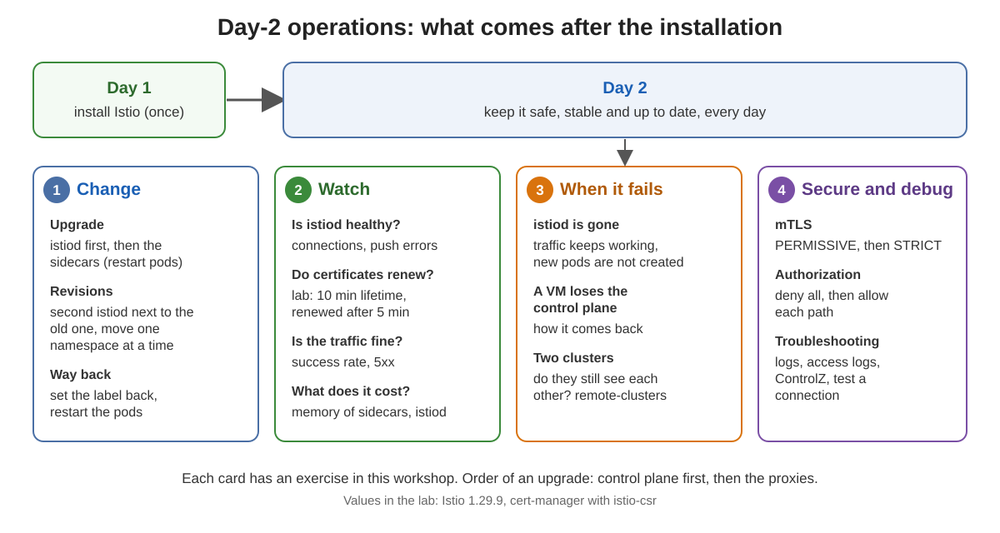

# Day-2 operations for Istio: what comes after the installation

## What this page is

Day 1 is the installation. Day 2 is everything after it: keeping Istio safe, stable and up to date. This page is a map. For each routine task it says what it is, and where in this workshop you do it. There are no commands here; the commands are on the pages we link to.

Two kinds of statements are on this page: values and behaviour **measured in our lab** (Istio 1.29.9, cert-manager with istio-csr), and statements from the **Istio documentation**, with the link. What we did not measure and the documentation does not say, we left out.

## The tasks

| Area | Routine task | Where in this workshop |
|---|---|---|
| Upgrade | Upgrade `istiod` first, then roll the sidecars | [Upgrade Istio: control plane first, then the proxies](../upgrade/01-upgrade-istio-in-place.md) |
| Upgrade | Run a second control plane (a revision) next to the old one, move one namespace at a time, way back = label and restart | [Upgrade Istio with revisions](../upgrade/02-upgrade-istio-with-revisions.md) |
| Upgrade | Upgrade the sidecar on a VM | [How the sidecar on a VM is upgraded](../upgrade/00-how-the-vm-sidecar-is-upgraded.md), then `03` to `05` in the same folder |
| Monitoring | Know the values to watch: `istiod`, certificates, traffic, cost | [Read the day-2 values in Grafana](../observability/07-read-the-day-2-values-in-grafana.md) |
| Certificates | Make the expiry of all certificates visible, alert before it happens | [Make the expiry of certificates visible](../observability/02-certificate-expiry.md) |
| Resources | Measure what the sidecars and `istiod` cost, limit the configuration of a sidecar with the `Sidecar` object | [What Istio costs](../observability/00-what-istio-costs.md), [Memory of the sidecars](../observability/03-sidecar-memory-and-the-sidecar-object.md) |
| Multi-cluster | Check that the clusters still see each other | [Check the link between two clusters](../multi-cluster/01-check-the-link-between-clusters.md) |
| Failures | What works and what does not while `istiod` is gone | [Outage: istiod is gone](../outage/01-istiod-is-gone.md) |
| Failures | What happens to a VM when the control plane is gone, and how it comes back | [Outage: what happens to the VM](../virtual-machines/03-outage-what-happens-to-the-vm.md) |
| Health | Is the application on the VM alive | [Health check of the VM](../virtual-machines/04-health-check-of-the-vm.md) |
| Security | Move from PERMISSIVE to STRICT mTLS, then restrict access with authorization policies | [mTLS: PERMISSIVE and STRICT](../security/01-mtls-permissive-and-strict.md), [Zero trust with Bookinfo](../security/02-zero-trust-with-authorization-policies.md) |
| Troubleshooting | Logs, log levels, access logs, ControlZ, testing a connection | [Debugging Istio](../debugging/01-logs-and-log-levels.md) |

## Points from the Istio documentation

These are not exercises in this workshop. Read them in the documentation before you do them.

| Task | What the documentation says | Source |
|---|---|---|
| Check before an upgrade | "it is recommended to run the `istioctl x precheck` command to make sure the upgrade is compatible" | [Canary upgrade](https://istio.io/latest/docs/setup/upgrade/canary/) |
| Revision tags | "Revision tags are stable identifiers that point to revisions and can be used to avoid relabeling namespaces." Change the tag with `istioctl tag set`, all namespaces labeled with that tag are updated at the same time. | [Canary upgrade](https://istio.io/latest/docs/setup/upgrade/canary/) |
| After a relabel | "After the namespace updates, you need to restart the pods to trigger re-injection." | [Canary upgrade](https://istio.io/latest/docs/setup/upgrade/canary/) |
| Rollback of gateways | You must first reinstall the gateways for the previous revision manually. | [Canary upgrade](https://istio.io/latest/docs/setup/upgrade/canary/) |
| Order with Helm (in place) | Base chart, then the discovery chart, then (optional) the gateway charts. | [Upgrade with Helm](https://istio.io/latest/docs/setup/upgrade/helm/) |
| Check the configuration | `istioctl analyze` "can run against a live cluster or a set of local configuration files", also "against a combination of the two, allowing you to catch problems before you apply changes to a cluster". Analysis never changes configuration state. | [istioctl analyze](https://istio.io/latest/docs/ops/diagnostic-tools/istioctl-analyze/) |
| mTLS mode | "It is recommended to migrate to strict mode when possible, to enforce that mutual TLS is used." | [Security best practices](https://istio.io/latest/docs/ops/best-practices/security/) |
| Multi-cluster endpoint discovery | An administrator deploys a remote secret to each primary cluster. It holds credentials for the API server of the other cluster. The control planes use it to discover the service endpoints there. | [Deployment models](https://istio.io/latest/docs/ops/deployment/deployment-models/) |

## What to take away

* Day-2 work is mostly: upgrade, watch, renew certificates, and know what happens when a part fails.
* **Order of an upgrade:** control plane first, then proxies. With revisions the way back is cheap: set the label back and restart the pods.
* **Every failed call in our upgrade tests fell into the restart of the pods,** not into a step at the control plane.
* **Watch the certificates.** In our lab a workload certificate lives 10 minutes and is renewed after 5; a sidecar without a valid certificate can keep existing connections but cannot open new ones.
* Write down who does what on which alarm. A short runbook entry has: trigger, effect, check, fix, verify, escalation.
