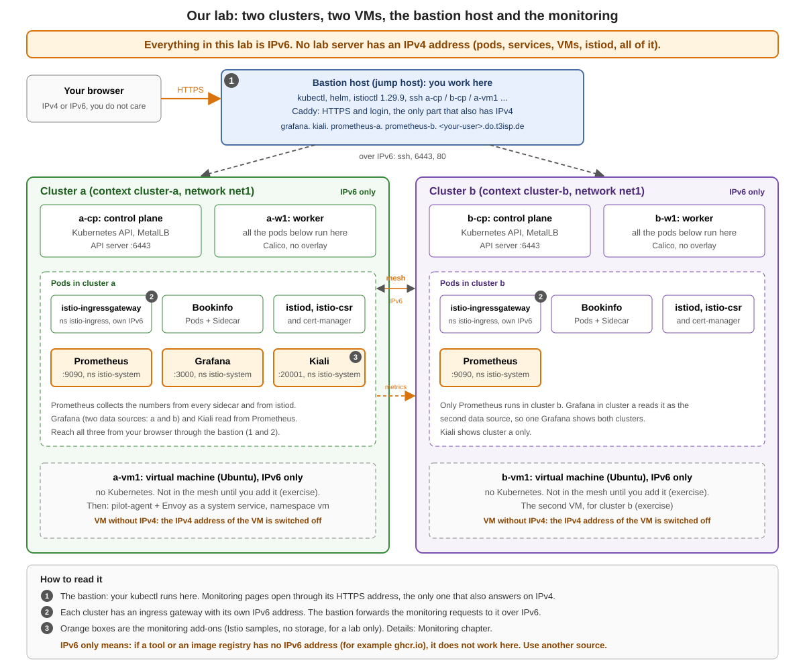

# Our lab: servers, VMs, bastion and monitoring



**Everything in this lab is IPv6.** No lab server has an IPv4 address: not the Kubernetes nodes, not the pods and services, not the VMs, not `istiod`. Only the bastion host also answers on IPv4, so your browser can reach the monitoring pages from any network.

What this means for you:

* Addresses you see are IPv6 addresses, for example `2a01:4f8:...::1`. In URLs they are written in square brackets.
* A tool or an image registry without an IPv6 address does not work here (example: `ghcr.io`). The exercises use another source where needed.
* The VMs have no IPv4 either. That is on purpose: it is the situation we want to test.

## The parts

| Part | How many | What it is |
|---|---|---|
| Bastion host | 1 | The server you work on. `kubectl`, `helm`, `istioctl` and `ssh` shortcuts are installed. Caddy on it gives the monitoring pages HTTPS and a login |
| Cluster a | 1 control plane, 1 worker | Kubernetes with Istio (sidecar mode). Context `cluster-a`, network `net1` |
| Cluster b | 1 control plane, 1 worker | The same, context `cluster-b`, also network `net1` (one flat network) |
| VM a | 1 (`a-vm1`) | Plain Ubuntu, for cluster a. Not in the mesh until you add it |
| VM b | 1 (`b-vm1`) | Plain Ubuntu, for cluster b. Not in the mesh until you add it |
| Prometheus | in both clusters | Collects the numbers from all sidecars and from `istiod` |
| Grafana | cluster a | Dashboards, with Prometheus of both clusters as data sources |
| Kiali | cluster a | The picture of the mesh of cluster a |

All pods of a cluster, including `istiod`, the ingress gateway and the monitoring, run on the worker. The control plane node runs the Kubernetes API.

## The list of all servers

The bastion has a file with all names, shortcuts and IPv6 addresses of **your** lab:

```
cat ~/server-overview.md
```

Every server is reachable with `ssh <shortcut>` (`a-cp`, `a-w1`, `a-vm1`, `b-cp`, `b-w1`, `b-vm1`), no password.

## The monitoring pages

Open them in your browser. The addresses and the password are in this file on the bastion:

```
cat ~/monitoring-access.md
```

| Page | Shows |
|---|---|
| Grafana | dashboards of both clusters |
| Kiali | the mesh of cluster a: who talks to whom |
| Prometheus a, Prometheus b | the raw numbers of each cluster |

The pages are the Istio sample add-ons. They are good for a lab and not meant for production (no storage, no access control of their own). The chapter "Monitoring" works with them.

Next: [Look around the lab: nodes, pods, sidecar](01-look-around.md)
