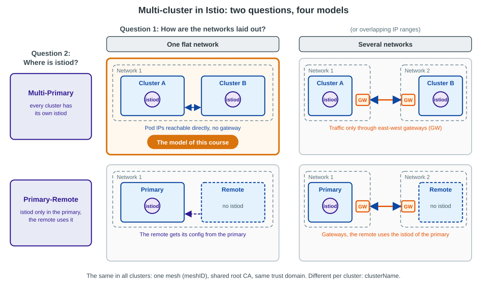
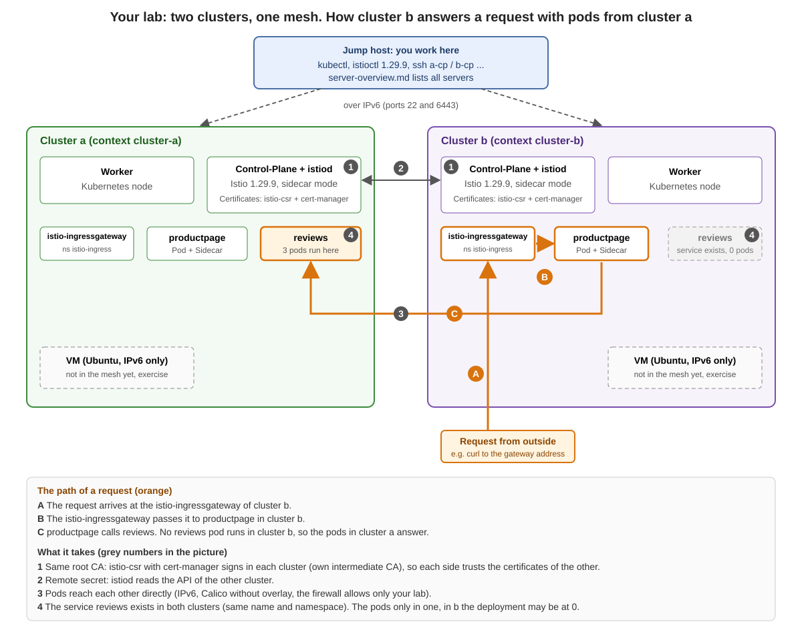
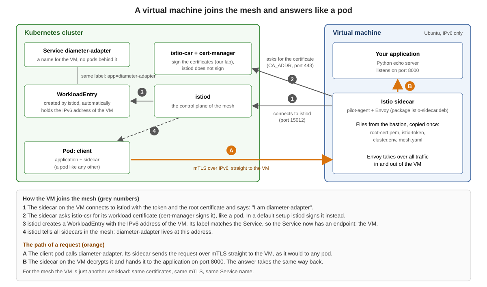
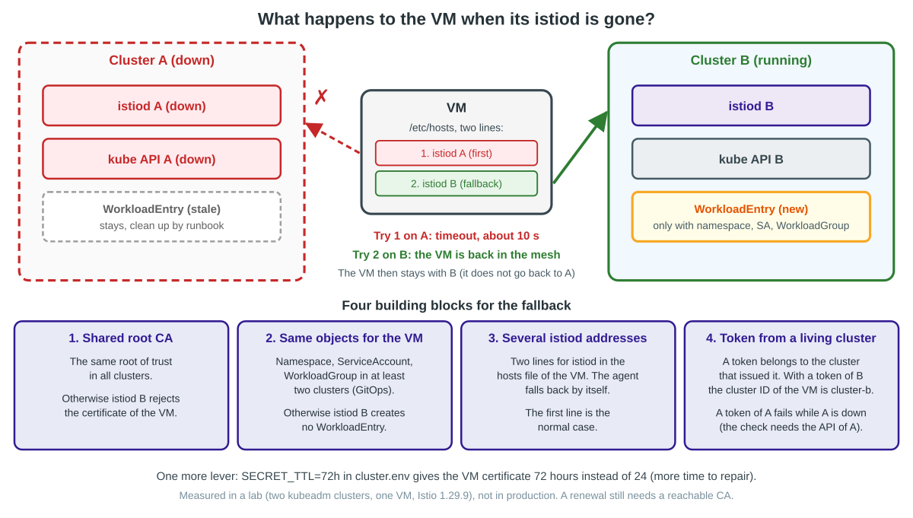

# The big picture: several clusters and virtual machines in one mesh

This page shows where the course is heading: two Kubernetes clusters and a virtual machine (VM) in **one** mesh. The details and the exercises follow in the chapters "Two clusters, one mesh" and "Virtual machines in the mesh".

## Two questions, four models

* **Question 1, the network:** In one flat network every pod IP is reachable from everywhere, so no gateway is needed between the clusters. Several networks need an east-west gateway per cluster.
* **Question 2, the control plane:** In multi-primary every cluster has its own `istiod`. In primary-remote a cluster uses the `istiod` of another cluster.
* **This course:** multi-primary on one flat network, sidecar mode, IPv6 only, no east-west gateway.

## Two clusters, one mesh

* Every `istiod` gets a **remote secret** for the other cluster. With it, it reads the services and endpoints there.
* The sidecar of a calling pod then knows the endpoints of **both** clusters.
* The request goes directly to the pod IP in the other cluster, protected by mTLS.
* The same in all clusters: `meshID`, root CA, trust domain. Different per cluster: `clusterName`.

## A virtual machine in the mesh

* A VM is a workload without Kubernetes. The same sidecar (`pilot-agent` and Envoy) runs on it as a system service.
* The sidecar needs three things: it must reach `istiod` (port `15012`), a **token** to log in, and the **root certificate**.
* When the VM connects, `istiod` creates a `WorkloadEntry` with the address of the VM. From then on the VM is an endpoint like a pod.
* mTLS runs between the sidecars. The application on the VM only talks to its local sidecar.

## What happens when the istiod of the VM is gone?

A VM knows **one** `istiod` address by default. If that cluster is down, the sidecar gets no new configuration and cannot log in again. The certificate of the VM is valid for 24 hours by default. When it runs out and no `istiod` has renewed it, the VM drops out of the mesh.

Measured in the lab (clusters A and B, shared root CA, a VM with two `istiod` addresses in `/etc/hosts`, A first):

| Situation | Result |
|---|---|
| `istiod` A is down, certificate of the VM is valid | Traffic to the VM keeps running. The VM connects to `istiod` B within a few seconds |
| All servers of A are off, agent on the VM restarted, certificate valid | The VM is back through B after about 11 seconds (10 seconds of that are the wait for the dead address of A) |
| A is off, no certificate, **token from A** | The VM does not come back (`Unauthenticated`). B cannot check the token without the API server of A |
| A is off, no certificate, **fresh token from B** | The VM is back through B after about 11 seconds |
| Certificate and token have expired, `istiod` is reachable again | The VM does not come back by itself. A fresh token in the token file is enough, without a restart |

What to remember:

* An outage of `istiod` does not stop the traffic. The proxies go on with their last configuration.
* The real deadline is the **lifetime of the certificate**.
* After the fallback the VM stays with B. The old `WorkloadEntry` in A stays as well.

## Sources

* [Istio: Deployment models](https://istio.io/latest/docs/ops/deployment/deployment-models/)
* [Istio: Install multicluster](https://istio.io/latest/docs/setup/install/multicluster/)
* [Istio: Virtual machine installation](https://istio.io/latest/docs/setup/install/virtual-machine/)

Next: [What is a service mesh, and what is Istio?](01-what-is-a-service-mesh.md)
