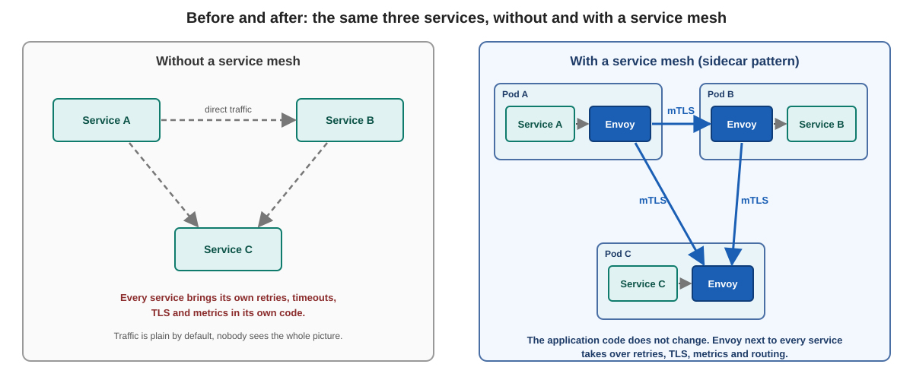

# What is a service mesh, and what is Istio?

## Background

This page has no commands. It gives you the words for the rest of the course. You look at a real mesh in the exercise [Look around the lab](../explore-the-lab/01-look-around.md).

## What is a service mesh?

A service mesh is a layer of infrastructure that handles the communication between services:

* It sits **between** the services, as a transparent layer. The application code does not change.
* Retries, timeouts, encryption (mTLS), access rules and metrics are configured **in one place**, not in every service.
* It gives applications zero-trust security, observability and advanced traffic management without code changes.

## Istio in one paragraph

Istio is an open source service mesh. It was started by Google, IBM and Lyft. Its data path is made of **Envoy** proxies. In the classic model an Envoy runs next to every workload as a **sidecar** and catches all network traffic of that workload. A central control plane, **istiod**, tells every proxy what to do.

In this course you use Istio in **sidecar mode** with the classic Istio APIs (`VirtualService`, `DestinationRule`, `ServiceEntry`, `Gateway`).

## Two architectures: sidecar and ambient

Istio knows two data plane modes. They can run side by side in one cluster.

| | Sidecar mode | Ambient mode |
|---|---|---|
| Where is the proxy? | One Envoy **in every pod** | One `ztunnel` **per node** (layer 4), optional `waypoint` proxy (layer 7, usually one per namespace) |
| What the proxy does | Layer 4 and layer 7: mTLS, routing, retries, metrics | `ztunnel`: mTLS and layer 4 telemetry. `waypoint`: routing, retries, layer 7 rules |
| Cost | CPU and memory in every pod | Less overhead, because proxies are shared |
| Pod changes | The pod gets a sidecar (injection, restart needed) | No change to the pod |
| What it needs from the cluster | Nothing special | An Istio node agent on every node (Istio CNI, a privileged component) |
| In this course | **Taught and practised** | **Theory only, about 15 minutes, no lab** |

Why sidecar here: you work as a tenant and you cannot install a privileged component on every node. The sidecar needs nothing of that, and it is the model that is still in wide use. Ambient is worth knowing because it changes the data path, so you can judge it when the question comes up.

## What you should remember

* A mesh is a **control plane** (decides) and a **data plane** (the proxies that carry the traffic).
* In sidecar mode every pod has an Envoy next to the application.
* The mesh works at the network level, so it works for every language.

Next: [Why a service mesh?](02-why-a-service-mesh.md)
