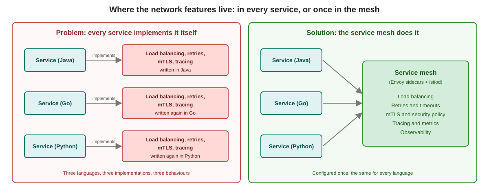

# Why a service mesh?

## Background

This page has no commands.

## The problem

With a few services, the network is easy. With dozens or hundreds of services, communication becomes the hard part. Every service needs:

* load balancing
* retries and timeouts
* circuit breaking
* mTLS encryption
* distributed tracing and metrics

If every service implements this itself, you get:

* **Different behaviour per language.** The Java service retries three times, the Go service never retries, the Python service retries forever.
* **High maintenance.** A change to the TLS settings means a new release of every service.
* **No overview.** Nobody can say which service talks to which, and whether the traffic is encrypted.

## The solution

The mesh moves this work **out of the application code into the infrastructure**:

| Who | What changes |
|---|---|
| Developers | Concentrate on the business logic |
| Platform team | Sets policy once (encryption, access, retries) for all services |
| Operations | Sees the same metrics for every service, whatever the language |

## The five things a mesh gives you

| Area | What it means |
|---|---|
| Observability | Metrics, traces and logs for all service-to-service traffic |
| Traffic management | Canary releases, weighted routing, load balancing |
| Resilience | Retries, timeouts, outlier detection |
| Security | mTLS between services, authentication and authorization policy |
| Service discovery | Services find each other, also when the system changes |

You will meet every row of this table in a later module.

Previous: [What is a service mesh?](01-what-is-a-service-mesh.md)
Next: [Challenges and benefits](03-challenges-and-benefits.md)
