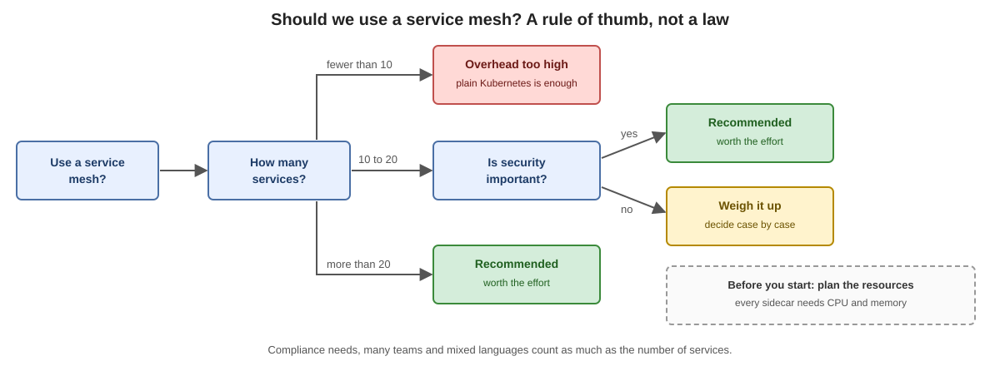

# Challenges and benefits

## Benefits

* **mTLS between all services**, automatic. The sidecars get certificates and rotate them.
* **Traffic control**: canary release, blue-green, A/B tests, weighted routing.
* **One view of everything**: metrics, traces and logs look the same for every service.
* **Central security policy**: who may call whom is a configuration, not code.
* **No code changes.**

## Challenges

| Challenge | What it means in practice |
|---|---|
| Resource overhead | Every sidecar needs CPU and memory. With many pods this adds up. You set requests and limits for the sidecar. |
| Extra latency | Every call goes through two proxies, the one of the caller and the one of the target. The delay is small, but it is there. |
| Learning curve | New objects, new terms, new places where a problem can hide. |
| Harder debugging | A failed call can be the application, the sidecar, the network or the mesh configuration. Tools like `istioctl proxy-status` help. |
| Another system to run | istiod, certificates, upgrades. |

## When is it worth it?

A rule of thumb, not a law:

* from about 20 to 30 services
* high requirements for security and compliance (for example encryption between all services, proof of who may call whom)
* many teams that use different languages

With fewer than 10 services the overhead usually outweighs the gain. Between 10 and 20 it depends mainly on how much security matters to you.

Previous: [Why a service mesh?](02-why-a-service-mesh.md)
Next: [Istio architecture and components](04-istio-architecture-and-components.md)
