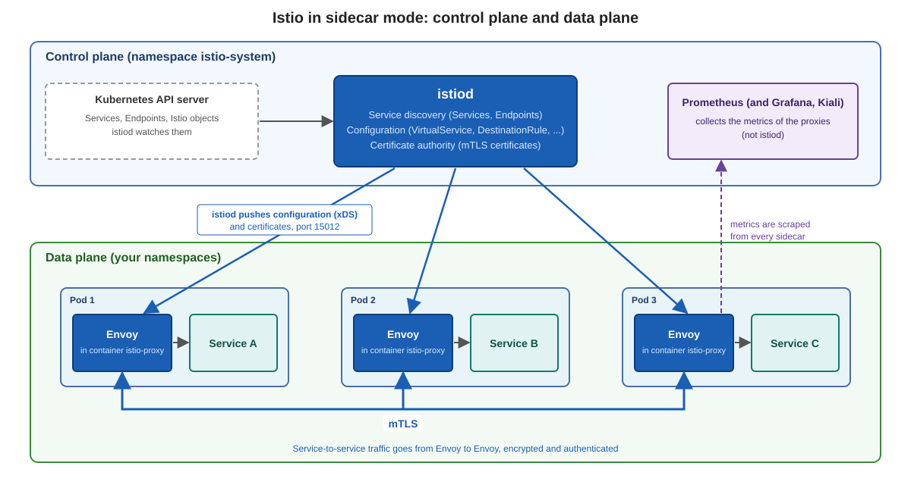
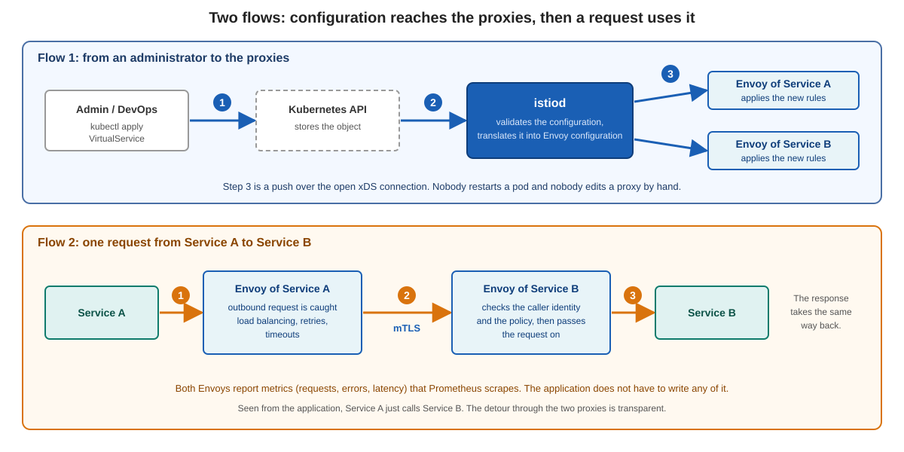

# Istio architecture and components

An Istio mesh has two parts:

| Part | What it is | Where in your lab |
|---|---|---|
| **Control plane** | `istiod`: one Deployment that decides | namespace `istio-system` |
| **Data plane** | The Envoy proxies that carry the traffic: one in every pod of the mesh, plus the gateways | the sidecar in every pod, the gateway in `istio-ingress` |

## The control plane: istiod

`istiod` is one process with several jobs:

* **Service discovery.** It watches the Kubernetes API for Services and Endpoints.
* **Configuration.** It reads the Istio objects (`VirtualService`, `DestinationRule`, `Gateway`, ...) and translates them into Envoy configuration.
* **Certificate authority.** It signs the workload certificates for mTLS. The identity of a workload is its Kubernetes ServiceAccount.
* **Distribution.** It pushes the configuration to all proxies over a gRPC connection (xDS, port 15012).

istiod does **not** carry any application traffic, and it does not collect metrics. The proxies expose their metrics, and Prometheus scrapes them.

## The data plane: Envoy

Envoy is a fast, generic proxy. In a pod it runs as the container `istio-proxy`. Inside this container two programs run:

| Program | Job |
|---|---|
| `pilot-agent` (process 1) | Connects to istiod, fetches the certificate, starts Envoy |
| `envoy` (child process) | Carries the traffic: routing, retries, mTLS, metrics |

Envoy does not talk to istiod directly. It talks to `pilot-agent` over a local Unix socket, and `pilot-agent` holds the connection to istiod. A small init container, `istio-init`, runs once at pod start and sets up iptables rules. These rules send all traffic of the pod through Envoy.

The messages that carry configuration are called **xDS**. You will see the names in `istioctl proxy-status`:

| Name | What istiod sends |
|---|---|
| CDS | clusters: the services a proxy can call |
| EDS | endpoints: the pod addresses behind a service |
| LDS | listeners: which ports the proxy listens on |
| RDS | routes: how requests are matched and where they go |
| NDS | names: the DNS table for the DNS proxy |

## Gateways

A gateway is an Envoy that runs **on its own**, without an application next to it. It stands at the edge of the mesh. The **ingress gateway** lets traffic in, an egress gateway lets traffic out in a controlled way. How an ingress gateway is configured is the topic of the next page.

## From configuration to traffic

1. You apply a high level object, for example a `VirtualService`.
2. istiod validates it and translates it into Envoy configuration.
3. istiod pushes the result to every proxy that needs it. Nobody restarts a pod.
4. At run time the Envoy of the caller catches the outbound request, applies load balancing and retries, and sends it with mTLS to the Envoy of the target. That Envoy checks the identity and the policy and hands the request to the application.

## What you should remember

* istiod **decides**, Envoy **carries**.
* The configuration travels from istiod to Envoy, never the other way round. The connection always starts at the proxy.
* The proxies hold their last configuration. If istiod is down for a while, existing traffic keeps flowing, but changes and new certificates stop.

Previous: [Challenges and benefits](03-challenges-and-benefits.md)
Next: [Istio ingress gateway vs. Kubernetes Gateway API](05-ingress-gateway-vs-gateway-api.md)
