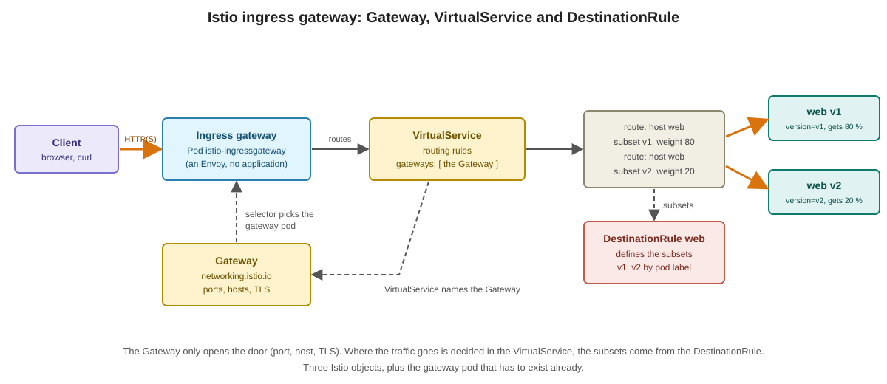
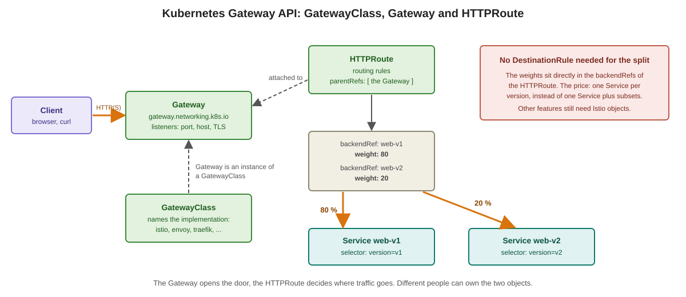

# Istio ingress gateway vs. Kubernetes Gateway API

Traffic that comes **into** the cluster from outside is called north-south traffic. In Istio you have two ways to describe it:

* the **Istio APIs**: `Gateway` plus `VirtualService` (plus `DestinationRule`). This is what the exercise [Expose Bookinfo through the ingress gateway over IPv6](../ingress-gateway/01-expose-bookinfo-over-ipv6.md) uses.
* the **Kubernetes Gateway API**: `GatewayClass`, `Gateway` and `HTTPRoute`. It is a Kubernetes standard, not an Istio invention, and several products implement it.

## The Istio way

| Object | What it does |
|---|---|
| Ingress gateway (`istio-ingressgateway`) | A Deployment with a Service of type `LoadBalancer`. In the lab both are called `istio-ingressgateway` and live in the namespace `istio-ingress`. |
| `Gateway` (`networking.istio.io`) | Opens the door on the ingress gateway: ports, hosts, TLS. A `selector` picks the gateway pods |
| `VirtualService` | The routing rules. It names the `Gateway` in its `gateways` field |
| `DestinationRule` | Defines **subsets** (for example `v1`, `v2` by pod label) and the policy for the target: load balancing, connection pool, outlier detection |

The same `VirtualService` and `DestinationRule` also work for traffic **inside** the mesh. That is why you learn them first.

## The Kubernetes Gateway API way

| Object | What it does |
|---|---|
| `GatewayClass` | Names the implementation (`istio`, `envoy`, `traefik`, ...). One per implementation, usually created by the platform |
| `Gateway` (`gateway.networking.k8s.io`) | An instance of a class: the listeners (port, host, TLS) |
| `HTTPRoute` | The routing rules. It attaches to a `Gateway` with `parentRefs` |

Two differences to remember:

* **The weights are in the route.** An `HTTPRoute` lists `backendRefs` with a `weight`. Each backend is a Service, so a canary needs one Service per version. No `DestinationRule` is needed for the split.
* **Istio can create the gateway pod for you.** With the Gateway API, a `Gateway` of class `istio` makes Istio create the Deployment and the Service itself. With the Istio `Gateway` you run the gateway pod yourself.

Other route types exist, for example `GRPCRoute` for gRPC.

## Side by side

| | Istio `Gateway` + `VirtualService` | Gateway API `Gateway` + `HTTPRoute` |
|---|---|---|
| Who defines it | Istio | Kubernetes SIG Network, many implementations |
| Door and routing | `Gateway` and `VirtualService` | `Gateway` and `HTTPRoute` |
| Link between them | `VirtualService.gateways` names the `Gateway` | `HTTPRoute.parentRefs` names the `Gateway` |
| Canary | weights over **subsets** (needs a `DestinationRule`) | weights over **Services** in `backendRefs` |
| Gateway pod | you run it | Istio can create it from the `Gateway` |
| Who may attach a route | a `VirtualService` that names the `Gateway` | the `Gateway` decides with `allowedRoutes` (namespaces, kinds) |
| Works with another product | no, Istio only | yes, same objects with another `GatewayClass` |
| Where it is installed | Istio brings the CRDs | The Gateway API CRDs are **not** part of Kubernetes, someone has to install them |

The last row matters if you are a tenant: installing CRDs is a cluster-wide act. Ask your trainer whether the Gateway API CRDs are installed in your lab.

## Which one to use?

* The Gateway API is the direction Istio is moving in. For **new ingress** configuration it is a good default when the CRDs are available.
* The Istio APIs stay important. Not every feature of `VirtualService` and `DestinationRule` has an equivalent in the Gateway API, for example fault injection, connection pool settings and outlier detection are still configured with the Istio objects. Existing setups are full of them, and many companies run the classic APIs.
* You can use both in one cluster, and you can move step by step.
* **One owner per Service.** Do not describe the routing of the same Service with an `HTTPRoute` and a `VirtualService` at the same time. Pick one. (Hint: It does not work properly)

In this course the focus is on the Istio APIs. You see the Gateway API as a short contrast.

Previous: [Istio architecture and components](04-istio-architecture-and-components.md)
