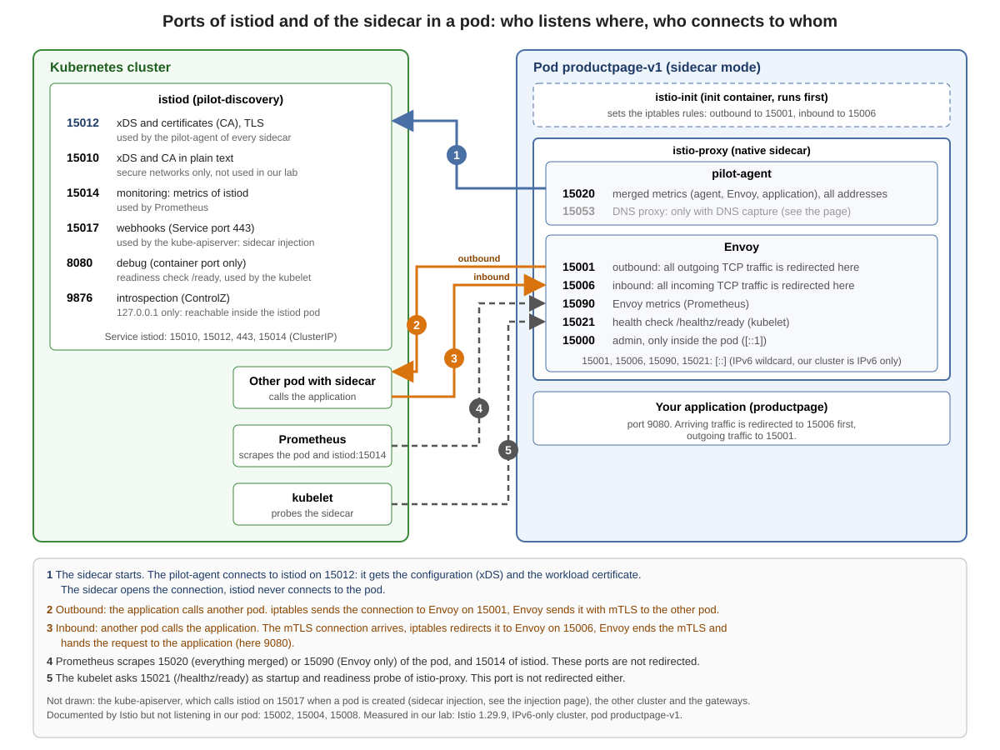

# Ports of istiod and of the sidecar (sidecar mode)



The picture shows every port, its task and who connects to it. Measured in our lab: Istio 1.29.9, IPv6 only, the `productpage` pod of Bookinfo. The tasks come from the Istio documentation (*Ports used by Istio*). `istiod` is the program `pilot-discovery`. The container `istio-proxy` runs `pilot-agent` and Envoy; in our lab it is a Kubernetes *native sidecar* (listed under `initContainers` with `restartPolicy: Always`).

## Not in the picture

* **Addresses:** `[::]` is the IPv6 wildcard address (our cluster is IPv6 only). `15020` listens on all addresses, `15000` on `[::1]` only.
* **Prometheus:** the pod carries the annotations `prometheus.io/scrape: "true"`, `prometheus.io/port: "15020"` and `prometheus.io/path: /stats/prometheus`. `15020` gives everything in one place, `15090` only the metrics of Envoy.
* **Not listening** in our pod: `15002` (failure detection), `15004` (debug), `15008` (HBONE tunnel, ambient mode).
* **The `Service istiod`** has `15010`, `15012`, `443` (forwarded to `15017`) and `15014`. `8080` is a container port only.

### What iptables redirects

The init container `istio-init` sets these rules in the pod (we read them from its log):

| Direction | Rule |
|---|---|
| outbound | all TCP to `15001` |
| inbound | all TCP to `15006` |
| inbound, **not** redirected | `15008`, `15090`, `15021`, `15020`: the ports of the sidecar itself |
| outbound, **not** redirected | traffic of the proxy itself (user and group `1337`) and traffic to `127.0.0.1`, otherwise Envoy would redirect its own traffic to itself |

## DNS capture and port 15053

Normally an application asks the cluster DNS (`kube-dns`). It knows the Kubernetes `Service`s, but not your own `ServiceEntry` hosts or services outside of Kubernetes. With **DNS capture** the sidecar answers itself: "all DNS requests from an application will be redirected to the sidecar". The `pilot-agent` keeps a table of names and addresses from `istiod` and answers what it can. Any other name goes on to the DNS server from `/etc/resolv.conf`. It also gives addresses to `ServiceEntry`s that have none (*auto allocation*, `240.240.0.0/16`), and a VM uses it to find the services of the cluster.

* **Off by default in sidecar mode** (on by default in ambient mode from Istio 1.25 on).
* **Mesh-wide:** `ISTIO_META_DNS_CAPTURE: "true"` in `meshConfig.defaultConfig.proxyMetadata` (ConfigMap `istio`). **One pod:** the annotation `proxy.istio.io/config`.
* **In our lab** the mesh configuration of cluster a has `ISTIO_META_DNS_CAPTURE` and `ISTIO_META_DNS_AUTO_ALLOCATE` set to `"true"`, because the VM exercise switches them on.
* **It is read when the pod is created.** We measured it:

| Pod | Started | Listens on `15053` |
|---|---|---|
| `productpage-v1` | before DNS capture was switched on | no |
| a new test pod in a labelled namespace | after | yes: `[::1]:15053`, tcp and udp |

That is why the picture, measured on `productpage-v1`, shows `15053` greyed out.

## What the words mean

| Word | Meaning |
|---|---|
| **xDS** | The family of discovery APIs over which `istiod` sends the configuration to the proxies: clusters, listeners, endpoints, routes and names (CDS, LDS, EDS, RDS, NDS). You see them in the column `SUBSCRIBED TYPES` of `istioctl proxy-status`. One long-lived gRPC connection that the proxy opens |
| **CA** | `istiod` is also the certificate authority. The `pilot-agent` sends a certificate request with the token of the service account of the pod (the volume `istio-token`) on the same connection and gets the workload certificate for mTLS |
| **`15012` and `15010`** | The same two services, with TLS (`15012`) and in plain text (`15010`). Plain text is only for networks you trust completely. We use `15012` |
| **Webhook** | An HTTPS address that the `kube-apiserver` calls when something is created. A *mutating* webhook may change the object (the [sidecar injection](07-sidecar-injection.md)), a *validating* webhook may reject it (`istiod` checks Istio resources). Both use `443` and `15017` |
| **Readiness (`8080`)** | The kubelet asks `/ready` to find out whether `istiod` is ready. Only then the `Service` sends traffic to it |
| **ControlZ (`9876`)** | A small introspection interface of `istiod`. It listens on `127.0.0.1` only. We do not use it in the course |

## Look at it yourself

The commands run on your bastion host as your lab user. They use the `productpage` pod of Bookinfo.

```
kubectl exec deploy/productpage-v1 -c istio-proxy -- ss -ltnp
kubectl logs deploy/productpage-v1 -c istio-init | grep -E "^-A ISTIO_(INBOUND|REDIRECT|IN_REDIRECT)"
kubectl get pod -l app=productpage -o jsonpath='{.items[0].metadata.annotations}'
kubectl -n istio-system get deploy istiod -o jsonpath='{range .spec.template.spec.containers[0].ports[*]}{.name}={.containerPort} {end}'
kubectl -n istio-system get svc istiod
kubectl -n istio-system get cm istio -o jsonpath='{.data.mesh}' | grep ISTIO_META_DNS
```

The same ports on a virtual machine: [Ports of istiod and of the sidecar on the VM](../virtual-machines/00-ports-of-sidecar-and-istiod.md).

Previous: [Istio ingress gateway vs. Kubernetes Gateway API](05-ingress-gateway-vs-gateway-api.md)
Next: [How the sidecar gets into the pod (sidecar injection)](07-sidecar-injection.md)
