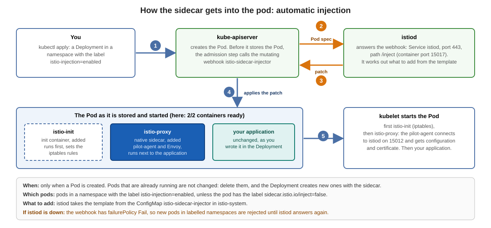

# How the sidecar gets into the pod (sidecar injection)



The picture shows the steps. This page adds what we measured in our lab (Istio 1.29.9).

## Which pods get a sidecar

| What you do | Result | Seen in our lab |
|---|---|---|
| namespace without a label | no sidecar | pod `a`: `1/1`, no init containers |
| namespace with `istio-injection=enabled` | sidecar | pod `b`: `2/2`, init containers `istio-init` and `istio-proxy` |
| namespace with the label, pod with `sidecar.istio.io/inject=false` | no sidecar | pod `c`: no init containers |

With control plane revisions the label `istio.io/rev` is used instead (if both are set, `istio-injection` takes precedence). If either label says "disabled", the pod is not injected.

Running pods are not changed: pod `a` was created before the namespace got its label and stayed `1/1`. Delete the pods, and the Deployment creates new ones with the sidecar.

## What the injector adds

The annotation `sidecar.istio.io/status` of a pod lists it:

* the init container `istio-init` and the container `istio-proxy` (also listed under `initContainers`, with `restartPolicy: Always`: a Kubernetes *native sidecar*)
* volumes, among them `istio-envoy`, `istio-token`, `istiod-ca-cert` and `workload-certs`

`kubectl get pod` shows `2/2`: your application and the sidecar. Your Deployment stays unchanged.

The `MutatingWebhookConfiguration` `istio-sidecar-injector` has four webhooks, one for each way to select pods (label `istio-injection` or `istio.io/rev`, on the namespace or on the pod). All four call the same `Service`.

## Look at it yourself

The commands run on your bastion host as your lab user.

```
kubectl get ns default --show-labels
kubectl get mutatingwebhookconfiguration istio-sidecar-injector -o jsonpath='{range .webhooks[*]}{.name}{" -> "}{.clientConfig.service.name}{":"}{.clientConfig.service.port}{.clientConfig.service.path}{" failurePolicy="}{.failurePolicy}{"\n"}{end}'
kubectl get pod -l app=productpage
kubectl get pod -l app=productpage -o jsonpath='{.items[0].metadata.annotations.sidecar\.istio\.io/status}'
```

### Try it: three pods, three results

```
kubectl create namespace inj-test
kubectl -n inj-test run a --image=curlimages/curl:8.11.1 --restart=Never -- sleep 3600
kubectl label namespace inj-test istio-injection=enabled
kubectl -n inj-test run b --image=curlimages/curl:8.11.1 --restart=Never -- sleep 3600
kubectl -n inj-test run c --image=curlimages/curl:8.11.1 --restart=Never --labels=sidecar.istio.io/inject=false -- sleep 3600
kubectl -n inj-test wait --for=condition=Ready pod --all --timeout=120s
kubectl -n inj-test get pod
kubectl -n inj-test get pod a b c -o custom-columns=NAME:.metadata.name,INIT:.spec.initContainers[*].name
```

```
NAME   READY   STATUS    RESTARTS   AGE
a      1/1     Running   0          6s
b      2/2     Running   0          5s
c      1/1     Running   0          5s

NAME   INIT
a      <none>
b      istio-init,istio-proxy
c      <none>
```

Clean up:

```
kubectl delete namespace inj-test
```

Previous: [Ports of istiod and of the sidecar](06-ports-of-istiod-and-the-sidecar.md)
