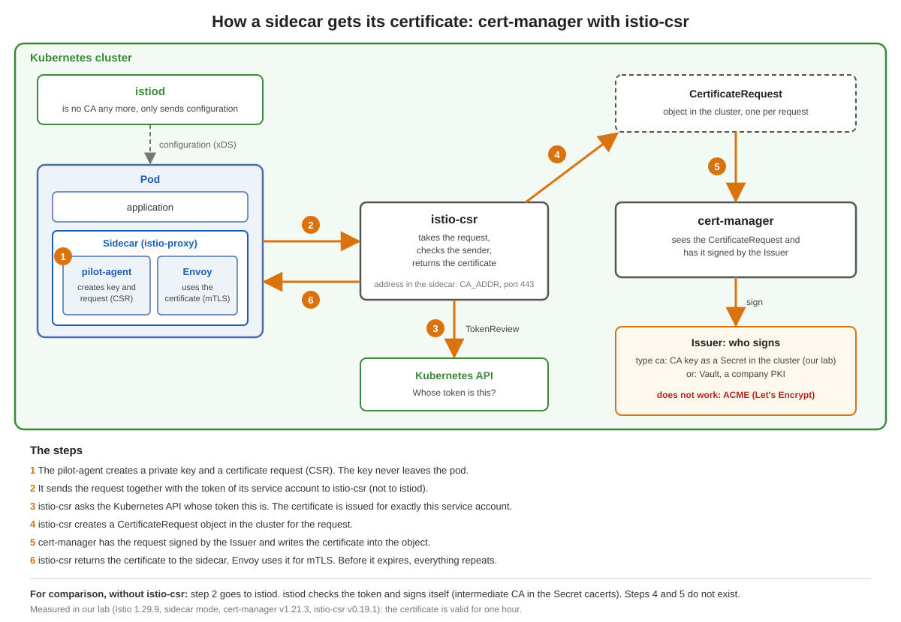

# Who signs the certificates: cert-manager with istio-csr



Every sidecar needs a certificate for mTLS. By default `istiod` signs it. In our lab `istiod` is **not** the certificate authority (CA): cert-manager signs every certificate, and `istio-csr` is the link between Istio and cert-manager. Measured in our lab: Istio 1.29.9, sidecar mode, IPv6 only, cert-manager v1.21.3, istio-csr v0.19.1.

## The parts

| Part | What it is | What it does |
|---|---|---|
| **cert-manager** | A controller in the cluster (namespace `cert-manager`) | Signs what an `Issuer` allows it to sign |
| **`Issuer`** | An object of cert-manager | Says who signs. In our lab: type `ca`, the key of an intermediate CA lies in the `Secret istio-ca` |
| **istio-csr** | Its own program with its own pod and Helm chart, made by the cert-manager project. It is not a plugin | Speaks the certificate API of Istio towards the sidecars and creates a `CertificateRequest` for cert-manager |
| **`CertificateRequest`** | An object of cert-manager, one per request | Carries the request to cert-manager and the signed certificate back |
| **`istiod`** | The control plane | Sends the configuration only. `ENABLE_CA_SERVER` is `false` |

## What is different from the default

| | `istiod` is the CA (default) | cert-manager with istio-csr (our lab) |
|---|---|---|
| The sidecar asks | `istiod`, port `15012` | `istio-csr`, port `443` (`CA_ADDR`) |
| Who signs | `istiod` with its own key (or the `Secret cacerts`) | the `Issuer` of cert-manager |
| Lifetime of a workload certificate | 24 hours (Istio default, not measured here) | 1 hour by default (measured). **Our lab: 10 minutes** (measured), set with `app.server.maxCertificateDuration` in the Helm chart of istio-csr |
| A certificate request is visible in the cluster | no | yes, as a `CertificateRequest` (istio-csr deletes it after it is done) |
| The root certificate comes to the pods | from `istiod`, as `ConfigMap istio-ca-root-cert` | from `istio-csr`, as `ConfigMap istio-ca-root-cert` |

`istio-csr` runs **in every cluster**. In our lab both clusters have their own intermediate CA under one common root. That is why a sidecar in cluster a trusts a sidecar in cluster b.

## Which `Issuer`?

For Istio it makes no difference who signs in the end: `istio-csr` always creates a `CertificateRequest`, and only the `Issuer` object changes.

| `Issuer` | Where the CA key is | Remark |
|---|---|---|
| type `ca` | as a `Secret` in the cluster | our lab |
| Vault | in Vault | cert-manager asks Vault to sign |
| a company PKI | in the PKI | through an issuer for this PKI |
| ACME (Let's Encrypt) | | **does not work** for mesh certificates |

**Why not ACME?** ACME proves that you own a DNS name (with an HTTP or a DNS challenge). A mesh certificate has no DNS name. It carries the identity of a service account as a URI, for example `spiffe://cluster.local/ns/default/sa/bookinfo-productpage`. There is no ACME challenge for that. Here `istio-csr` does the proof itself: it asks the Kubernetes API whose token it got. For the certificate of an ingress gateway with a real DNS name, ACME works as usual. That is a different certificate.

## Why this matters for debugging

* **Two things can fail now.** Without `istiod` a sidecar gets no new configuration. Without `istio-csr` or cert-manager it gets no new certificate.
* **A short lifetime.** A sidecar renews its certificate after half of its lifetime. If the CA is gone for longer than the rest of the lifetime, the certificate expires and new mTLS connections fail. With one hour this happens much sooner than with 24 hours. Our lab uses 10 minutes on purpose: you see a renewal every 5 minutes, and an outage of the CA shows its effect within minutes.
* **A VM needs a second address.** It must reach `istiod` **and** `istio-csr`. We come back to this in the VM exercise.

## Exercise: Look at it yourself

The commands run on your bastion host as your lab user.

The pods of cert-manager and istio-csr:

```
kubectl -n cert-manager get pods
```

```
NAME                                       READY   STATUS    RESTARTS   AGE
cert-manager-7b64759498-tszv8              1/1     Running   0          22m
cert-manager-cainjector-5d85cc9c99-m4q94   1/1     Running   0          22m
cert-manager-istio-csr-79bbfd7669-twxpr    1/1     Running   0          21m
cert-manager-webhook-674b6c7468-rsmps      1/1     Running   0          22m
```

The `Issuer` and the certificate of `istiod` itself (`istiod` also gets its certificate from cert-manager):

```
kubectl -n istio-system get issuer,certificate
```

```
NAME                              READY   AGE
issuer.cert-manager.io/istio-ca   True    21m

NAME                                 READY   SECRET       AGE
certificate.cert-manager.io/istiod   True    istiod-tls   21m
```

`istiod` is no CA:

```
kubectl -n istio-system get deploy istiod -o yaml | grep -A1 ENABLE_CA_SERVER
```

```
        - name: ENABLE_CA_SERVER
          value: "false"
```

The sidecar knows where to ask:

```
kubectl get pod -l app=productpage -o yaml | grep -A1 "name: CA_ADDR"
```

```
      - name: CA_ADDR
        value: cert-manager-istio-csr.cert-manager.svc:443
```

The certificate of the sidecar. Look at `NOT BEFORE` and `NOT AFTER`: ten minutes. Run the command again after five minutes: the sidecar has a new certificate already.

```
istioctl proxy-config secret deploy/productpage-v1
```

```
RESOURCE NAME     TYPE           STATUS     VALID CERT     SERIAL NUMBER                                NOT AFTER                NOT BEFORE
default           Cert Chain     ACTIVE     true           3c86c8408d15841d9f5fa1ab6a843ff50774d4de     2026-11-14T10:17:45Z     2026-11-14T10:07:45Z
ROOTCA            CA             ACTIVE     true           622ad438aac119a3c725647160f33603ba53e4f7     2026-12-14T09:31:53Z     2026-11-14T09:31:53Z
```

Who signed it, and for which identity:

```
istioctl proxy-config secret deploy/productpage-v1 -o json | jq -r ".dynamicActiveSecrets[0].secret.tlsCertificate.certificateChain.inlineBytes" | base64 -d | openssl x509 -noout -issuer -dates -ext subjectAltName
```

```
issuer=O = Lab, CN = Intermediate CA tln2 a
notBefore=Nov 13 14:21:15 2026 GMT
notAfter=Nov 13 15:21:15 2026 GMT
X509v3 Subject Alternative Name: 
    URI:spiffe://cluster.local/ns/default/sa/bookinfo-productpage
```

Your output shows the name of your own lab user in the issuer.

## Sources

* [cert-manager: istio-csr](https://cert-manager.io/docs/usage/istio-csr/)
* [Istio: Custom CA integration with cert-manager and istio-csr](https://istio.io/latest/docs/ops/integrations/certmanager/)

Not measured in our lab, from our own knowledge: the default lifetime of 24 hours when `istiod` is the CA, the issuers Vault and company PKI, the statement about ACME.

Previous: [How the sidecar gets into the pod](07-sidecar-injection.md)
