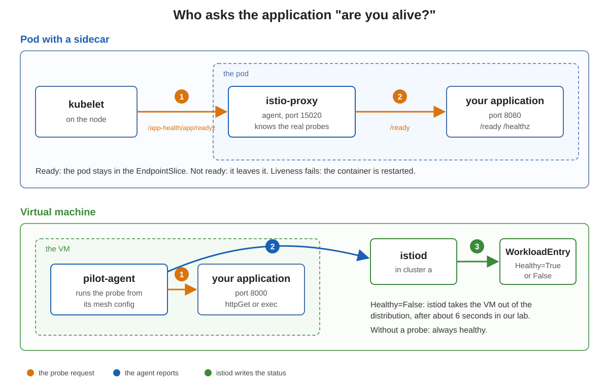

# Probes on pods and on VMs



## What we do

A probe asks the application "are you alive?". You see three things:

1. How Istio rewrites the probes of a pod, and what happens when a probe fails (readiness and liveness).
2. That the probes keep working with mTLS `STRICT`.
3. How the same question is asked on a **VM**, where the agent runs the probe.

Read first: [Health checks in the mesh](00-health-checks-overview.md).

Prerequisite: the two clusters are one mesh and the VM `a-vm1` is in the mesh ([Add a virtual machine to the mesh](../virtual-machines/01-add-a-vm-to-the-mesh.md)), the test pod `client` runs in cluster a. Measured in our lab: Istio 1.29.9, IPv6 only.

All commands run on your bastion host as your lab user.

```
export CTX_A=cluster-a
mkdir -p ~/probes
cd ~/probes
```

## Part 1: probes on a pod

### Step 1: An application with two probes

The application is a small Python web server. `/ready` and `/healthz` answer `200`, unless the file `/tmp/not-ready` (for `/ready`) or `/tmp/dead` (for `/healthz`) exists, then they answer `500`. This way you can switch a probe to "failed" with `touch`.

```
cat <<'EOF' > 01-health-demo.yml
apiVersion: apps/v1
kind: Deployment
metadata:
  name: health-demo
spec:
  replicas: 1
  selector:
    matchLabels:
      app: health-demo
  template:
    metadata:
      labels:
        app: health-demo
    spec:
      containers:
      - name: app
        image: python:3.13-alpine
        command: ["python", "-u", "-c"]
        args:
        - |
          import http.server, os, socket
          class H(http.server.BaseHTTPRequestHandler):
              def do_GET(self):
                  broken = {"/ready": "/tmp/not-ready", "/healthz": "/tmp/dead"}.get(self.path)
                  ok = broken is None or not os.path.exists(broken)
                  self.send_response(200 if ok else 500)
                  self.end_headers()
                  self.wfile.write(b"ok\n" if ok else b"broken\n")
          class S(http.server.ThreadingHTTPServer):
              address_family = socket.AF_INET6
          S(("::", 8080), H).serve_forever()
        ports:
        - containerPort: 8080
        readinessProbe:
          httpGet:
            path: /ready
            port: 8080
          periodSeconds: 3
          failureThreshold: 2
        livenessProbe:
          httpGet:
            path: /healthz
            port: 8080
          periodSeconds: 3
          failureThreshold: 2
---
apiVersion: v1
kind: Service
metadata:
  name: health-demo
spec:
  selector:
    app: health-demo
  ports:
  - name: http
    port: 8080
EOF
```

```
kubectl --context $CTX_A create namespace probes
kubectl --context $CTX_A label namespace probes istio-injection=enabled
kubectl --context $CTX_A apply -n probes -f 01-health-demo.yml
kubectl --context $CTX_A -n probes rollout status deploy/health-demo --timeout=180s
kubectl --context $CTX_A -n probes get pods
```

```
NAME                           READY   STATUS    RESTARTS   AGE
health-demo-79f64cfb48-dgcnt   2/2     Running   0          8s
```

### Step 2: The probe in the pod is not the probe you wrote

Your manifest says `/ready` on port `8080`. Look at the probe of the running pod:

```
kubectl --context $CTX_A -n probes get pod -l app=health-demo -o jsonpath='{.items[0].spec.containers[0].readinessProbe}{"\n"}'
```

```
{"failureThreshold":2,"httpGet":{"path":"/app-health/app/readyz","port":15020,"scheme":"HTTP"},"periodSeconds":3,"successThreshold":1,"timeoutSeconds":1}
```

The sidecar injection rewrote it: the `kubelet` now asks port `15020`, which is the agent in the sidecar. The agent knows the original probes:

```
kubectl --context $CTX_A -n probes get pod -l app=health-demo -o jsonpath='{.items[0].spec.initContainers[?(@.name=="istio-proxy")].env[?(@.name=="ISTIO_KUBE_APP_PROBERS")].value}{"\n"}'
```

```
{"/app-health/app/livez":{"httpGet":{"path":"/healthz","port":8080,"scheme":"HTTP"},"timeoutSeconds":1},"/app-health/app/readyz":{"httpGet":{"path":"/ready","port":8080,"scheme":"HTTP"},"timeoutSeconds":1}}
```

### Step 3: Readiness fails

```
kubectl --context $CTX_A -n probes exec deploy/health-demo -c app -- touch /tmp/not-ready
sleep 8
kubectl --context $CTX_A -n probes get pods
kubectl --context $CTX_A -n probes get endpointslice -l kubernetes.io/service-name=health-demo -o jsonpath='{range .items[0].endpoints[*]}{.addresses} ready={.conditions.ready}{"\n"}{end}'
kubectl --context $CTX_A -n probes describe pod -l app=health-demo | grep "Readiness probe failed" | tail -1
```

```
NAME                           READY   STATUS    RESTARTS   AGE
health-demo-79f64cfb48-dgcnt   1/2     Running   0          35s
["2a01:4f8:c016:712e::1:915b"] ready=false
  Warning  Unhealthy  1s (x5 over 29s)  kubelet            spec.containers{app}: Readiness probe failed: HTTP probe failed with statuscode: 500
```

The pod is running but not ready (`1/2`), and its endpoint says `ready=false`: no traffic goes to it. The error comes from the `kubelet`, with the status code of the application. Make it ready again:

```
kubectl --context $CTX_A -n probes exec deploy/health-demo -c app -- rm /tmp/not-ready
sleep 6
kubectl --context $CTX_A -n probes get pods
```

```
NAME                           READY   STATUS    RESTARTS   AGE
health-demo-79f64cfb48-dgcnt   2/2     Running   0          44s
```

### Step 4: Liveness fails

```
kubectl --context $CTX_A -n probes exec deploy/health-demo -c app -- touch /tmp/dead
sleep 12
kubectl --context $CTX_A -n probes describe pod -l app=health-demo | grep -E "Liveness probe failed|Killing" | tail -2
```

```
  Warning  Unhealthy  10s (x2 over 13s)  kubelet            spec.containers{app}: Liveness probe failed: HTTP probe failed with statuscode: 500
  Normal   Killing    10s                kubelet            spec.containers{app}: Container app failed liveness probe, will be restarted
```

Readiness takes the pod out of the distribution, liveness restarts the container. Both work through the rewrite.

### Step 5: mTLS STRICT, the rewrite is still on

```
cat <<'EOF' > 02-strict.yml
apiVersion: security.istio.io/v1
kind: PeerAuthentication
metadata:
  name: default
spec:
  mtls:
    mode: STRICT
EOF
```

```
kubectl --context $CTX_A -n probes apply -f 02-strict.yml
kubectl --context $CTX_A -n probes delete pod -l app=health-demo
kubectl --context $CTX_A -n probes rollout status deploy/health-demo --timeout=120s
sleep 8
kubectl --context $CTX_A -n probes get pods
```

```
NAME                           READY   STATUS    RESTARTS   AGE
health-demo-79f64cfb48-hcnlb   2/2     Running   0          45s
```

With `STRICT` every call into the pod needs mTLS, and the pod still becomes ready: the `kubelet` calls port `15020` of the agent (see step 2), not the application. 

### Step 6: An `exec` probe on a pod

Remove the first deployment. The new deployment runs `sleep` and has an `exec` probe: the pod is ready when the file `/tmp/ready` exists.

```
kubectl --context $CTX_A -n probes delete deploy health-demo
```

```
cat <<'EOF' > 03-exec-demo.yml
apiVersion: apps/v1
kind: Deployment
metadata:
  name: exec-demo
spec:
  replicas: 1
  selector:
    matchLabels:
      app: exec-demo
  template:
    metadata:
      labels:
        app: exec-demo
    spec:
      containers:
      - name: app
        image: python:3.13-alpine
        command: ["sleep", "3600"]
        readinessProbe:
          exec:
            command: ["test", "-f", "/tmp/ready"]
          periodSeconds: 3
          failureThreshold: 2
EOF
```

```
kubectl --context $CTX_A -n probes apply -f 03-exec-demo.yml
sleep 30
kubectl --context $CTX_A -n probes get pods
kubectl --context $CTX_A -n probes get pod -l app=exec-demo -o jsonpath='{.items[0].spec.containers[0].readinessProbe}{"\n"}'
```

```
NAME                         READY   STATUS    RESTARTS   AGE
exec-demo-5d768f4dd7-z2vqr   1/2     Running   0          31s
{"exec":{"command":["test","-f","/tmp/ready"]},"failureThreshold":2,"periodSeconds":3,"successThreshold":1,"timeoutSeconds":1}
```

The `exec` probe is not rewritten: the `kubelet` runs the command in the container. Create the file and the pod turns ready:

```
kubectl --context $CTX_A -n probes exec deploy/exec-demo -c app -- touch /tmp/ready
sleep 8
kubectl --context $CTX_A -n probes get pods
```

```
NAME                         READY   STATUS    RESTARTS   AGE
exec-demo-5d768f4dd7-z2vqr   2/2     Running   0          41s
```

## Part 2: an `exec` probe on a VM

A VM has no `kubelet`. The agent on the VM runs the probe from the `WorkloadGroup` (see [Health check of the VM](../virtual-machines/04-health-check-of-the-vm.md), which does `httpGet`). Here you try `exec`.

```
export VM=a-vm1
cd ~/vm-in-the-mesh
export ISTIOD_ADDR=$(kubectl --context $CTX_A -n istio-system get svc istiod-lb -o jsonpath='{.status.loadBalancer.ingress[0].ip}')
```

Two helpers, to read the health of the VM and to call it from the pod `client`:

```
st() { kubectl --context $CTX_A get workloadentry -n vm -o jsonpath='{range .items[*]}{range .status.conditions[*]}{.type}={.status} ({.message}) {end}{"\n"}{end}'; }
call() { kubectl --context $CTX_A exec deploy/client -c curl -- curl -s -m 5 -o /dev/null -w "HTTP %{http_code}\n" http://diameter-adapter.vm.svc.cluster.local:8000/; }
```

### Step 7: `exec` on the VM

The probe is a command on the VM. It is healthy when the exit status is 0. Here: "something listens on port 8000":

```
cp 02-workloadgroup.yml wg-exec.yml
printf '  probe:\n    periodSeconds: 3\n    failureThreshold: 2\n    exec:\n      command: ["sh", "-c", "ss -ltn | grep -q :8000"]\n' >> wg-exec.yml
kubectl --context $CTX_A apply -f wg-exec.yml
istioctl --context $CTX_A x workload entry configure -f wg-exec.yml -o vmfiles-exec --clusterID cluster-a --ingressIP $ISTIOD_ADDR --autoregister
scp -q vmfiles-exec/mesh.yaml $VM:/etc/istio/config/mesh
scp -q vmfiles-exec/istio-token $VM:/var/run/secrets/tokens/istio-token
ssh $VM "chown istio-proxy: /etc/istio/config/mesh /var/run/secrets/tokens/istio-token; systemctl restart istio"
sleep 25
st; call
ssh $VM "systemctl stop vm-echo"
sleep 10
st; call
ssh $VM "systemd-run --unit vm-echo python3 /root/vm-echo-server.py"
sleep 10
st; call
```

```
Healthy=True () 
HTTP 200
Healthy=False (exit status 1) 
HTTP 503
Healthy=True () 
HTTP 200
```

The `exec` probe finds the stopped application, and the reason (`exit status 1`) is in the `WorkloadEntry`. The log of the agent on the VM says the same:

```
ssh $VM "grep healthcheck /var/log/istio/istio.log | tail -3"
```

```
info	healthcheck	success threshold hit, marking as healthy
info	healthcheck	failure threshold hit, marking as unhealthy: exit status 1
info	healthcheck	success threshold hit, marking as healthy
```

## What to take away

| | Pod with sidecar | VM (IPv6 only) |
|---|---|---|
| Who runs the probe | the `kubelet`, sent to the agent on port `15020` (`httpGet`) | the agent on the VM, from the `WorkloadGroup` |
| `httpGet` | rewritten, finds a stopped application | finds it, `Healthy=False` after about 6 s |
| `exec` | not rewritten, runs in the container | finds it, `Healthy=False (exit status 1)` |

* On a pod, Istio rewrites `httpGet` probes to port `15020`, so they keep working with mTLS `STRICT`.
* The failure of a pod is visible in `READY` and in the `EndpointSlice`, the failure of a VM in the status of the `WorkloadEntry`. `proxy-status` shows neither.
* IPv6 only. On a dual stack VM the `httpGet` probe needs `host: 127.0.0.1` and `DUAL_STACK`, see [why](../virtual-machines/00-why-health-check-or-scraping.md). We did not test `exec` on a dual stack VM.

## Clean up

The VM goes back to the state without a probe:

```
kubectl --context $CTX_A apply -f 02-workloadgroup.yml
istioctl --context $CTX_A x workload entry configure -f 02-workloadgroup.yml -o vmfiles-base --clusterID cluster-a --ingressIP $ISTIOD_ADDR --autoregister
scp -q vmfiles-base/mesh.yaml $VM:/etc/istio/config/mesh
scp -q vmfiles-base/istio-token $VM:/var/run/secrets/tokens/istio-token
ssh $VM "chown istio-proxy: /etc/istio/config/mesh /var/run/secrets/tokens/istio-token; systemctl restart istio"
sleep 25
st; call
rm -rf wg-exec.yml vmfiles-exec vmfiles-base
```

```
kubectl --context $CTX_A delete namespace probes
rm -rf ~/probes
```

Previous: [Health checks in the mesh](00-health-checks-overview.md)
