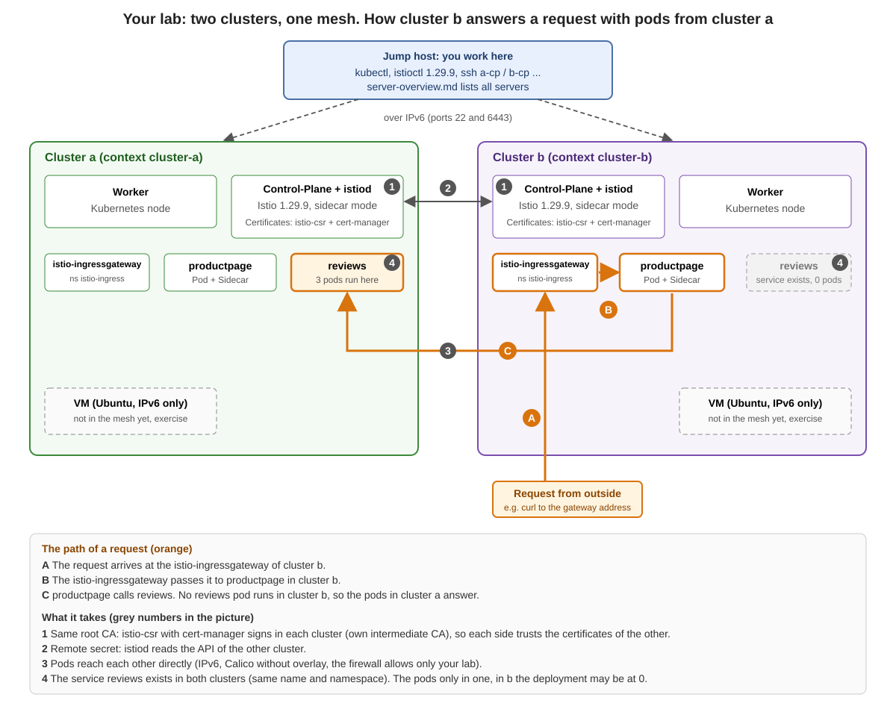

# Connect cluster a and cluster b to one mesh (multi-primary)



## What we do

Your lab has two clusters. Each one has its own `istiod` (multi-primary), and Bookinfo runs in both. Right now they are **two separate meshes**. In this exercise you connect them: every `istiod` gets read access to the API server of the other cluster. Afterwards a sidecar in cluster a knows the pods of cluster b, and the other way round.

Three things must be in place before two clusters can become one mesh. In your lab they are prepared:

| Requirement | In our lab |
|---|---|
| The same root certificate in both clusters | one common root, one intermediate CA per cluster (see [cert-manager with istio-csr](../fundamentals/08-certificates-with-cert-manager-and-istio-csr.md)) |
| The pods of both clusters reach each other directly | routed IPv6 network, no overlay, the same Istio `network` (`net1`). No east-west gateway is needed |
| The same mesh ID, different cluster names | `cluster-a` and `cluster-b` |

What is missing is the fourth part, and that is your job: the **remote secrets**.

All commands run on your bastion host as your lab user.

```
export CTX_A=cluster-a
export CTX_B=cluster-b
```

## Step 1: Look at the state before

Each `istiod` knows only its own cluster:

```
istioctl --context $CTX_A remote-clusters
istioctl --context $CTX_B remote-clusters
```

```
NAME          SECRET     STATUS     ISTIOD
cluster-a                synced     istiod-66dbd576c8-mrtbz
NAME          SECRET     STATUS     ISTIOD
cluster-b                synced     istiod-66c66c685f-p422m
```

The sidecar of `productpage` in cluster a knows three endpoints of `reviews`, all of them in cluster a:

```
istioctl --context $CTX_A proxy-config endpoints deploy/productpage-v1 --cluster "outbound|9080||reviews.default.svc.cluster.local"
```

```
ENDPOINT                            STATUS      OUTLIER CHECK     CLUSTER
2a01:4f8:c013:2b1d::1:e28b:9080     HEALTHY     OK                outbound|9080||reviews.default.svc.cluster.local
2a01:4f8:c013:2b1d::1:e28d:9080     HEALTHY     OK                outbound|9080||reviews.default.svc.cluster.local
2a01:4f8:c013:2b1d::1:e28e:9080     HEALTHY     OK                outbound|9080||reviews.default.svc.cluster.local
```

## Step 2: Check the common root certificate

```
for CTX in $CTX_A $CTX_B; do
  kubectl --context $CTX get cm istio-ca-root-cert -n default -o jsonpath='{.data.root-cert\.pem}' | openssl x509 -noout -subject -fingerprint -sha256
done
```

```
subject=O = Lab, CN = Lab Root CA tln2
sha256 Fingerprint=B6:F9:D8:41:C1:B7:5A:8E:E9:9E:CB:61:C3:72:AD:25:F7:29:8C:11:CD:B0:A3:8B:4F:2B:C7:AD:72:EC:8D:53
subject=O = Lab, CN = Lab Root CA tln2
sha256 Fingerprint=B6:F9:D8:41:C1:B7:5A:8E:E9:9E:CB:61:C3:72:AD:25:F7:29:8C:11:CD:B0:A3:8B:4F:2B:C7:AD:72:EC:8D:53
```

Both lines must show the same fingerprint (yours differs from the one above). If they differ, stop here: the sidecars of the two clusters would not trust each other, and connecting the clusters would break traffic.

## Step 3: Give cluster a access to cluster b

A remote secret for cluster b is created **in cluster b** and applied **in cluster a**:

```
istioctl --context $CTX_B create-remote-secret --name=cluster-b | kubectl --context $CTX_A apply -f -
```

```
secret/istio-remote-secret-cluster-b created
```

| Part | Meaning |
|---|---|
| `create-remote-secret` | creates a service account with read access in cluster b and prints a `Secret` that holds a small kubeconfig for it |
| `--name=cluster-b` | the cluster name of b, as it is set in its `istiod` |
| `kubectl --context $CTX_A apply` | puts the `Secret` into the namespace `istio-system` of cluster a. The `istiod` of cluster a watches for such secrets |

The secret contains a token. Do not print it and do not commit it.

After about 15 seconds:

```
istioctl --context $CTX_A remote-clusters
istioctl --context $CTX_B remote-clusters
```

```
NAME          SECRET                                         STATUS     ISTIOD
cluster-a                                                    synced     istiod-66dbd576c8-mrtbz
cluster-b     istio-system/istio-remote-secret-cluster-b     synced     istiod-66dbd576c8-mrtbz
NAME          SECRET     STATUS     ISTIOD
cluster-b                synced     istiod-66c66c685f-p422m
```

Cluster a sees cluster b. Cluster b does not see cluster a yet: **the link has a direction.** Look at the endpoints again, in both clusters:

```
istioctl --context $CTX_A proxy-config endpoints deploy/productpage-v1 --cluster "outbound|9080||reviews.default.svc.cluster.local"
```

```
ENDPOINT                            STATUS      OUTLIER CHECK     CLUSTER
2a01:4f8:c013:2b1d::1:e28b:9080     HEALTHY     OK                outbound|9080||reviews.default.svc.cluster.local
2a01:4f8:c013:2b1d::1:e28d:9080     HEALTHY     OK                outbound|9080||reviews.default.svc.cluster.local
2a01:4f8:c013:2b1d::1:e28e:9080     HEALTHY     OK                outbound|9080||reviews.default.svc.cluster.local
2a01:4f8:c015:c588::1:630c:9080     HEALTHY     OK                outbound|9080||reviews.default.svc.cluster.local
2a01:4f8:c015:c588::1:630d:9080     HEALTHY     OK                outbound|9080||reviews.default.svc.cluster.local
2a01:4f8:c015:c588::1:630f:9080     HEALTHY     OK                outbound|9080||reviews.default.svc.cluster.local
```

Six endpoints in cluster a: three from each cluster (two different `/64` networks). The same command with `--context $CTX_B` still shows three.

## Step 4: Give cluster b access to cluster a

The same in the other direction:

```
istioctl --context $CTX_A create-remote-secret --name=cluster-a | kubectl --context $CTX_B apply -f -
```

```
secret/istio-remote-secret-cluster-a created
```

After about 15 seconds:

```
istioctl --context $CTX_A remote-clusters
istioctl --context $CTX_B remote-clusters
```

```
NAME          SECRET                                         STATUS     ISTIOD
cluster-a                                                    synced     istiod-66dbd576c8-mrtbz
cluster-b     istio-system/istio-remote-secret-cluster-b     synced     istiod-66dbd576c8-mrtbz
NAME          SECRET                                         STATUS     ISTIOD
cluster-b                                                    synced     istiod-66c66c685f-p422m
cluster-a     istio-system/istio-remote-secret-cluster-a     synced     istiod-66c66c685f-p422m
```

Every cluster holds a secret for the **other** one, and all four lines say `synced`. Now the sidecar in cluster b knows six endpoints, too:

```
istioctl --context $CTX_B proxy-config endpoints deploy/productpage-v1 --cluster "outbound|9080||reviews.default.svc.cluster.local"
```

The two clusters are one mesh. Leave it like this: the next exercises need it.

## Why this matters for debugging

* **Nothing fails loudly.** With a missing remote secret there is no error. The other cluster is simply not there, and traffic stays local.
* **The link has a direction.** One secret is enough for one direction. If only one side answers with pods of the other cluster, look at `istioctl remote-clusters` in **both** clusters.
* **`istiod` needs the API server of the other cluster.** The address in the remote secret is the one from your kubeconfig. It must be reachable from the `istiod` pod.

Next: [Check the link between two clusters](01-check-the-link-between-clusters.md)
