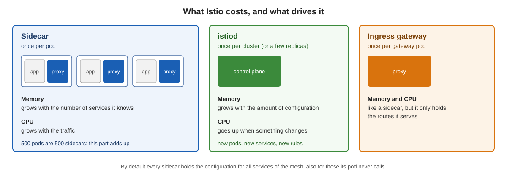
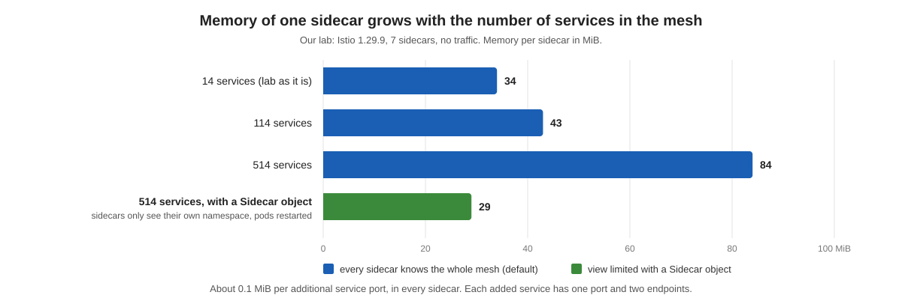
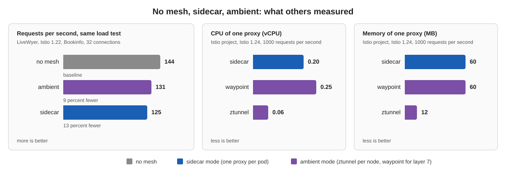

# What Istio costs: CPU and memory of the sidecars and of istiod

This page is theory. You measure it yourself in two exercises: [what Istio costs in the lab](01-prometheus-grafana-kiali.md) (step 4) and [many services and the Sidecar object](03-sidecar-memory-and-the-sidecar-object.md).

## The sidecar: memory follows the number of services

* A pod that calls two services still holds the configuration for all of them.
* **What counts is the port, not the service.** The sidecar holds one entry (Envoy calls it a cluster) per port of a service. In our lab one service with three ports added three entries. The services we added for the chart have one port and two endpoints each, so the 0.1 MiB are per service port. How much a second port of the same service costs in memory we did not measure.
* The `Sidecar` object limits what a sidecar sees. **You only see the effect after the pods are restarted.**

## The sidecar: CPU follows the traffic

| Situation | CPU of one sidecar | Source |
|---|---|---|
| no traffic | 3 to 4 millicores | our lab |
| 1000 requests per second | about 200 millicores (0.20 vCPU) | Istio project, Istio 1.24 |

The number of services made no difference to the CPU in our lab.

## istiod: it costs when something changes

In our lab `istiod` stayed below 100 MiB with 514 services and 8 proxies. Its CPU went up only while services were created or pods restarted, and came back down.

## No mesh, sidecar, ambient

What you can take from it: a mesh costs some throughput, and ambient costs less than sidecars, because one ztunnel per node replaces one proxy per pod.

**Read these numbers with care:**

* They are from Istio 1.22 and 1.24. Ambient was still beta in 1.22.
* In the load test the application was the bottleneck, and the result without a mesh moved by about 10 percent between runs.
* Other hardware gives other values. Measure on your own platform.

## The knobs

| You want to | Use |
|---|---|
| reserve and cap CPU and memory of the sidecars | Helm `global.proxy.resources`, per pod the annotations `sidecar.istio.io/proxyCPU`, `proxyMemory`, `proxyCPULimit`, `proxyMemoryLimit` |
| make the sidecars hold less configuration | object `Sidecar` with `egress.hosts` |
| make `istiod` ignore whole namespaces | `discoverySelectors` in the mesh configuration |
| reserve CPU and memory for `istiod` | Helm values of the chart `istiod` |

The number of worker threads of the proxy (`concurrency`) is a knob, too. The Istio reference says: "If unset, which is recommended, this will be automatically determined based on CPU requests/limits."

## Sources

* Istio documentation, [Performance and Scalability](https://istio.io/v1.29/docs/ops/deployment/performance-and-scalability/): numbers per proxy (measured with Istio 1.24, bare metal, 1 KB payload, 2 worker threads, mTLS on), and: "The memory consumption of the proxy depends on the total configuration state the proxy holds." For large meshes: "At large scale, configuration scoping is highly recommended."
* Istio documentation, [Sidecar reference](https://istio.io/v1.29/docs/reference/config/networking/sidecar/): "By default, Istio will program all sidecar proxies in the mesh with the necessary configuration required to reach every workload instance in the mesh".
* LiveWyer, [test report Istio Ambient vs Istio Sidecar](https://github.com/livewyer-ops/poc-servicemesh2024/blob/main/docs/test-report-istio.md) ([blog article](https://livewyer.io/blog/2024/06/06/comparison-of-service-meshes-part-two/)): Bookinfo on AWS, Istio 1.22, 300000 requests with 32 connections from a pod to `productpage`. Over all load levels the sidecar cluster served 13 to 25 percent fewer requests per second than the cluster without a mesh, the ambient cluster 9 to 22 percent fewer.
* Our lab: Istio 1.29.9, 7 sidecars, no traffic, cloud servers with 2 vCPU and 4 GB.

Next: [Prometheus, Grafana, Kiali, and what Istio costs](01-prometheus-grafana-kiali.md)
