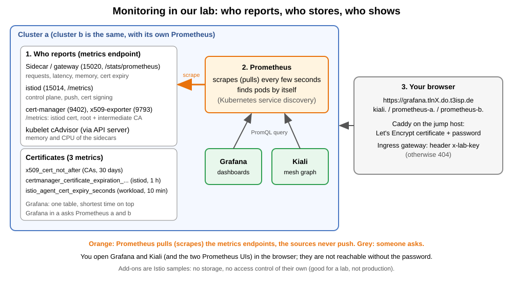

# Monitoring: Prometheus, Grafana, Kiali, and what Istio costs



## What we do

The three sample add-ons of Istio are already installed in your lab. You ask Prometheus four questions: who talks to whom, how fast, and how much memory and CPU the sidecars and `istiod` use. Measured in our lab (Istio 1.29.9, IPv6 only).

The add-ons are the samples from the Istio repository. They are good for a lab and not meant for production (no storage, no access control).

All commands run on your bastion host as your lab user, in cluster a.

## Step 1: Check the add-ons

Prometheus (both clusters), Grafana and Kiali (cluster a) are already installed in your lab. Nothing to install. The addresses and the password for your browser are in `~/monitoring-access.md`.

```
kubectl -n istio-system get pods
```

You should see `grafana`, `kiali` and `prometheus` with `Running`.

**IPv6 only:** one image of the Prometheus sample comes from `ghcr.io`, and this registry has no IPv6 address. The pod would stay in `ImagePullBackOff`. The lab uses the same image from `quay.io`.

## Step 2: Create some traffic

```
kubectl create deploy client --image=curlimages/curl:8.11.1 --dry-run=client -o yaml -- sleep infinity | kubectl apply -f -
kubectl rollout status deploy/client
kubectl exec deploy/client -c curl -- sh -c 'for i in $(seq 1 100); do curl -s -o /dev/null http://productpage:9080/productpage; done; echo done'
```

(If the deployment `client` already exists, keep it.) Wait about 20 seconds, Prometheus collects the numbers at intervals.

## Step 3: Ask Prometheus

Every sidecar counts its requests. Prometheus collects the numbers from all sidecars. We ask it from a test pod, with a small helper that prints one line per result. First the pod:

```
kubectl -n istio-system get deploy curl > /dev/null 2>&1 || kubectl -n istio-system create deploy curl --image=curlimages/curl:8.11.1 -- sleep infinity
kubectl -n istio-system rollout status deploy/curl
```

This pod is in `istio-system` on purpose and has no sidecar. A pod with a sidecar (like `client`) would send the call to `prometheus` to the Prometheus of **both** clusters, one after the other, because the two clusters are one mesh: you would see the numbers of cluster a and of cluster b in turn.

Then the helper:

```
Q() { kubectl -n istio-system exec deploy/curl -- curl -s -G "http://prometheus:9090/api/v1/query" --data-urlencode "query=$1" | jq -r '.data.result[] | [(.metric | to_entries | map(.value) | join(" ")), .value[1]] | @tsv'; }
```

**Who talks to whom, and with which result?**

```
Q 'sum by (source_workload, destination_workload, response_code) (istio_requests_total{reporter="source"})'
```

```
productpage-v1 200 istio-ingressgateway	1
details-v1 200 productpage-v1	131
reviews-v1 200 productpage-v1	43
reviews-v2 200 productpage-v1	42
reviews-v3 200 productpage-v1	46
ratings-v1 200 reviews-v2	42
ratings-v1 200 reviews-v3	46
productpage-v1 200 client	130
```

Read a line as: destination, response code, source, number of requests. This is the call graph of Bookinfo, taken from the sidecars. The application was not changed for it. `reviews-v1` does not call `ratings`, and you see that here.

**How many requests per second does a workload get?**

```
Q 'round(sum by (destination_workload) (rate(istio_requests_total{reporter="destination"}[5m])), 0.01)'
```

```
productpage-v1	0.45
ratings-v1	0.24
reviews-v2	0.12
reviews-v1	0.16
details-v1	0.43
reviews-v3	0.15
```

**How long does a request take (95 percent are faster than this, in milliseconds)?**

```
Q 'round(histogram_quantile(0.95, sum by (le, destination_workload) (rate(istio_request_duration_milliseconds_bucket{reporter="destination"}[5m]))), 0.1)'
```

```
productpage-v1	56.2
ratings-v1	4.7
reviews-v1	13
reviews-v2	24.6
details-v1	4.8
reviews-v3	27.5
```

## Step 4: What Istio costs

**Memory of every sidecar, in MiB:**

```
Q 'round(sum by (pod) (container_memory_working_set_bytes{container="istio-proxy", namespace="default"}) / 1024 / 1024, 0.1)'
```

```
productpage-v1-7f885b46fc-nmwps	39.2
client-7b7df66fb8-svxkd	34.6
ratings-v1-77b8b6df5b-zph29	35.1
reviews-v3-7b775c7568-h9q2w	34.7
details-v1-6cc9f5cc44-6qf76	35.1
reviews-v1-fdbf79cd8-9zv55	34.1
reviews-v2-674c6d8b4-rcfxg	34.4
```

**CPU of every sidecar, in millicores:**

```
Q 'round(sum by (pod) (rate(container_cpu_usage_seconds_total{container="istio-proxy", namespace="default"}[5m])) * 1000, 0.1)'
```

```
productpage-v1-7f885b46fc-nmwps	1
client-7b7df66fb8-svxkd	1.3
ratings-v1-77b8b6df5b-zph29	1.2
reviews-v3-7b775c7568-h9q2w	0.7
details-v1-6cc9f5cc44-6qf76	1.1
reviews-v1-fdbf79cd8-9zv55	0.9
reviews-v2-674c6d8b4-rcfxg	1
```

**The control plane** (the container of `istiod` is called `discovery`), memory in MiB and CPU in millicores:

```
Q 'round(sum by (pod) (container_memory_working_set_bytes{container="discovery"}) / 1024 / 1024, 0.1)'
Q 'round(sum by (pod) (rate(container_cpu_usage_seconds_total{container="discovery"}[5m])) * 1000, 0.1)'
```

```
istiod-66dbd576c8-k4456	56.2
istiod-66dbd576c8-k4456	0.8
```

In our lab: about 35 MiB and 1 millicore per sidecar, and 56 MiB for `istiod`, with seven proxies and almost no traffic. **These are lab numbers.** From our experience (not measured here): the memory of a sidecar grows with the number of services it knows, the CPU grows with the traffic. Measure in your own environment with the same two queries.

## Step 5: The pictures (Grafana, Kiali)

Grafana and Kiali show the same numbers as dashboards and as a graph of the mesh. Both are web pages inside the cluster. Both answer:

```
kubectl exec deploy/client -c curl -- curl -s -o /dev/null -w "kiali HTTP %{http_code}\n" http://kiali.istio-system:20001/kiali/
kubectl exec deploy/client -c curl -- curl -s -o /dev/null -w "grafana HTTP %{http_code}\n" http://grafana.istio-system:3000/
```

```
kiali HTTP 200
grafana HTTP 200
```

## Clean up

Leave the add-ons installed for the next exercises. To remove them:

```
kubectl delete -f $ADDONS/kiali.yaml -f $ADDONS/grafana.yaml -f $ADDONS/prometheus.yaml
```

Next: [Make the expiry of certificates visible](02-certificate-expiry.md)
