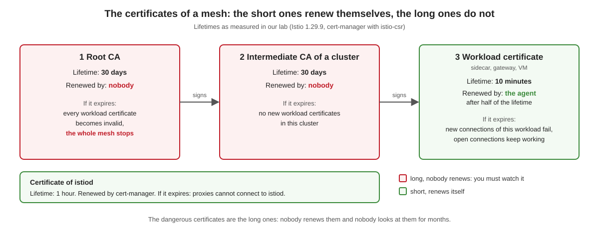

# Make the expiry of certificates visible



## What we do

A mesh has several certificates with very different lifetimes. You look at each of them and learn which one you must watch. Measured in our lab (Istio 1.29.9, cert-manager with istio-csr).

| Certificate | Lifetime in our lab | Renewed by | What happens when it expires |
|---|---|---|---|
| root CA | 30 days | **nobody** | every workload certificate becomes invalid: the whole mesh stops |
| intermediate CA of a cluster | 30 days | **nobody** | no new workload certificates in this cluster |
| certificate of `istiod` | 1 hour | cert-manager | proxies cannot connect to `istiod` |
| workload certificate (sidecar, gateway, VM) | 10 minutes (1 hour is the default of istio-csr) | the agent in the sidecar, after half of the lifetime | new connections of this workload fail, connections that are open keep working |

In our lab nobody renews the two CAs, because the setup creates them once. In production, with cert-manager the intermediate CA can be a `Certificate` with `isCA: true` and then renews itself; the root CA you always replace by hand, with a time where the old and the new root are both trusted.

The last column is what follows from the chain of trust. We did not let a root or an intermediate CA expire in our lab; for workload certificates of pods and of a VM we measured it.

The short ones renew themselves. The dangerous ones are the long ones, because nobody renews them and nobody looks at them for months.

All commands run on your bastion host as your lab user, in cluster a. Prometheus and Grafana are part of the lab, you do not install anything. This page does not need any other exercise.

## Step 0: Prepare

You ask Prometheus from a small test pod (`client`) inside the mesh. Create it, if it does not exist yet, and wait until it runs:

```
kubectl get deploy client > /dev/null 2>&1 || kubectl create deploy client --image=curlimages/curl:8.11.1 -- sleep infinity
kubectl rollout status deploy/client
```

Then define a small helper `Q` in your shell. It sends a query to Prometheus and prints one line per result: first the labels, then the value. If you open a new shell, define it again:

```
Q() { kubectl exec deploy/client -c curl -- curl -s -G "http://prometheus.istio-system:9090/api/v1/query" --data-urlencode "query=$1" | jq -r '.data.result[] | [(.metric | to_entries | map(.value) | join(" ")), .value[1]] | @tsv'; }
```

Test it. Every sidecar reports how long its certificate is still valid, so you get one line per proxy:

```
Q 'count(istio_agent_cert_expiry_seconds)'
```

You see one number, the count of proxies with a certificate in cluster a (11 in our lab, it depends on what runs in your cluster). If the answer is empty, run the command again: the first call after the start of the pod can fail.

## Step 1: The whole chain of one workload

```
istioctl proxy-config secret deploy/productpage-v1
```

```
RESOURCE NAME     TYPE           STATUS     VALID CERT     SERIAL NUMBER                                NOT AFTER                NOT BEFORE
default           Cert Chain     ACTIVE     true           3c86c8408d15841d9f5fa1ab6a843ff50774d4de     2026-11-14T10:17:45Z     2026-11-14T10:07:45Z
ROOTCA            CA             ACTIVE     true           622ad438aac119a3c725647160f33603ba53e4f7     2026-12-14T09:31:53Z     2026-11-14T09:31:53Z
```

`default` is the workload certificate (ten minutes), `ROOTCA` is the root (30 days in our lab). The intermediate CA is missing in this table. It is in the chain that the sidecar presents:

```
istioctl proxy-config secret deploy/productpage-v1 -o json | jq -r ".dynamicActiveSecrets[0].secret.tlsCertificate.certificateChain.inlineBytes" | base64 -d > chain.pem
while openssl x509 -noout -subject -enddate; do :; done < chain.pem 2>/dev/null
rm chain.pem
```

```
subject=O = 
notAfter=Nov 14 10:17:45 2026 GMT
subject=O = Lab, CN = Intermediate CA tln2 a
notAfter=Dec 14 09:31:54 2026 GMT
subject=O = Lab, CN = Lab Root CA tln2
notAfter=Dec 14 09:31:53 2026 GMT
```

Three certificates: workload, intermediate CA, root.

## Step 2: The root certificate

It is in a ConfigMap in every namespace:

```
kubectl get cm istio-ca-root-cert -o jsonpath="{.data.root-cert\.pem}" | openssl x509 -noout -subject -enddate
```

```
subject=O = Lab, CN = Lab Root CA tln2
notAfter=Dec 14 09:31:53 2026 GMT
```

## Step 3: The certificate of istiod

cert-manager manages it as a `Certificate` object and knows when it will renew it:

```
kubectl -n istio-system get certificate istiod -o jsonpath="{.status.notAfter} renew at {.status.renewalTime}{'\n'}"
```

```
2026-11-13T16:43:05Z renew at 2026-11-13T16:13:05Z
```

cert-manager also tells Prometheus (helper `Q` from step 0). Seconds until the certificate expires:

```
Q 'certmanager_certificate_expiration_timestamp_seconds - time()'
```

The answer has one line, for the `Certificate` `istiod`, with the value `2551.9` in our lab (about 42 minutes). This metric only knows `Certificate` objects. Workload certificates are not `Certificate` objects, so they are not in it, and neither are the root and the intermediate CA.

## Step 4: A VM

On a VM the certificate is a file:

```
ssh a-vm1 "openssl x509 -noout -enddate -in /etc/certs/cert-chain.pem"
```

If the time shown is in the past, the VM cannot open new connections in the mesh. For a pod, `istioctl proxy-config secret` shows `false` in the column `VALID CERT`. See [Outage: what happens to the VM](../virtual-machines/03-outage-what-happens-to-the-vm.md).

## Step 5: The certificate of every proxy in one command

`istioctl proxy-status` lists every proxy that is connected to `istiod`: pods with a sidecar, the gateways, and the VM. This loop asks each of them for its workload certificate and prints when it expires:

```
for p in $(istioctl proxy-status | awk 'NR>1{print $1}'); do echo "$p  $(istioctl proxy-config secret $p -o json 2>/dev/null | jq -r '.dynamicActiveSecrets[]|select(.name=="default")|.secret.tlsCertificate.certificateChain.inlineBytes' | base64 -d | openssl x509 -noout -enddate 2>/dev/null | cut -d= -f2)"; done
```

```
client-7b7df66fb8-v6kkw.default  Nov 17 15:07:08 2026 GMT
details-v1-6cc9f5cc44-nl5vq.default  Nov 17 15:05:23 2026 GMT
istio-ingressgateway-5dc49cc6bf-4jcdm.istio-ingress  Nov 17 15:06:54 2026 GMT
productpage-v1-7f885b46fc-kdtg8.default  Nov 17 15:09:03 2026 GMT
reviews-v1-fdbf79cd8-n7r8k.default  Nov 17 15:07:44 2026 GMT
...
v6-tln1-a-vm1.vm
```

Every workload certificate runs out within the next ten minutes, and each one is renewed by its agent before that. This is what you expect. A proxy whose date is in the past is a proxy that did not renew.

The line of the VM stays empty: `istioctl proxy-config secret` cannot read it. Read the file on the VM as in step 4.

The loop only sees the proxies of the cluster you are in. For cluster b, write `istioctl --context cluster-b` in both places.

## Step 6: All certificates at a glance in Grafana

### Open Grafana

Address, user and password are in a file on your bastion host. Show it there:

```
cat ~/monitoring-access.md
```

In the table you find the address of Grafana, it looks like `https://grafana.<your lab user>.do.t3isp.de` (for the lab user `tln5`: `https://grafana.tln5.do.t3isp.de`). Below the table is the login: the user is your lab user, and the line `password:` holds your personal password. If you only want that line:

```
grep password ~/monitoring-access.md
```

Open the address in the browser of your laptop. The browser asks for the user and the password of this file (a login window of the browser, this is the first protection in front of all monitoring pages). Grafana itself opens without a second login. The password is made for each lab, it is not the password of the bastion host.

If the browser shows a certificate warning or does not load the page, check that you typed the address without a dot at the end and with `https://`.

Then choose **Dashboards** in the menu on the left, open the folder **lab**, and open the dashboard **Lab: certificates and when they expire**.

It has one table for cluster a and one for cluster b. Every row is one certificate, the one that expires first is on top:

| Kind | Certificate | Where the number comes from |
|---|---|---|
| CA, nobody renews it | root CA and intermediate CA of the cluster | `x509_cert_not_after` (a small exporter reads the secret `istio-ca`) |
| istiod, renewed by cert-manager | `istiod` | `certmanager_certificate_expiration_timestamp_seconds` |
| workload, renewed by its agent | one row per pod with a sidecar, and the ingress gateway | `istio_agent_cert_expiry_seconds` (every sidecar reports it) |

The column **Expires in** is green with more than five minutes left, orange with less, and red when the certificate has expired. The workload rows move between ten and five minutes all the time: the agent renews after half of the lifetime. Below the tables you see this as a saw.

Now stop the component that signs the workload certificates in cluster a, and watch the table of cluster a:

```
kubectl -n cert-manager scale deploy cert-manager-istio-csr --replicas=0
```

Measured in our lab (seven workload certificates in cluster a):

| Time after the stop | Table of cluster a |
|---|---|
| 1 minute | shortest time left 246 seconds, nothing is red |
| 5 minutes | the first workload certificate has expired (red) |
| 10 minutes | all workload certificates have expired |
| 14 minutes | the table counts on below zero (minus 548 seconds) |

The rows of the CAs and of `istiod` stay green, and so does the whole table of cluster b: each cluster has its own istio-csr. Start it again:

```
kubectl -n cert-manager scale deploy cert-manager-istio-csr --replicas=1
```

One minute later every workload row is green again (565 seconds left in our lab). The agents ask again by themselves, you do not restart any pod.

## Step 7: Put the VM into the table

The VM is not in the table yet: Prometheus collects from pods, and the VM is not a pod. The Istio agent on the VM reports the same metric as every sidecar, `istio_agent_cert_expiry_seconds`, on port 15020. You only have to tell Prometheus where to look. This needs the VM to be in the mesh (exercise [A VM joins the mesh](../virtual-machines/01-add-a-vm-to-the-mesh.md)).

First check that the VM answers (the agent listens on all addresses, and your clusters reach the VM over IPv6):

```
VM=v6-$(whoami)-a-vm1.do.t3isp.de
kubectl exec deploy/client -c curl -- curl -s -m 5 "http://$VM:15020/metrics" | grep ^istio_agent_cert_expiry_seconds
```

```
istio_agent_cert_expiry_seconds{resource_name="default"} 578.7
```

Now add a job to the Prometheus of cluster a. The configuration of this Prometheus is in the ConfigMap `prometheus` (it is the sample of Istio, not the Prometheus Operator). The commands read the configuration, add the job `vm-agents` with the address of your VM at the end, and write it back. `scrape_configs` is the last part of this file, so a job at the end belongs to it. The label `pod` is what the table shows as the name. The `grep` makes sure the job is added only once, if you run it again:

```
kubectl -n istio-system get cm prometheus -o jsonpath='{.data.prometheus\.yml}' > /tmp/prometheus.yml
grep -q "job_name: vm-agents" /tmp/prometheus.yml || cat >> /tmp/prometheus.yml <<YAML
- job_name: vm-agents
  static_configs:
  - targets:
    - v6-$(whoami)-a-vm1.do.t3isp.de:15020
    labels:
      pod: a-vm1
YAML
jq -Rs '{data: {"prometheus.yml": .}}' /tmp/prometheus.yml > /tmp/prom-patch.json
kubectl -n istio-system patch cm prometheus --type merge --patch-file /tmp/prom-patch.json
rm /tmp/prometheus.yml /tmp/prom-patch.json
```

```
configmap/prometheus patched
```

`jq -Rs` reads the whole file as one text and wraps it into the JSON that `kubectl patch` needs. The other entries of the ConfigMap stay as they are.

With the Prometheus Operator you would not edit a ConfigMap. You would create a `ScrapeConfig` with the same address and label.

Prometheus reloads its configuration by itself, after at most a minute. Check the target:

```
Q 'up{job="vm-agents"}'
```

```
up v6-tln12-a-vm1.do.t3isp.de:15020 vm-agents a-vm1	1
```

`1` means Prometheus collects from the VM. Reload the dashboard: a row `a-vm1` is in the table of cluster a, and a line `a-vm1` in the saw below it, between about 600 and 300 seconds like every workload. We measured this in our lab (one VM in cluster a, after one minute `up` was `1`).

If the VM stops renewing (see [Outage: what happens to the VM](../virtual-machines/03-outage-what-happens-to-the-vm.md)), its row falls and turns red like the row of a pod. For a VM in cluster b you do the same in the Prometheus of cluster b.

The agent reports what the VM holds in its own file. You can still read the file itself (step 4) when Prometheus does not answer.

## What to watch, and how

| What | How we looked at it | Idea for an alert |
|---|---|---|
| root and intermediate CA | `openssl x509 -enddate` on the ConfigMap and on the chain | a job that reads the date and warns weeks ahead |
| certificate of `istiod` | `certmanager_certificate_expiration_timestamp_seconds` | less than half of the lifetime left: the renewal is late |
| workload certificates | `istioctl proxy-config secret`, on a VM the file | a workload is missing in `istioctl proxy-status` |

**A trap:** Envoy has a metric `envoy_server_days_until_first_cert_expiring`. It counts whole days. With certificates that live one hour it always showed `0` in our lab (and ten minutes are less than a day, too), so it is useless for an alert here.

The alerts in the last column are ideas, not tested rules. The three metrics of step 6 are the numbers such rules would use: an alert is the same question as the table, with a limit.

Previous: [Monitoring: Prometheus, Grafana, Kiali](01-prometheus-grafana-kiali.md)
Next: [Memory of the sidecars: many services, and the Sidecar object](03-sidecar-memory-and-the-sidecar-object.md)
