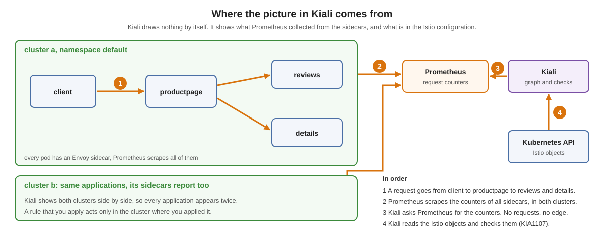
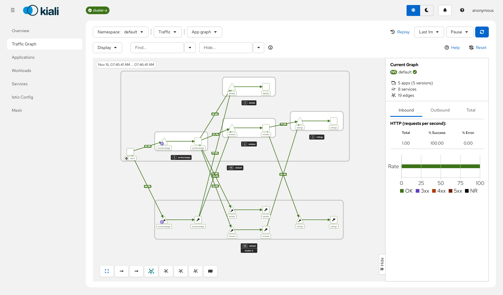
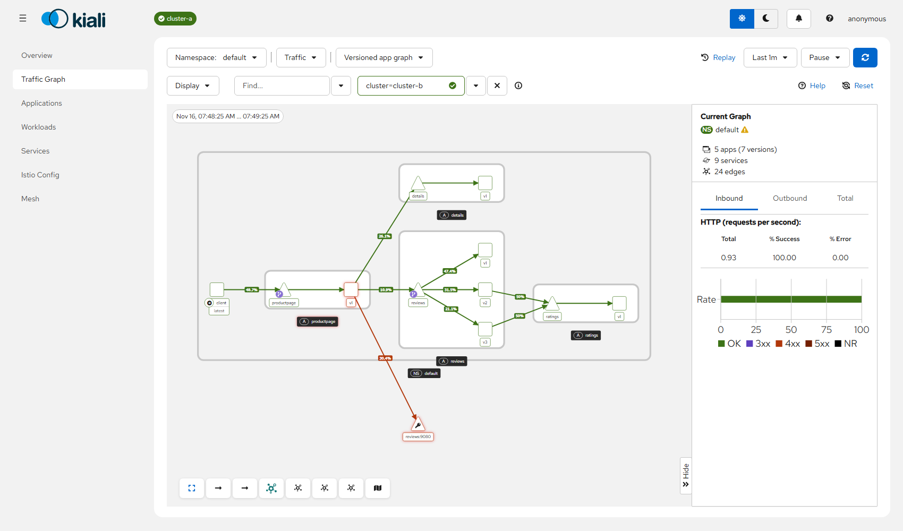
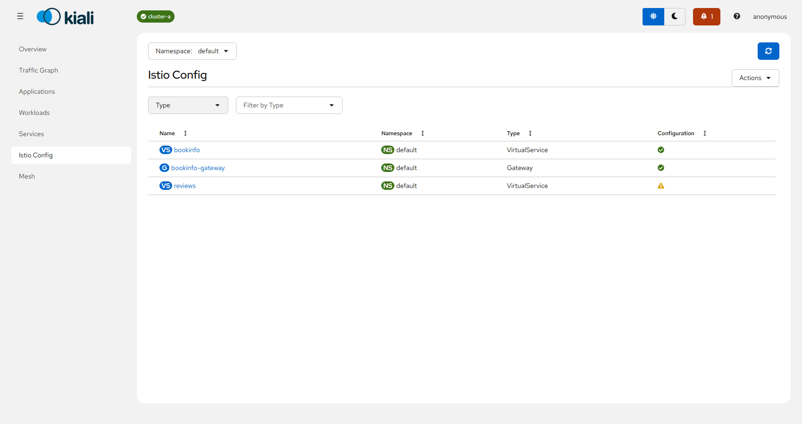
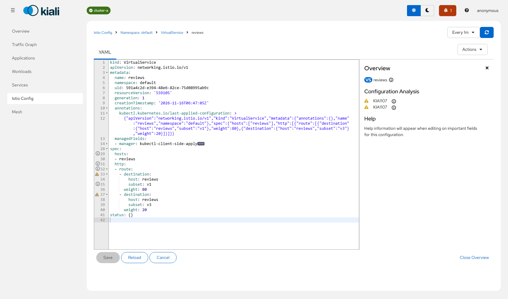

# Kiali in practice: read the graph, find a broken rule



## What we do

Kiali is installed in your lab, and many teams do not know what to do with it. In this exercise you use it for three jobs that it does well:

1. **Who calls whom?** Read the traffic graph of a namespace.
2. **Where does it fail?** Break a rule on purpose and find it in Kiali, first in the graph, then in the Istio Config.
3. **When can you trust the picture?** See what the graph shows when there is no traffic, and what it does not show.

Measured in our lab (Istio 1.29.9, Kiali v2.21.0, Bookinfo in the namespace `default`, both clusters connected). Kiali runs in cluster a and reads the metrics of Prometheus. It shows **only what the sidecars reported**. It does not read your mind: no traffic in the time window means no edge in the graph.

The commands run on your bastion host as your lab user, in cluster a. Kiali runs in your browser. The address and the password are in `~/monitoring-access.md`.

## Step 1: Create steady traffic

Kiali needs requests to draw edges. Open a **second terminal** on the bastion host and let it run for 15 minutes (900 calls, one per second, then it stops by itself):

```
kubectl create deploy client --image=curlimages/curl:8.11.1 --dry-run=client -o yaml -- sleep infinity | kubectl apply -f -
kubectl rollout status deploy/client
kubectl exec deploy/client -c curl -- sh -c 'for i in $(seq 1 900); do curl -s -o /dev/null http://productpage:9080/productpage; sleep 1; done'
```

(If the deployment `client` already exists, keep it.) Use the first terminal for the next steps.

## Step 2: Read the graph

Open the address of Kiali from `~/monitoring-access.md`. In the menu on the left choose **Traffic Graph**. Then set:

- Namespace: `default`
- Graph type: **App graph**
- Time range (top right): **Last 1m**

You can also open it directly. Replace `<your kiali address>` with the address of Kiali from the file:

```
https://<your kiali address>/kiali/console/graph/namespaces?namespaces=default&graphType=app&boxes=cluster&duration=60&edges=trafficDistribution
```

You see this (the traffic of the last minute, no rules yet):



Read it from left to right:

- **client** (left) calls **productpage**. Arrows show the direction of the calls.
- **productpage** calls **details** and **reviews**, **reviews** calls **ratings**.
- The **numbers on the arrows** are the share of the requests that a caller sends to this target (here: `edges=trafficDistribution`, the edge label "Traffic distribution" in the Display menu).
- Triangle = service, square = workload (the pods).
- **Green** = all requests succeeded. Orange or red = errors (see step 4).
- The two big boxes are the **two clusters**. Both clusters run Bookinfo and the mesh load-balances across them, so every application appears **twice**: once in the cluster of Kiali and once in the other cluster. A call that crosses from one box to the other went from cluster a to cluster b.

Click on an edge or a node. The panel on the right shows the requests per second and the share of success and error.

**Questions for your team (5 minutes):**

1. Which service in your graph is called by the most other services?
2. Does one of your calls cross the cluster border?
3. What would you not see in this picture, even if it was there? (Think: a pod without a sidecar, a call that is not HTTP.)

## Step 3: Break a rule on purpose

Somebody wants to send 80 percent of the calls to `reviews` to version 1 and 20 percent to version 3. They apply the `VirtualService` and **forget the `DestinationRule`** that defines the subsets. Create the file `01-virtualservice-reviews-80-20.yml`:

```
cat <<'EOF' > 01-virtualservice-reviews-80-20.yml
apiVersion: networking.istio.io/v1
kind: VirtualService
metadata:
  name: reviews
spec:
  hosts:
    - reviews
  http:
    - route:
        - destination:
            host: reviews
            subset: v1
          weight: 80
        - destination:
            host: reviews
            subset: v3
          weight: 20
EOF
```

```
kubectl apply -f 01-virtualservice-reviews-80-20.yml
```

The pods are all healthy. The calls are not:

```
kubectl exec deploy/client -c curl -- sh -c 'for i in $(seq 1 20); do curl -s -o /dev/null -w "%{http_code}\n" http://reviews:9080/reviews/0; done' | sort | uniq -c
```

```
     20 503
```

Wait about one minute (Kiali shows the last minute), then reload the graph:



What Kiali shows:

- A **red edge** from `productpage` to a triangle named **`reviews:9080`**, and a red `productpage`. The target has no pods behind it: the sidecar of the caller had no cluster for the subset and answered `503` itself, so the request never reached a workload. A service node without a workload under it is a hint for exactly this.
- The warning triangle at the namespace `default` in the right panel.
- **Not everything is red.** The rule exists only in cluster a. The `productpage` of cluster b has no rule and still reaches the `reviews` pods. Kiali shows both, side by side. This is the same picture as in the trainer demo: **a rule acts only in the cluster where you applied it.**

To see only cluster a, type `cluster=cluster-b` into the **Hide** field above the graph.

## Step 4: Ask Kiali what is wrong

In the menu on the left choose **Istio Config** and the namespace `default`. The column "Configuration" shows a check mark for what is fine and a warning for what is not:



Click on `reviews`. Kiali opens the YAML. The warning triangles are at the two `destination` lines, and the panel on the right lists the checks:



The check is `KIA1107`, message **"Subset not found"**, at `spec/http[0]/route[0]/destination` and `spec/http[0]/route[1]/destination`.

`istioctl analyze` finds the same fault with another code (`IST0101`, see the trainer demo). Kiali is the same check as a picture, with the position in the YAML.

## Step 5: Repair and check

Create the file `02-destinationrule-reviews.yml`:

```
cat <<'EOF' > 02-destinationrule-reviews.yml
apiVersion: networking.istio.io/v1
kind: DestinationRule
metadata:
  name: reviews
spec:
  host: reviews
  subsets:
    - name: v1
      labels:
        version: v1
    - name: v3
      labels:
        version: v3
EOF
```

```
kubectl apply -f 02-destinationrule-reviews.yml
kubectl exec deploy/client -c curl -- sh -c 'for i in $(seq 1 20); do curl -s -o /dev/null -w "%{http_code}\n" http://reviews:9080/reviews/0; done' | sort | uniq -c
```

```
     20 200
```

Kiali shows the last minute. After about a minute look at the graph and at **Istio Config** again.

## Step 6: When there is no traffic

The graph is built from the requests of the chosen time window. Look at it with the traffic of step 1 running, then again some minutes after it has ended (it stops by itself after 15 minutes). Switch the time range between **Last 1m** and **Last 10m**.

Discuss in your team: you open Kiali during an incident and the graph is empty or has fewer edges than you expected. What are the possible reasons? (No requests in the window, the sidecar of the caller is missing, the metrics of Prometheus are late.) Which of them can you check with `kubectl` and `istioctl proxy-status`?

## Where Kiali helps and where it misleads

| Kiali helps | Kiali misleads |
|---|---|
| Who calls whom, at a glance | A rule acts only in its own cluster, the picture mixes both clusters (step 3) |
| A red edge to a service without a workload: the request failed before it reached a pod | The percentages are shares of the **observed** requests, not the configured weights: with the rule 80/20 in cluster a, our graph showed 68.5 percent to `v1`, 21.1 to `v2` and 10.4 to `v3`, because the `productpage` of cluster b has no rule and sends to all three |
| Istio Config: a warning with the position in the YAML (`KIA1107`) | The graph holds only the time window (step 6) |

The first two rows of the right column we measured. The last one, the empty graph without traffic, is a question for your team in step 6, we did not measure it.

## Clean up

```
kubectl delete -f 01-virtualservice-reviews-80-20.yml -f 02-destinationrule-reviews.yml
```

Leave Kiali and the `client` pod for the next exercises.

Previous: [Memory of the sidecars: many services, and the Sidecar object](03-sidecar-memory-and-the-sidecar-object.md)
Next: [Latency: a pod without a sidecar and a pod with one](05-latency-with-and-without-a-sidecar.md)
