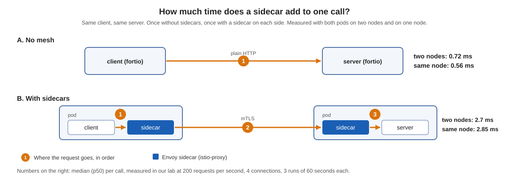

# Latency: a pod without a sidecar and a pod with one



Theory for this exercise: [What Istio costs](00-what-istio-costs.md).

## What we do

The same `fortio` client calls the same `fortio` server twice: once in a namespace without sidecars, once in a namespace where both pods get a sidecar. `fortio` sends 200 requests per second and tells you how long each call took.

1. Create two namespaces, only one of them with sidecar injection
2. Deploy a server and a client in each of them
3. Measure without sidecars
4. Measure with sidecars and compare

The client **also** has a sidecar in the second namespace. A call then passes two Envoys (the one of the client and the one of the server), and that is what a call between two pods in your mesh looks like.

## Before you start

* All commands run on your bastion host as your lab user, in cluster a.
* The images come from Docker Hub. This works in our lab.
* `fortio` resolves only IPv4 names by default. Our lab is IPv6 only, therefore the option `-resolve-ip-type ip6` below.

## The steps

### Step 1: Two namespaces

```
kubectl create namespace latency-plain
kubectl create namespace latency-mesh
kubectl label namespace latency-mesh istio-injection=enabled
```

```
namespace/latency-plain created
namespace/latency-mesh created
namespace/latency-mesh labeled
```

### Step 2: Server and client in both

One file, applied twice. The client is placed on the node of the server, so that no network between nodes is part of the measurement. The container of the client only sleeps in `fortio server` mode, we start the test from inside it.

```
cat > latency.yml <<'EOF'
apiVersion: apps/v1
kind: Deployment
metadata:
  name: server
spec:
  replicas: 1
  selector:
    matchLabels:
      app: server
  template:
    metadata:
      labels:
        app: server
    spec:
      containers:
      - name: fortio
        image: fortio/fortio:1.69.5
        args: ["server", "-http-port", "8080"]
        ports:
        - containerPort: 8080
---
apiVersion: v1
kind: Service
metadata:
  name: server
spec:
  selector:
    app: server
  ports:
  - name: http
    port: 8080
---
apiVersion: apps/v1
kind: Deployment
metadata:
  name: client
spec:
  replicas: 1
  selector:
    matchLabels:
      app: client
  template:
    metadata:
      labels:
        app: client
    spec:
      affinity:
        podAffinity:
          requiredDuringSchedulingIgnoredDuringExecution:
          - topologyKey: kubernetes.io/hostname
            labelSelector:
              matchLabels:
                app: server
      containers:
      - name: fortio
        image: fortio/fortio:1.69.5
        args: ["server", "-http-port", "8080"]
EOF
kubectl -n latency-plain apply -f latency.yml
kubectl -n latency-mesh apply -f latency.yml
```

```
deployment.apps/server created
service/server created
deployment.apps/client created
deployment.apps/server created
service/server created
deployment.apps/client created
```

Wait until all four pods run and look at the `READY` column:

```
kubectl -n latency-plain rollout status deploy/server
kubectl -n latency-plain rollout status deploy/client
kubectl -n latency-mesh rollout status deploy/server
kubectl -n latency-mesh rollout status deploy/client
kubectl -n latency-plain get pods
kubectl -n latency-mesh get pods
```

```
NAME                     READY   STATUS    RESTARTS   AGE
client-d67bfb987-56k8q   1/1     Running   0          7s
server-5dd466bd5-dc4jp   1/1     Running   0          7s
NAME                     READY   STATUS    RESTARTS   AGE
client-d67bfb987-bpgmg   2/2     Running   0          8s
server-5dd466bd5-qhm5w   2/2     Running   0          8s
```

`1/1` is the application only, `2/2` is the application and the sidecar. Give the pods 20 seconds to settle.

### Step 3: The measurement

A small helper. It runs `fortio` inside the client of the namespace you name: 200 requests per second, 4 connections, 30 seconds, and prints the average and the percentiles in milliseconds. Define it once per shell:

```
L() { kubectl -n $1 exec deploy/client -c fortio -- fortio load -resolve-ip-type ip6 -qps 200 -c 4 -t 30s -p 50,90,99,99.9 -json - -loglevel error http://server:8080/echo 2>/dev/null | jq -r '"calls \(.RetCodes["200"])   average \(.DurationHistogram.Avg*1000*100|round/100) ms", (.DurationHistogram.Percentiles[] | "p\(.Percentile)   \(.Value*1000*100|round/100) ms")'; }
```

Without sidecars:

```
L latency-plain
```

```
calls 6000   average 0.57 ms
p50   0.56 ms
p90   0.95 ms
p99   2.29 ms
p99.9   4.56 ms
```

With a sidecar on both sides:

```
L latency-mesh
```

```
calls 6000   average 3.07 ms
p50   2.92 ms
p90   3.99 ms
p99   6.64 ms
p99.9   10.19 ms
```

`p90` means: 90 percent of the calls were faster than this. Repeat each measurement two or three times: the values at the end of the list (`p99.9`) jump from run to run.

## What we measured in our lab

Three runs of 60 seconds each (200 requests per second, 4 connections, Istio 1.29.9, IPv6 only, client and server on the same node, mTLS between the sidecars), values in milliseconds:

| | no sidecars | sidecar on both sides |
|---|---|---|
| average | 0.56 to 0.66 | 3.1 to 3.2 |
| p50 (median) | 0.56 | 2.84 to 2.88 |
| p90 | 0.95 to 0.97 | 4.1 to 4.7 |
| p99 | 2.0 to 2.6 | 7.0 to 10.3 |
| p99.9 | 4.0 to 28 | 22 to 25 |

* A call between two pods with sidecars took **about 2.3 ms longer** at the median (0.56 ms against 2.85 ms) in our lab. That is the two Envoys and the mTLS between them, not the network: both pods were on one node.
* The slow calls get slower in absolute numbers (p99: about 2 ms against 7 to 10 ms).
* The server answers in a fraction of a millisecond. A real application that needs 20 ms to answer sees the same few milliseconds on top, but a much smaller share of its total time.
* This is one small test: one request size (the `echo` answer of `fortio`), idle node, CPU and memory of the sidecars were not measured here. Measure with your own services and your own request sizes.

## Clean up

```
kubectl delete namespace latency-plain latency-mesh
rm latency.yml
```

Previous: [Kiali in practice: read the graph, find a broken rule](04-kiali-in-practice.md)
