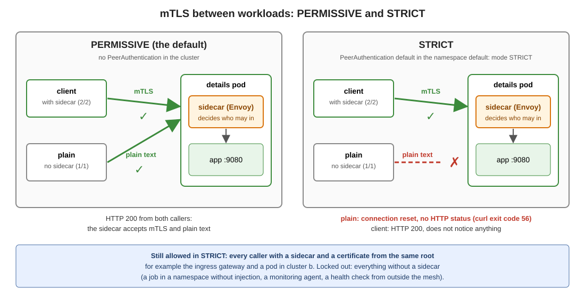
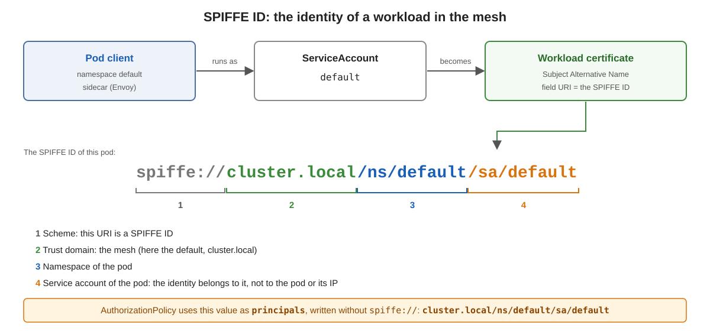

# mTLS between workloads: PERMISSIVE and STRICT



## What we do

Two sidecars talk mTLS to each other without any setting. But by default a workload also accepts plain text, from callers that have no sidecar (mode `PERMISSIVE`). In this exercise you see the difference, switch one namespace to `STRICT` and see who is locked out.

All commands run on your bastion host as your lab user, in cluster a.

> **Hint: What is a SPIFFE ID?** In mTLS the certificate carries the identity of the workload, not a DNS name. Istio calls it a SPIFFE ID, and it belongs to the service account of the pod.



## Step 1: Two callers

A caller **with** a sidecar (namespace `default`):

```
kubectl create deploy client --image=curlimages/curl:8.11.1 --dry-run=client -o yaml -- sleep infinity | kubectl apply -f -
kubectl rollout status deploy/client

kubectl --context cluster-b create deploy client --image=curlimages/curl:8.11.1 --dry-run=client -o yaml -- sleep infinity | kubectl --context cluster-b apply -f -
kubectl --context cluster-b rollout status deploy/client 
```

(If the deployment `client` already exists from another exercise, keep it.)

A caller **without** a sidecar, in a namespace that has no injection label:

```
kubectl create ns plain
kubectl -n plain create deploy plain --image=curlimages/curl:8.11.1 --dry-run=client -o yaml -- sleep infinity | kubectl -n plain apply -f -
kubectl -n plain rollout status deploy/plain
kubectl -n plain get pods
```

```
NAME                     READY   STATUS    RESTARTS   AGE
plain-55fd7db7d9-xbsx4   1/1     Running   0          2s
```

`1/1`: no sidecar.

## Step 2: The default is PERMISSIVE

There is no `PeerAuthentication` in the cluster:

```
kubectl get peerauthentication -A
```

```
No resources found
```

Both callers reach `details`:

```
kubectl -n plain exec deploy/plain -- curl -s -o /dev/null -m 5 -w "HTTP %{http_code}\n" http://details.default:9080/details/0
kubectl exec deploy/client -c curl -- curl -s -o /dev/null -m 5 -w "HTTP %{http_code}\n" http://details.default:9080/details/0
```

```
HTTP 200
HTTP 200
```

`istioctl` tells you the mode of a workload (last lines of the output):

```
istioctl x describe pod $(kubectl get pod -l app=details -o jsonpath="{.items[0].metadata.name}")
```

```
Effective PeerAuthentication:
   Workload mTLS mode: PERMISSIVE
```

## Step 3: Switch the namespace to STRICT

```
cd
mkdir -p manifests/perms/
cd manifests/perms/
```

```
nano peerauthentication-strict.yml
```

```
apiVersion: security.istio.io/v1
kind: PeerAuthentication
metadata:
  name: default
  namespace: default
spec:
  mtls:
    mode: STRICT
```

```
kubectl apply -f peerauthentication-strict.yml
```

The same two calls:

```
kubectl -n plain exec deploy/plain -- curl -s -o /dev/null -m 5 -w "HTTP %{http_code}\n" http://details.default:9080/details/0
kubectl exec deploy/client -c curl -- curl -s -o /dev/null -m 5 -w "HTTP %{http_code}\n" http://details.default:9080/details/0
```


```
HTTP 000
command terminated with exit code 56
HTTP 200
```

The caller without a sidecar is locked out: the connection is reset (`curl` exit code 56), there is no HTTP answer at all. The caller with a sidecar does not notice anything.

```
istioctl x describe pod $(kubectl get pod -l app=details -o jsonpath="{.items[0].metadata.name}")
```

```
Effective PeerAuthentication:
   Workload mTLS mode: STRICT
Applied PeerAuthentication:
   default.default
```

Two more callers still work, because both have a sidecar and a certificate from the same root: the ingress gateway and a pod in **cluster b**.

```
curl -6 -s -o /dev/null -m 8 -w "HTTP %{http_code}\n" "http://[$(kubectl -n istio-ingress get svc istio-ingressgateway -o jsonpath="{.status.loadBalancer.ingress[0].ip}")]/productpage"
kubectl --context cluster-b exec deploy/client -c curl -- curl -s -o /dev/null -m 5 -w "HTTP %{http_code}\n" http://details.default:9080/details/0
```

```
HTTP 200
HTTP 200
```

(The second command needs a `client` deployment in cluster b and connected clusters. Skip it if you do not have them yet.)

## Why this matters for debugging

* **`STRICT` fails without an HTTP status.** The caller sees a reset connection, not a `403` or `503`. In a log this looks like a network problem.
* **Who is locked out:** everything without a sidecar. Typical cases are a job in a namespace without injection, a monitoring agent, a health check from outside the mesh.
* **The scope is the namespace.** Our `PeerAuthentication` acts on the namespace `default` only. According to the Istio documentation the same object in the root namespace (`istio-system`) acts on the whole mesh (not tried in our lab).

## Clean up

```
kubectl delete -f peerauthentication-strict.yml
kubectl delete ns plain
```
