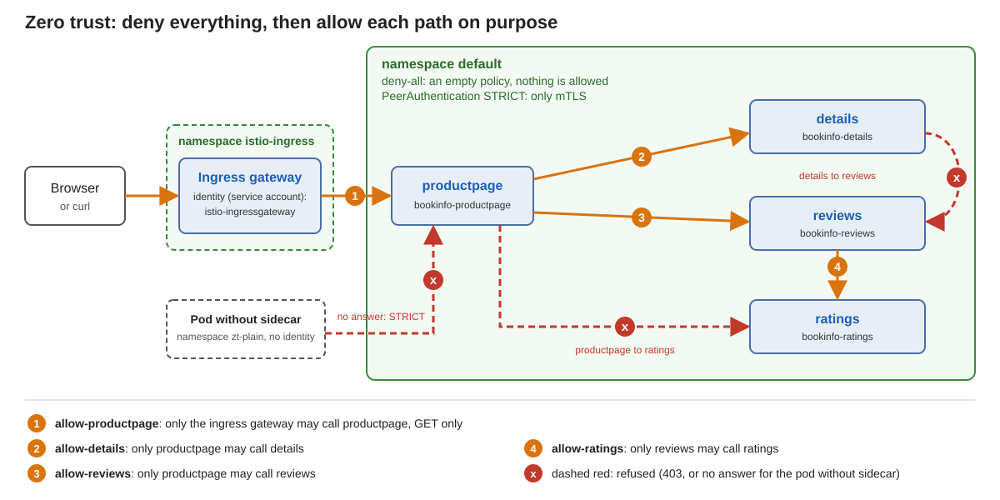

# Zero trust with Bookinfo: deny all, then allow each path



## What we do

mTLS (the previous exercise) tells every sidecar **who** is calling: each workload has an identity, its service account. It does not decide **what** the caller may do. That is the job of the `AuthorizationPolicy`.

Zero trust means: nothing is allowed by default. In this exercise you

1. make mTLS mandatory (`PeerAuthentication` with `STRICT`), so that every caller needs an identity,
2. lock the whole namespace `default` with one empty policy (`deny-all`), and see why this is not enough with two connected clusters,
3. read in the log of the sidecar **why** a request was refused,
4. allow exactly the four calls Bookinfo needs, one policy each (the numbers in the picture),
5. check that every other call is still refused,
6. add a `DENY` policy that refuses a call even where an `ALLOW` exists.

A caller is recognised by its **principal**: `cluster.local/ns/<namespace>/sa/<service account>`. It is part of the workload certificate; the sidecar writes it into its log as `uriSanPeerCertificate` (step 4).

All commands run on your bastion host as your lab user. Bookinfo is already deployed and published through the ingress gateway (exercise "Expose Bookinfo through the ingress gateway over IPv6"). In your lab the ingress gateway runs in the namespace `istio-ingress`, Bookinfo in `default`.

**Attention 1:** the policies in this exercise act on the whole namespace `default`. Everything else you run there is locked out until the clean up at the end.

**Attention 2:** Bookinfo runs in **both** clusters, and both clusters are one mesh. An `AuthorizationPolicy` is an object of **one** cluster. You will see what that means in step 3.

## Step 0: Prepare 

```
mkdir -p ~/zero-trust
cd ~/zero-trust
```

## Step 1: Callers and the starting point

The address of the gateway and a helper that prints only the HTTP status:

```
export GATEWAY=$(kubectl get svc istio-ingressgateway -n istio-ingress -o jsonpath='{.status.loadBalancer.ingress[0].ip}')
curl -6 -s -o /dev/null -w "HTTP %{http_code}\n" "http://[$GATEWAY]/productpage"

```

```
HTTP 200
```

Two more callers, one **with** a sidecar (namespace `default`) and one **without** (namespace `zt-plain`):

```
# Starting client in deploy (sidecar)
kubectl create deploy zt-client --image=curlimages/curl:8.11.1 --dry-run=client -o yaml -- sleep infinity | kubectl apply -f -

# Creating namespace for 2nd client->zt-plain
kubectl create ns zt-plain --dry-run=client -o yaml | kubectl apply -f -
# Creating the client plain 
kubectl -n zt-plain create deploy plain --image=curlimages/curl:8.11.1 --dry-run=client -o yaml -- sleep infinity | kubectl -n zt-plain apply -f -

# Waiting for rollout 
kubectl rollout status deploy/zt-client
kubectl -n zt-plain rollout status deploy/plain

```

(You can run this block again at any time.)

Both reach `productpage`. There is no policy yet:

```
# Checking connection to productpage within default
kubectl exec deploy/zt-client -c curl -- curl -s -o /dev/null -m 5 -w "client:  HTTP %{http_code}\n" http://productpage:9080/productpage

# Checking connection to productpage from namespace: zt-plain 
kubectl -n zt-plain exec deploy/plain -- curl -s -o /dev/null -m 5 -w "plain:   HTTP %{http_code}\n" http://productpage.default:9080/productpage

# Do we have any AuthorizationPolicy
# in our name space default 
kubectl get authorizationpolicy

```

```
client:  HTTP 200
plain:   HTTP 200
No resources found in default namespace.
```

Bookinfo also runs in cluster b, in the same namespace:

```
kubectl --context cluster-b get pods -n default -l app=productpage

```

```
NAME                              READY   STATUS    RESTARTS   AGE
productpage-v1-7f885b46fc-jpb24   2/2     Running   0          21h
```

The service accounts Bookinfo uses (the names in the picture):

```
kubectl get sa
```

```
NAME                   AGE
bookinfo-details       21h
bookinfo-productpage   21h
bookinfo-ratings       21h
bookinfo-reviews       21h
default                21h
```

```
mkdir -p zero-trust
cd zero-trust
```

## Step 2: Require mTLS (STRICT)

An `AuthorizationPolicy` decides by the identity of the caller. That identity comes from the mTLS handshake. In mode `PERMISSIVE` (the default, previous exercise) a workload also accepts plain text from callers without any identity. For zero trust we close that door first: `STRICT` accepts only mTLS.

A small helper that runs `kubectl apply` in both clusters (Bookinfo runs in both, see Attention 2). Use it from now on:

```
apply2() { for c in cluster-a cluster-b; do kubectl --context $c apply "$@"; done; }

```

Create `peerauthentication-strict.yml`:

```
cat > peerauthentication-strict.yml <<'EOF'
apiVersion: security.istio.io/v1
kind: PeerAuthentication
metadata:
  name: default
  namespace: default
spec:
  mtls:
    mode: STRICT
EOF

```

```
apply2 -f peerauthentication-strict.yml

```

```
peerauthentication.security.istio.io/default created
peerauthentication.security.istio.io/default created
```

Repeat the calls until you see the expected answers. Callers with a sidecar still work, the pod without a sidecar is locked out (no HTTP status, only a reset connection, as in the previous exercise):

```
curl -6 -s -o /dev/null -w "gateway: HTTP %{http_code}\n" "http://[$GATEWAY]/productpage"
kubectl exec deploy/zt-client -c curl -- curl -s -o /dev/null -m 5 -w "client:  HTTP %{http_code}\n" http://productpage:9080/productpage
kubectl -n zt-plain exec deploy/plain -- curl -s -o /dev/null -m 5 -w "plain:   HTTP %{http_code}\n" http://productpage.default:9080/productpage

```

```
gateway: HTTP 200
client:  HTTP 200
plain:   HTTP 000
command terminated with exit code 56
```

`HTTP 000` means: no answer at all. Everybody who is left now has an identity. What each identity may do is decided in the next steps.

## Step 3: Deny all

Create `deny-all.yml`:

```
cat > deny-all.yml <<'EOF'
apiVersion: security.istio.io/v1
kind: AuthorizationPolicy
metadata:
  name: deny-all
  namespace: default
spec: {}
EOF

```

First only in cluster a:

```
kubectl --context cluster-a apply -f deny-all.yml

```

Wait 30 seconds. Then call the page ten times:

```
for i in $(seq 1 10); do curl -6 -s -o /dev/null -m 8 -w "%{http_code} " "http://[$GATEWAY]/productpage"; sleep 1; done; echo

```

```
403 200 200 403 200 200 403 403 200 403
```

Your order differs, but you see both answers, `403` and `200`, and it does not become stable. The reason: the clusters are one mesh. The gateway sends a part of the requests to `productpage` in cluster b, and cluster b has no policy yet.

Now the same policy in cluster b, with the helper `apply2` from step 2:

```
apply2 -f deny-all.yml

```

```
authorizationpolicy.security.istio.io/deny-all unchanged
authorizationpolicy.security.istio.io/deny-all created
```

A new policy needs time to reach all sidecars: in our lab between a few seconds and more than a minute. Call the page again, and repeat the loop until all ten answers are `403`:

```
for i in $(seq 1 10); do curl -6 -s -o /dev/null -m 8 -w "%{http_code} " "http://[$GATEWAY]/productpage"; sleep 1; done; echo
curl -6 -s -m 8 "http://[$GATEWAY]/productpage"; echo

```

```
403 403 403 403 403 403 403 403 403 403
RBAC: access denied
```

From now on: after every `apply2` repeat the check until you get the expected answer, before you look for an error.

An `AuthorizationPolicy` without `action` and without `rules` is an `ALLOW` policy that allows nothing. As soon as one `ALLOW` policy exists for a workload, only requests that match an `ALLOW` policy get through.

The `403` and the text `RBAC: access denied` come from the **sidecar of `productpage`**, not from the application. (Compare: `STRICT` in the previous exercise gave no HTTP status at all, only a reset connection.)

## Step 4: Find out why: the log of the sidecar

The sidecar only logs its decisions at log level `debug` of the component `rbac`:

```
istioctl proxy-config log deploy/productpage-v1 --level rbac:debug | grep rbac

```

```
  rbac: debug
```

Call the page a few times and read the log. The gateway shares the requests between the two clusters, so only the requests that arrive in cluster a show up in this log:

```
for i in 1 2 3 4 5 6; do curl -6 -s -o /dev/null -w "HTTP %{http_code}\n" "http://[$GATEWAY]/productpage"; done
kubectl logs deploy/productpage-v1 -c istio-proxy --tail=20 | grep rbac_filter | tail -2

```

Every request that arrives in cluster a gives two lines (shortened here). The first one is the important one:

```
... checking request: requestedServerName: outbound_.9080_._.productpage.default.svc.cluster.local, ... ssl: uriSanPeerCertificate: spiffe://cluster.local/ns/istio-ingress/sa/istio-ingressgateway, ...
... enforced denied, matched policy none

```

* `uriSanPeerCertificate` is **who is calling**: the principal of the caller, here the ingress gateway. This is the value you need for the policy in the next step.
* `matched policy none` means: no `ALLOW` policy matched. The request is refused because nothing allows it.

You can also ask which policies apply to a workload:

```
istioctl x authz check deploy/productpage-v1

```

```
ACTION   AuthorizationPolicy   RULES
ALLOW    deny-all.default      1
```

## Step 5: Allow the gateway to call productpage

The principal of the gateway is `cluster.local/ns/istio-ingress/sa/istio-ingressgateway`: namespace `istio-ingress`, service account `istio-ingressgateway`. You saw it in the log, and you can read the service account from the pod:

```
kubectl -n istio-ingress get pod -l istio=ingressgateway -o jsonpath='{.items[0].spec.serviceAccountName}{"\n"}'

```

```
istio-ingressgateway
```

Create `allow-productpage.yml`:

```
cat > allow-productpage.yml <<'EOF'
apiVersion: security.istio.io/v1
kind: AuthorizationPolicy
metadata:
  name: allow-productpage
  namespace: default
spec:
  selector:
    matchLabels:
      app: productpage
  action: ALLOW
  rules:
  - from:
    - source:
        principals: ["cluster.local/ns/istio-ingress/sa/istio-ingressgateway"]
    to:
    - operation:
        methods: ["GET"]
        paths: ["/productpage", "/static/*", "/login", "/logout", "/api/v1/products*"]
EOF

```

```
apply2 -f allow-productpage.yml

```

Two things in the policy: `selector` limits it to the pods with the label `app: productpage` (without a selector it applies to the whole namespace). `from` and `to` are both required: **who** (principal) and **what** (method and path).

Repeat the next call until it answers `200` (in our lab sometimes more than a minute):

```
curl -6 -s -o /dev/null -w "HTTP %{http_code}\n" "http://[$GATEWAY]/productpage"
curl -6 -s "http://[$GATEWAY]/productpage" | grep -E "Error fetching|currently unavailable"

```

```
HTTP 200
          <p class="text-2xl text-red-500">Error fetching product details</p>
          <p class="text-lg text-gray-600">Sorry, product details are currently unavailable for this book.</p>
      <p class="text-2xl text-red-500">Error fetching product reviews</p>
      <p class="text-lg text-gray-600">Sorry, product reviews are currently unavailable for this book.</p>
```

The page comes, but without details and reviews: `productpage` may be called now, but it may not call `details` and `reviews` yet. The log of the sidecar shows the new decision. Call the page a few times first (see step 4: only the requests that arrive in cluster a are logged here):

```
for i in 1 2 3 4 5 6; do curl -6 -s -o /dev/null "http://[$GATEWAY]/productpage"; done
kubectl logs deploy/productpage-v1 -c istio-proxy --tail=80 | grep rbac_filter | grep allowed | tail -2

```

```
... enforced allowed, matched policy ns[default]-policy[allow-productpage]-rule[0]
... allowed by default or by policy

```

## Step 6: Allow the rest of the chain

`productpage` calls `details` and `reviews`, `reviews` calls `ratings`. One policy for each target, with the service account of the **caller** as principal.

Create `allow-details.yml`:

```
cat > allow-details.yml <<'EOF'
apiVersion: security.istio.io/v1
kind: AuthorizationPolicy
metadata:
  name: allow-details
  namespace: default
spec:
  selector:
    matchLabels:
      app: details
  action: ALLOW
  rules:
  - from:
    - source:
        principals: ["cluster.local/ns/default/sa/bookinfo-productpage"]
    to:
    - operation:
        methods: ["GET"]
        paths: ["/details/*"]
EOF

```

Create `allow-reviews.yml`:

```
cat > allow-reviews.yml <<'EOF'
apiVersion: security.istio.io/v1
kind: AuthorizationPolicy
metadata:
  name: allow-reviews
  namespace: default
spec:
  selector:
    matchLabels:
      app: reviews
  action: ALLOW
  rules:
  - from:
    - source:
        principals: ["cluster.local/ns/default/sa/bookinfo-productpage"]
    to:
    - operation:
        methods: ["GET"]
        paths: ["/reviews/*"]
EOF

```

Create `allow-ratings.yml`:

```
cat > allow-ratings.yml <<'EOF'
apiVersion: security.istio.io/v1
kind: AuthorizationPolicy
metadata:
  name: allow-ratings
  namespace: default
spec:
  selector:
    matchLabels:
      app: ratings
  action: ALLOW
  rules:
  - from:
    - source:
        principals: ["cluster.local/ns/default/sa/bookinfo-reviews"]
    to:
    - operation:
        methods: ["GET"]
        paths: ["/ratings/*"]
EOF

```

```
apply2 -f allow-details.yml -f allow-reviews.yml -f allow-ratings.yml

```

Repeat the call until the error messages are gone (in our lab sometimes more than a minute, for a while some calls still fail):

```
curl -6 -s "http://[$GATEWAY]/productpage" | grep -c -E "Error fetching"

```

```
0
```


```
kubectl get authorizationpolicy

```

```
NAME                ACTION   AGE
allow-details       ALLOW    16s
allow-productpage   ALLOW    18s
allow-ratings       ALLOW    15s
allow-reviews       ALLOW    16s
deny-all                     21s

```

## Step 7: Everything else is still refused

Each call below is not in the picture (or not allowed by the policy), so each one is refused. Wait until step 6 is settled first. If a call answers `200`, wait and repeat it.

`zt-client` has a sidecar, but its service account is `default`:

```
kubectl exec deploy/zt-client -c curl -- curl -s -o /dev/null -m 5 -w "client to productpage: HTTP %{http_code}\n" http://productpage:9080/productpage
kubectl exec deploy/zt-client -c curl -- curl -s -o /dev/null -m 5 -w "client to details:     HTTP %{http_code}\n" http://details:9080/details/0
kubectl exec deploy/zt-client -c curl -- curl -s -o /dev/null -m 5 -w "client to ratings:     HTTP %{http_code}\n" http://ratings:9080/ratings/0

```

```
client to productpage: HTTP 403
client to details:     HTTP 403
client to ratings:     HTTP 403
```

The pod without a sidecar has no certificate and so no principal. It does not even reach the policy: `STRICT` (step 2) closes the connection first:

```
kubectl -n zt-plain exec deploy/plain -- curl -s -o /dev/null -m 5 -w "plain: HTTP %{http_code}\n" http://productpage.default:9080/productpage

```


```
plain: HTTP 000
command terminated with exit code 56

```

The right caller with the wrong method: the gateway may call `productpage`, but only with `GET`:

```
curl -6 -s -o /dev/null -w "POST through the gateway: HTTP %{http_code}\n" -X POST "http://[$GATEWAY]/productpage"

```

```
POST through the gateway: HTTP 403
```

Last test: a call from a pod that has the identity of `reviews`. A debug container in the pod of `reviews` uses the sidecar (and so the identity) of that pod. (If `kubectl debug` prints nothing, run the command again.)

```
POD=$(kubectl get pod -l app=reviews,version=v1 -o jsonpath='{.items[0].metadata.name}')
kubectl debug $POD -i -q --image=curlimages/curl:8.11.1 --target=reviews --profile=general -- sh -c 'curl -s -o /dev/null -m 5 -w "reviews to ratings: HTTP %{http_code}\n" http://ratings:9080/ratings/0; curl -s -o /dev/null -m 5 -w "reviews to details: HTTP %{http_code}\n" http://details:9080/details/0'

```

```
reviews to ratings: HTTP 200
reviews to details: HTTP 403
```

`reviews` may call `ratings` (policy 4) and nothing else.

## Step 8: A DENY policy

`DENY` policies are checked **before** `ALLOW` policies. They fit exceptions: refuse a call even where an `ALLOW` policy would let it pass.

Create `deny-ratings-debug.yml` (refuse every call to `ratings` that carries the header `x-debug: true`):

```
cat > deny-ratings-debug.yml <<'EOF'
apiVersion: security.istio.io/v1
kind: AuthorizationPolicy
metadata:
  name: deny-ratings-debug
  namespace: default
spec:
  selector:
    matchLabels:
      app: ratings
  action: DENY
  rules:
  - when:
    - key: request.headers[x-debug]
      values: ["true"]
EOF

```

```
apply2 -f deny-ratings-debug.yml

```

The same debug container, now with and without the header. The call with the header is repeated until it is refused (it can take more than a minute):

```
kubectl debug $POD -i -q --image=curlimages/curl:8.11.1 --target=reviews --profile=general -- sh -c 'for i in $(seq 1 40); do r=$(curl -s -o /dev/null -m 5 -w "%{http_code}" -H "x-debug: true" http://ratings:9080/ratings/0); [ "$r" = 403 ] && break; sleep 2; done; echo "x-debug:  HTTP $r"
curl -s -o /dev/null -m 5 -w "normal:   HTTP %{http_code}\n" http://ratings:9080/ratings/0'

```

```
x-debug:  HTTP 403
normal:   HTTP 200
```

The order in which Istio evaluates the policies of a workload (Istio documentation, *Authorization Policy*):

| Order | Kind | Result |
|---|---|---|
| 2 | `DENY` | request refused, if a rule matches |
| 3 | `ALLOW` | request passes, if a rule matches; if `ALLOW` policies exist and none matches: refused |
| 4 | no policy at all | request passes |

## Why this matters for debugging

* **`403` with `RBAC: access denied` is a policy, not the application.** It comes from the sidecar of the **called** pod. Look at the log of that sidecar (`rbac:debug`), not at the caller and not at the application.
* **`matched policy none`** means: an `ALLOW` policy exists for the workload, but none matches. The line before it shows the principal of the caller (`uriSanPeerCertificate`): compare it character by character with the `principals` in your policy.
* **Ingress gateway in another namespace:** its principal contains `istio-ingress`, not `default`. Bookinfo and gateway are in different namespaces in our lab, so the namespace in the principal must be right.
* **A policy is an object of one cluster.** With two connected clusters, apply it in both. Otherwise a part of the requests goes to the cluster without the policy and the answers alternate between `403` and `200` (step 3).
* **A new policy needs a few seconds** (in our lab from a few seconds to more than a minute). Right after an `apply2` you may still see the old behaviour. Wait and repeat before you search for an error.
* **A pod without a sidecar has no principal.** It can never match a `principals` rule. With `PERMISSIVE` it would get through mTLS and then an `RBAC: access denied` (`403`); with `STRICT` it fails earlier, with a reset connection and no HTTP status.
* **`PeerAuthentication` and `AuthorizationPolicy` work together.** `STRICT` answers "is there an identity?", the policy answers "may this identity do this?". Without `STRICT` a caller without identity is only refused by the `ALLOW` rules, not by the connection.
* **`deny-all` first means an outage until the allow policies are there.** In this exercise that is on purpose.

## Clean up

```
for c in cluster-a cluster-b; do kubectl --context $c delete authorizationpolicy --all; kubectl --context $c delete peerauthentication default; done
istioctl proxy-config log deploy/productpage-v1 --level rbac:warning | grep rbac
cd ..
rm -fr zero-trust

```

```
  rbac: warning
```

After a while (repeat the calls) all calls work again:

```
curl -6 -s -o /dev/null -w "HTTP %{http_code}\n" "http://[$GATEWAY]/productpage"
kubectl exec deploy/zt-client -c curl -- curl -s -o /dev/null -m 5 -w "HTTP %{http_code}\n" http://ratings:9080/ratings/0

```

```
HTTP 200
HTTP 200
```

Remove the two callers of this exercise:

```
kubectl delete deploy zt-client
kubectl delete ns zt-plain
```
