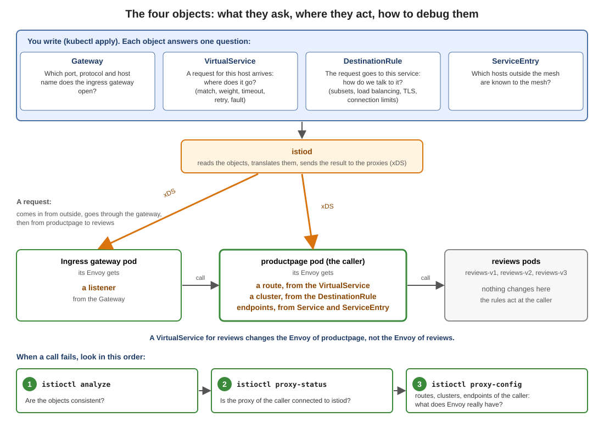

# Steering traffic: the four objects, and why they matter for debugging

This page is theory. The trainer shows two examples on the next page, you do not have to type anything.

* **None of them is needed for plain traffic.** A call to a Kubernetes `Service` works without them and is spread over all its pods. The objects only change the default.
* **They act on the side of the caller.** A `VirtualService` for `reviews` changes the Envoy of `productpage`, not the Envoy of `reviews`.
* **Envoy never reads these objects.** `istiod` translates them into listeners, routes, clusters and endpoints. You see the result with `istioctl proxy-config listeners|routes|clusters|endpoints`.
* **The objects are bound only by names.** A `VirtualService` names a host and a subset, the `DestinationRule` for the same host defines the subset (by a label of the pods). Nothing checks at `kubectl apply` that the other side exists.

## Why this matters for debugging

What you applied is not what runs. What counts is what Envoy has. A typical cause of `503`: the `VirtualService` sends to the subset `v1`, but no `DestinationRule` defines it. The application is healthy, the pods are running, and every call fails. With several clusters in one mesh, a `VirtualService` that exists only in cluster a does not change the callers in cluster b (measured in the demo), so apply the rules in every cluster.

The order to look at things is in the picture above.

Next: [Trainer demo: traffic shifting, fault injection, and a broken rule](01-trainer-demo-shifting-fault-injection-broken-rule.md)
