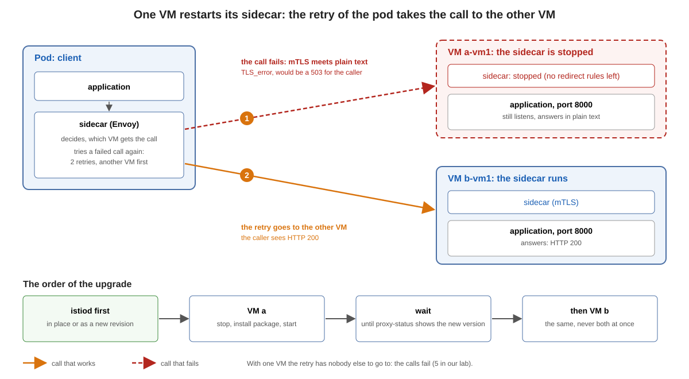

# How the sidecar on a VM is upgraded

> **Hint:** Upgrade the Istio control plane (`istiod`) first, then the sidecars. The sidecars may be behind the control plane for a while: in our lab sidecars on 1.29.9 worked with an `istiod` on 1.30.8 without an error. Do not do it the other way round.

A pod gets its sidecar when the pod is created. When you upgrade `istiod`, a running pod keeps its old sidecar until it is created again. A VM is the same, with one difference: **nobody creates it again for you.** The sidecar on a VM is the package `istio-sidecar.deb`, and you install the new package yourself.

## The order

Control plane first, then the VMs and the pods. The same as for pods. In our lab a new `istiod` (1.30.8) served a VM with the old sidecar (1.29.9) without an error.

## Where the package comes from

There is no `apt` repository for the sidecar. Istio publishes the package as a file, one URL per version:

* `https://storage.googleapis.com/istio-release/releases/<VERSION>/deb/istio-sidecar.deb`

So `apt upgrade` does not find a new version. You build the URL from the version and install the file with `dpkg -i`. In production this file belongs in your own repository or artifact store, with the version written down in one place, next to the version of `istiod`.

The Istio documentation has no page about upgrading the sidecar on a VM. We found the archived installation page (it installs the package with `dpkg`) and the pages about canary upgrades (they only describe pods). What you read here is what we measured in our lab.

## What happens on the VM

The upgrade is: stop the service `istio`, install the new package, start the service. While the service is stopped, the VM is **not** a mesh member, but the application on the VM still listens on its port. A pod that calls the VM still sends mTLS to that port, and the application answers in plain text. The call fails with `503`, and the error text says `TLS_error`. How long the gap lasts and how many calls fail: see the exercises.

With **two VMs** behind the same Service and the retries of the sidecar switched on (the default in our lab), the restart of one VM after the other cost no call. Without the second VM it cost 5, without the retries 9: [Upgrade two VMs, one after the other](05-upgrade-two-vms-one-after-the-other.md).

This is a property of the VM, not of the upgrade. The same happens when the sidecar crashes.

## Two ways, as for pods

| | In place | With revisions |
|---|---|---|
| Control plane | The new `istiod` replaces the old one | A second `istiod` runs next to the old one |
| What the VM connects to | The same address, now the new `istiod` | The address `istiod-lb` points to one revision, you move it |
| VM | New package, restart | New package, restart: the VM connects to the revision that `istiod-lb` points to |
| Exercise | [Upgrade a VM in place](03-upgrade-the-vm-in-place.md) | [Upgrade a VM with revisions](04-upgrade-the-vm-with-revisions.md) |

The VM has no namespace label and no `istio.io/rev`. Which control plane it uses is decided by the address of `istiod` in its configuration. In our lab that is a Service of type `LoadBalancer` (`istiod-lb`). Its selector decides which `istiod` pods answer.

## What stays open

* We measured one VM and two VMs, not more. A drain before the restart, blue/green and `outlierDetection` we did not test.
* We did not test a script or a configuration tool (for example Ansible) for the rollout.
* We did not test the upgrade while the two clusters are one mesh.

Next: the exercise [Upgrade a VM in place](03-upgrade-the-vm-in-place.md)
