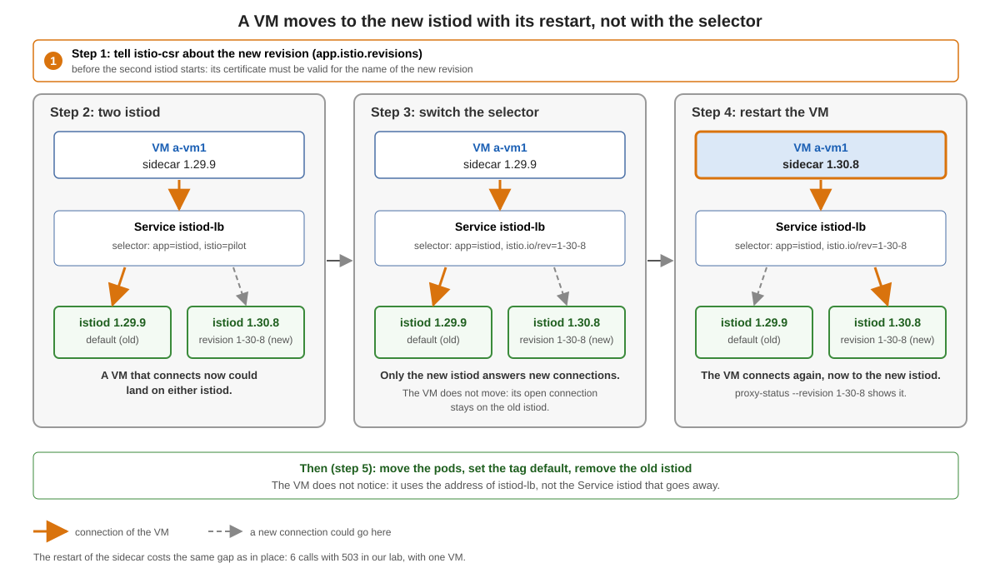

# Upgrade a VM with revisions

> **Hint:** Upgrade the Istio control plane (`istiod`) first, then the sidecars. The sidecars may be behind the control plane for a while: in our lab sidecars on 1.29.9 worked with an `istiod` on 1.30.8 without an error. Do not do it the other way round.



Theory: [How the sidecar on a VM is upgraded](00-how-the-vm-sidecar-is-upgraded.md). The control plane steps are the same as in [Upgrade Istio with revisions](02-upgrade-istio-with-revisions.md), read that page first.

## What we do

A VM is in the mesh in cluster a (exercise [Add a VM to the mesh](../virtual-machines/01-add-a-vm-to-the-mesh.md), Istio 1.29.9, lab with cert-manager and `istio-csr`). You start a second `istiod` (revision `1-30-8`) next to the old one, move the VM to it, and remove the old `istiod`. A loop in a pod calls the VM twice per second.

A VM has no namespace label. Which `istiod` it uses is decided by the address in its configuration: in our lab the Service `istiod-lb` (type `LoadBalancer`). Its selector names the `istiod` pods that answer. You move the VM by changing this selector and restarting the sidecar.

| Step | What |
|---|---|
| 1 | Tell `istio-csr` about the new revision |
| 2 | Install the second `istiod` |
| 3 | Start the loop and point `istiod-lb` to the new revision |
| 4 | Upgrade the package on the VM |
| 5 | Move the pods and remove the old `istiod` |
| 6 | Count the calls |

All commands run on your bastion host as your lab user. The lab must be at the state before the upgrade (Istio 1.29.9, one `istiod`).

```
export CTX=cluster-a
export NEW=1.30.8
export REV=1-30-8
export VM=a-vm1
mkdir -p ~/upgrade-vm && cd ~/upgrade-vm
helm repo add istio https://istio-release.storage.googleapis.com/charts --force-update
helm repo update
helm --kube-context $CTX -n istio-system get values istiod -o yaml > istiod-values.yaml
```

## Step 1: Tell istio-csr about the new revision

```
helm --kube-context $CTX upgrade cert-manager-istio-csr oci://quay.io/jetstack/charts/cert-manager-istio-csr --version v0.19.1 -n cert-manager --reuse-values --set "app.istio.revisions={default,$REV}" --wait
kubectl --context $CTX -n istio-system get certificate istiod -o jsonpath='{.spec.dnsNames}{"\n"}'
```

```
["istiod.istio-system.svc","istiod-1-30-8.istio-system.svc"]
```

## Step 2: Install the second istiod

```
helm --kube-context $CTX upgrade istio-base istio/base -n istio-system --version $NEW --wait
helm --kube-context $CTX install istiod-$REV istio/istiod -n istio-system --version $NEW --set revision=$REV -f istiod-values.yaml --wait --timeout 5m
kubectl --context $CTX -n istio-system get pods,svc -L istio.io/rev | grep -E "NAME|istiod"
kubectl --context $CTX -n istio-system get svc istiod-lb -o jsonpath='{.spec.selector}{"\n"}'
```

```
NAME                                           READY   STATUS    RESTARTS   AGE   REV
pod/istiod-1-30-8-666c89c89f-4wpmd             1/1     Running   0          3s    1-30-8
pod/istiod-bcfc6b467-2d66x                     1/1     Running   0          96s   default
NAME                                TYPE           CLUSTER-IP           EXTERNAL-IP               PORT(S)                                 AGE   REV
service/istiod                      ClusterIP      fd00:10:96::3:ceef   <none>                    15010/TCP,15012/TCP,443/TCP,15014/TCP   21h   default
service/istiod-1-30-8               ClusterIP      fd00:10:96::5:a6d0   <none>                    15010/TCP,15012/TCP,443/TCP,15014/TCP   3s    1-30-8
service/istiod-lb                   LoadBalancer   fd00:10:96::4:3ff5   2a01:4f8:c016:f27b::2:2   15012:31231/TCP                         21h   
{"app":"istiod","istio":"pilot"}
```

The selector of `istiod-lb` is `app: istiod, istio: pilot`. Both `istiod` pods carry these labels, so a VM that connects now can land on either of them. The VM is still connected to the old one:

```
istioctl --context $CTX proxy-status | grep -E "NAME|vm"
istioctl --context $CTX proxy-status --revision $REV
```

```
NAME                                                    CLUSTER       ISTIOD                     VERSION     SUBSCRIBED TYPES
v6-tln12-a-vm1.vm                                       cluster-a     istiod-bcfc6b467-2d66x     1.29.9      5 (CDS,LDS,EDS,RDS,NDS)
NAME     CLUSTER     ISTIOD     VERSION     SUBSCRIBED TYPES
```

## Step 3: Start the loop and point istiod-lb to the new revision

In a **second terminal**:

```
kubectl --context cluster-a exec deploy/client -c curl -- sh -c 'while true; do echo "$(date +%T) $(curl -s -o /dev/null -m 4 -w "%{http_code}" http://diameter-adapter.vm.svc.cluster.local:8000/)"; sleep 0.5; done' | tee ~/upgrade-vm/calls-b.log
```

Now the selector. It names the revision, so only the new `istiod` answers:

```
kubectl --context $CTX -n istio-system patch svc istiod-lb --type=json -p "[{\"op\":\"replace\",\"path\":\"/spec/selector\",\"value\":{\"app\":\"istiod\",\"istio.io/rev\":\"$REV\"}}]"
kubectl --context $CTX -n istio-system get endpoints istiod-lb
```

```
service/istiod-lb patched
NAME        ENDPOINTS                            AGE
istiod-lb   [2a01:4f8:c016:f901::1:bb62]:15012   21h
```

One endpoint, the new `istiod`. **The VM does not move.** Its connection to the old `istiod` stays open:

```
istioctl --context $CTX proxy-status | grep -E "NAME|vm"
```

```
NAME                                                    CLUSTER       ISTIOD                     VERSION     SUBSCRIBED TYPES
v6-tln12-a-vm1.vm                                       cluster-a     istiod-bcfc6b467-2d66x     1.29.9      5 (CDS,LDS,EDS,RDS,NDS)
```

## Step 4: Upgrade the package on the VM

```
ssh $VM "curl -fsSL https://storage.googleapis.com/istio-release/releases/$NEW/deb/istio-sidecar.deb -o /tmp/istio-sidecar-$NEW.deb"
ssh $VM "systemctl stop istio; dpkg -i /tmp/istio-sidecar-$NEW.deb; systemctl start istio"
```

```
Unpacking istio-sidecar (1.30.8) over (1.29.9) ...
Setting up istio-sidecar (1.30.8) ...
```

After the restart the VM connects to the address of `istiod-lb`, which now leads to the new `istiod`. Wait about 20 seconds:

```
istioctl --context $CTX proxy-status | grep -E "NAME|vm"
istioctl --context $CTX proxy-status --revision $REV | grep -E "NAME|vm"
kubectl --context $CTX get workloadentry -n vm
```

```
NAME                                                    CLUSTER       ISTIOD                     VERSION     SUBSCRIBED TYPES
NAME                  CLUSTER     ISTIOD                             VERSION     SUBSCRIBED TYPES
v6-tln12-a-vm1.vm     cluster-a   istiod-1-30-8-666c89c89f-4wpmd     1.30.8      5 (CDS,LDS,EDS,RDS,NDS)
NAME                                        AGE    ADDRESS
diameter-adapter-2a01-4f8-c016-ec--1-net1   115s   2a01:4f8:c016:ec::1
```

The first command (default control plane) shows no VM, the second (revision `1-30-8`) shows it with version 1.30.8. The `WorkloadEntry` is the same as before.

## Step 5: Move the pods and remove the old istiod

Stop the loop in the second terminal (Ctrl+C), because the pod `client` is restarted now. Then the same steps as on the page [Upgrade Istio with revisions](02-upgrade-istio-with-revisions.md): move the namespace, set the tag `default`, remove the old `istiod`:

```
kubectl --context $CTX label namespace default istio-injection- istio.io/rev=$REV
kubectl --context $CTX rollout restart deploy -n default
kubectl --context $CTX rollout status deploy/client
helm --kube-context $CTX template istiod-$REV istio/istiod --version $NEW -s templates/revision-tags-mwc.yaml --set revisionTags="{default}" --set revision=$REV -n istio-system | kubectl --context $CTX apply -f -
helm --kube-context $CTX delete istiod -n istio-system
helm --kube-context $CTX upgrade istio-base istio/base -n istio-system --version $NEW --set defaultRevision=$REV --wait
```

```
kubectl --context $CTX -n istio-system get pods,svc | grep istiod
istioctl --context $CTX proxy-status | grep -E "NAME|vm|client"
kubectl --context $CTX exec deploy/client -c curl -- curl -s -m 6 -o /dev/null -w "HTTP %{http_code}\n" http://diameter-adapter.vm.svc.cluster.local:8000/
```

```
pod/istiod-1-30-8-666c89c89f-4wpmd             1/1     Running   0          2m14s
service/istiod-1-30-8               ClusterIP      fd00:10:96::5:a6d0   <none>                    15010/TCP,15012/TCP,443/TCP,15014/TCP   2m14s
service/istiod-lb                   LoadBalancer   fd00:10:96::4:3ff5   2a01:4f8:c016:f27b::2:2   15012:31231/TCP                         21h
NAME                                       CLUSTER       ISTIOD                             VERSION     SUBSCRIBED TYPES
client-7c78f48965-nj67k.default            cluster-a     istiod-1-30-8-666c89c89f-4wpmd     1.30.8      5 (CDS,LDS,EDS,RDS,NDS)
v6-tln12-a-vm1.vm                          cluster-a     istiod-1-30-8-666c89c89f-4wpmd     1.30.8      5 (CDS,LDS,EDS,RDS,NDS)
HTTP 200
```

The Service `istiod` is gone with the old control plane, but the VM does not use it: it uses the address of `istiod-lb`. One more restart of the sidecar on the VM, with the old `istiod` gone, brings it back to the new one (`HTTP 200` again):

```
ssh $VM "systemctl restart istio"
```

## Step 6: Count the calls

```
awk '{print $2}' ~/upgrade-vm/calls-b.log | sort | uniq -c
grep -v " 200$" ~/upgrade-vm/calls-b.log
```

```
     95 200
      6 503
04:52:40 503
04:52:41 503
04:52:41 503
04:52:42 503
04:52:43 503
04:52:43 503
```

In our lab: 101 calls, 6 of them `503`, all within about 4 seconds, while the sidecar on the VM went down and came back (the same cause as in [Upgrade a VM in place](03-upgrade-the-vm-in-place.md), step 6). Starting the second `istiod`, pointing `istiod-lb` to it and removing the old one cost no call.

## What to take away

* **The VM moves with its restart, not with the selector.** Changing `istiod-lb` only decides where the next connection goes. The open connection stays on the old `istiod`, even for minutes.
* **Point `istiod-lb` to the revision before you restart the VM.** If the selector still names both `istiod` pods, the VM can land on either.
* **`istioctl proxy-status` needs `--revision`** to see the VM on the new control plane.
* **The gap is the same as in place:** the restart of the sidecar. The revision does not make it shorter.
* **The old `istiod` can go when the VM has moved.** Check with `proxy-status --revision` first.

## Clean up

This exercise leaves the lab on 1.30.8 with the revision `1-30-8`. The trainer sets the lab back.

Previous: [Upgrade a VM in place](03-upgrade-the-vm-in-place.md) | Next: [Upgrade two VMs, one after the other](05-upgrade-two-vms-one-after-the-other.md)
