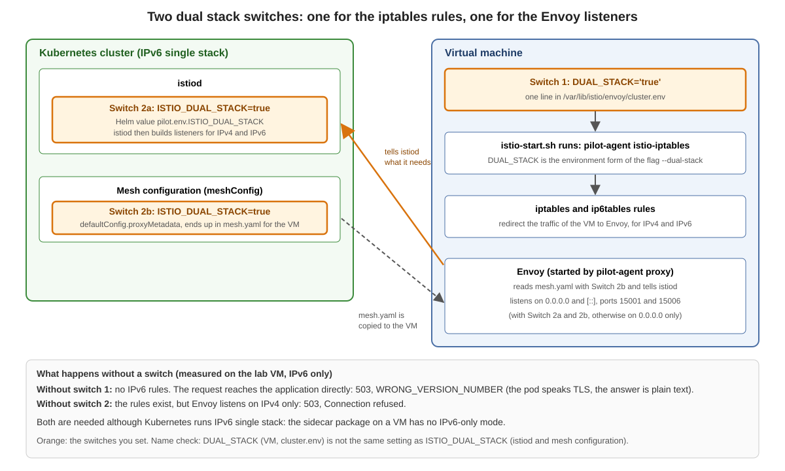

# Dual stack on the VM: what to set



## The rule

| The VM has | You set |
|---|---|
| **IPv6 only** | nothing |
| **IPv4 and IPv6** (our lab VM: IPv6 plus a private, not routed `100.65.x.x`) | one dual stack line in `/var/lib/istio/envoy/cluster.env`, and `ISTIO_SVC_IP` |

Why: Istio looks at the addresses of the VM. With both families the VM is a dual stack workload, and the sidecar does not handle IPv6 until you switch it on. Without the line, calls from a pod fail with `503`.

## Two names, two jobs

Both names are lines in `cluster.env`. Both switch on the IPv6 iptables rules. They differ in what else they change:

| | `DUAL_STACK='true'` | `ISTIO_DUAL_STACK='true'` |
|---|---|---|
| IPv6 rules (traffic goes through Envoy) | yes | yes |
| Envoy admin port `15000` | stays on `127.0.0.1` | moves to `[::1]` |
| Envoy metrics `15090` and readiness `15021` over IPv6 | **not reachable** | reachable |
| Health `probe` in the WorkloadGroup | **works** (with `host: 127.0.0.1`) | **does not work** |
| Who writes it | you (our script adds it) | `istioctl`, if `istiod` has the switch when you create the files |

## What do you want?

* **No `probe`, no scraping of the Envoy ports over IPv6:** keep what `istioctl` wrote (`ISTIO_DUAL_STACK`). Nothing to do.
* **A health `probe`:** use `DUAL_STACK` and **delete the line `ISTIO_DUAL_STACK`** from `cluster.env`, then restart the sidecar. Add `host: 127.0.0.1` to the `probe`. The price: Prometheus cannot read the Envoy metrics on `15090` over IPv6, and nothing can ask the Envoy readiness on `15021` over IPv6. The metrics of the agent on port `15020` work with both names.
* **Scraping `15090` or `15021` over IPv6:** use `ISTIO_DUAL_STACK`. The price: no `probe`.

You cannot have both. The reason is that the health check of the agent talks IPv4 on a dual stack VM (`127.0.0.1` for Envoy, `127.0.0.6` as source address), while `ISTIO_DUAL_STACK` moves Envoy to IPv6. Details and measurements: [reference page](00-dual-stack-switches-details.md).

## The cluster side

`istiod` needs `ISTIO_DUAL_STACK=true` in its environment (Helm value `pilot.env.ISTIO_DUAL_STACK`). It decides whether Envoy listens on `[::]` for the traffic redirect (ports `15001`, `15006`). In a real environment this is part of the cluster provisioning. Without it, nothing on the VM helps.

## Look at your VM

```
ssh $VM "ip -o addr show scope global | awk '{print \$3, \$4}'"
ssh $VM "grep -E 'DUAL_STACK|ISTIO_SVC_IP' /var/lib/istio/envoy/cluster.env"
ssh $VM "echo \"IPv4 rules: \$(iptables-save -t nat | grep -c ISTIO)  IPv6 rules: \$(ip6tables-save -t nat | grep -c ISTIO)\""
ssh $VM "ss -ltnp | grep -E ':150[0-9][0-9] ' | awk '{print \$4}' | sort -u"
```

Healthy dual stack: 23 IPv4 rules and 19 IPv6 rules, and the listeners `[::]:15001` and `[::]:15006`. IPv4 rules are always set, the tool never sets IPv6 rules alone. If a call fails with `503`, look here first, then at the `ADDRESS` of the `WorkloadEntry`.
