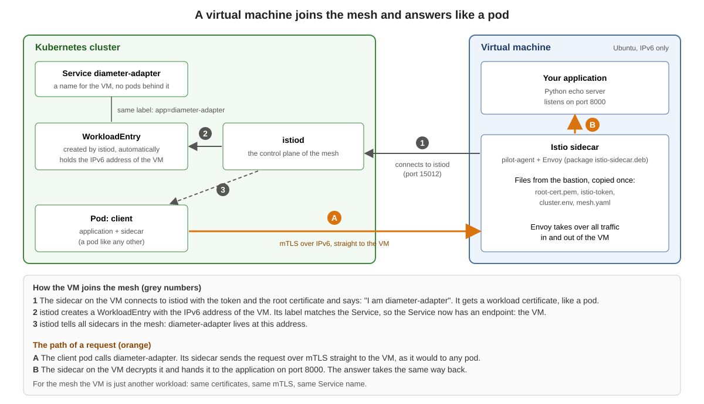

# How a VM joins the mesh



> **Attention:** When you use IPv6 only on the VMs (Istio hybrid), be sure that the IPv4 address on the VM is disabled. That is the best and easiest way. Otherwise you need to fiddle around (dual stack switches, `ISTIO_SVC_IP`, health `probe` workarounds).

A virtual machine joins the mesh with the Istio sidecar package (`istio-sidecar.deb`). The sidecar connects to `istiod` and gets a workload certificate. The VM is **not** a pod and does not show up in `kubectl get pods`. `istiod` creates a `WorkloadEntry` for it automatically (auto-registration), and it appears in `istioctl proxy-status` like the sidecar of a pod. From then on a pod calls the VM through a normal Kubernetes `Service`, with mTLS.

What `WorkloadGroup`, `WorkloadEntry` and `EndpointSlice` are and how they differ: [who is who](00-workloadgroup-workloadentry-endpointslice.md).

## IPv6 only on the VM

Kubernetes, Istio and the VM run as IPv6 single stack. The lab VM has an IPv6 address and **no IPv4 address** (the private address `100.65.x.x` that the cloud gives it is switched off in the VM). Then Istio needs no dual stack switches and no extra settings on the VM.

If a VM has an IPv4 address, things change: the sidecar may register the IPv4 address (calls fail with `503`) and needs the dual stack switches. That is the topic of the [optional page](02-add-a-vm-to-the-mesh-dual-stack-optional.md) and of [DUAL_STACK and ISTIO_DUAL_STACK](00-dual-stack-switches.md).

## What the VM gets from `istioctl`

The command `istioctl x workload entry configure` reads the `WorkloadGroup` and the mesh configuration of the cluster and writes everything the VM needs into a folder, five files in all:

| File | Goes to (on the VM) | What is in it |
|---|---|---|
| `cluster.env` | `/var/lib/istio/envoy/cluster.env` | One `KEY='value'` line per setting. `istio-start.sh` reads it and every line becomes an environment variable of the sidecar. See below |
| `mesh.yaml` | `/etc/istio/config/mesh` | The mesh configuration for the agent: `discoveryAddress: istiod.istio-system.svc:15012`, `meshId`, and under `proxyMetadata` the same entries as in `cluster.env` |
| `hosts` | appended to `/etc/hosts` | One line: `<ISTIOD_ADDR> istiod.istio-system.svc`, so the VM finds `istiod` by name |
| `root-cert.pem` | `/etc/certs/root-cert.pem` | The root certificate of the mesh (in our lab `Lab Root CA tln1`), so the VM trusts `istiod` and the other workloads |
| `istio-token` | `/var/run/secrets/tokens/istio-token` | A token (JWT) of the service account `diameter-adapter` in the namespace `vm`. The agent uses it once to get its workload certificate. **Secret**, valid for a short time (one hour by default). Do not print it and do not commit it |

This is the `cluster.env` of our lab (lines in the order `istioctl` writes them). There is no dual stack line, because `istiod` has no `ISTIO_DUAL_STACK` setting:

```
CANONICAL_REVISION='latest'
CANONICAL_SERVICE='diameter-adapter'
ISTIO_INBOUND_PORTS='8000'
ISTIO_LOCAL_EXCLUDE_PORTS='22,15090,15021,15020'
ISTIO_METAJSON_LABELS='{"app":"diameter-adapter",...}'
ISTIO_META_AUTO_REGISTER_GROUP='diameter-adapter'
ISTIO_META_CLUSTER_ID='cluster-a'
ISTIO_META_DNS_AUTO_ALLOCATE='true'
ISTIO_META_DNS_CAPTURE='true'
ISTIO_META_MESH_ID='mesh-tln1'
ISTIO_META_NETWORK='net1'
ISTIO_META_POD_PORTS='[{"name":"http","containerPort":8000,"protocol":""}]'
ISTIO_META_WORKLOAD_NAME='diameter-adapter'
ISTIO_NAMESPACE='vm'
ISTIO_SERVICE='diameter-adapter.vm'
ISTIO_SERVICE_CIDR='*'
POD_NAMESPACE='vm'
SERVICE_ACCOUNT='diameter-adapter'
TRUST_DOMAIN='cluster.local'
```

Where the lines come from:

* **From the `WorkloadGroup`:** `ISTIO_NAMESPACE`, `POD_NAMESPACE`, `SERVICE_ACCOUNT`, `ISTIO_SERVICE`, `ISTIO_INBOUND_PORTS` (the ports of the `WorkloadGroup`), `ISTIO_METAJSON_LABELS` (its labels), `ISTIO_META_NETWORK` (its network), `ISTIO_META_POD_PORTS`.
* **From the options:** `ISTIO_META_CLUSTER_ID` (`--clusterID`), `ISTIO_META_AUTO_REGISTER_GROUP` (`--autoregister`).
* **From the mesh configuration of the cluster (`proxyMetadata` in the ConfigMap `istio` in `istio-system`):** every entry there, for example `ISTIO_META_DNS_CAPTURE` and `ISTIO_META_DNS_AUTO_ALLOCATE`. They appear in `mesh.yaml` and in `cluster.env`. (With the dual stack setting in `istiod`, `ISTIO_DUAL_STACK` would appear here, too: see the [optional dual stack page](02-add-a-vm-to-the-mesh-dual-stack-optional.md).)
* **Fixed by `istioctl`:** `ISTIO_LOCAL_EXCLUDE_PORTS='22,15090,15021,15020'`. These ports are not redirected to Envoy: SSH and the three ports of the sidecar itself.

For a VM with IPv6 only, what `istioctl` wrote is enough: nothing has to be added to `cluster.env`.

## What the sidecar sets on the VM

The sidecar sets iptables rules, and Envoy listens on the IPv6 wildcard address.

The tool always sets the IPv4 rules, and it sets the IPv6 rules because the first address of the VM is an IPv6 address. Nothing to configure.

## Good to know

* The sidecar service is not enabled at boot (`systemctl is-enabled istio` shows `disabled`). After a reboot of the VM the sidecar does not start by itself.
* While the sidecar redirects IPv6 traffic to a port where Envoy does not listen, the outgoing IPv6 traffic of the VM is disturbed, too (a download with `curl` fails). SSH keeps working (port 22 is excluded).
* The files in `vmfiles` contain a token. Do not share them.

Next: the exercise [Add a virtual machine to the mesh (IPv6 only)](01-add-a-vm-to-the-mesh.md)
