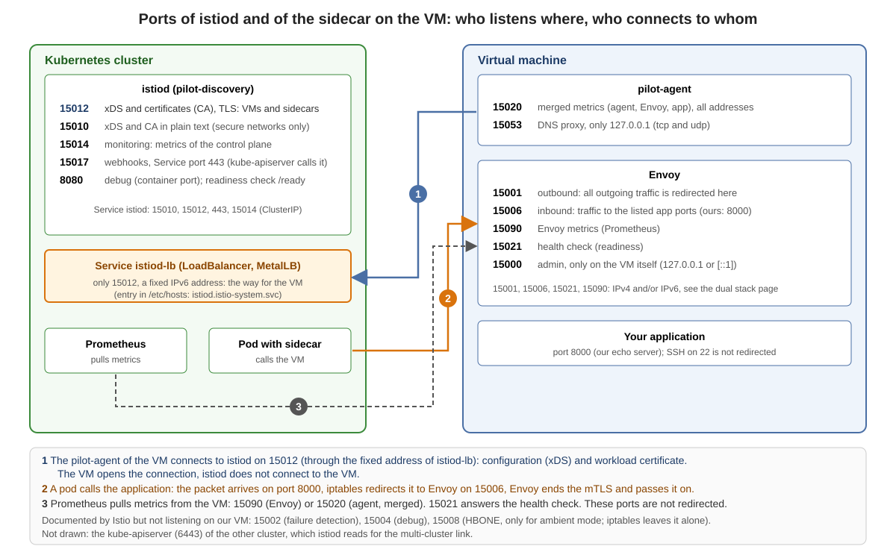

# Ports of istiod and of the sidecar on the VM



## Background

Two programs matter for a VM in the mesh:

* **`istiod`** (the program is called `pilot-discovery`) runs in the cluster. It gives the sidecars their configuration (xDS) and signs the workload certificates (CA).
* **The sidecar** runs on the VM: **`pilot-agent`** (the agent, it talks to `istiod`) and **Envoy** (the proxy, it carries the traffic).

The tables list every port. The column "Istio docs" is from the Istio documentation (*Ports used by Istio*), the column "Measured" is what we saw on our lab (Istio 1.29.9, `ss -ltnp` on the VM, `kubectl` for `istiod`).

## The sidecar on the VM

| Port | Who listens | Istio docs | Measured on our VM | Who connects |
|---|---|---|---|---|
| `15000` | Envoy | Envoy admin port (commands, diagnostics), pod-internal only | `127.0.0.1`, or `[::1]` with `ISTIO_DUAL_STACK` or on a VM with IPv6 only | only the VM itself (the agent asks it if Envoy is ready; you with `curl`) |
| `15001` | Envoy | Envoy outbound | `0.0.0.0` and `[::]` (IPv6 only: `[::]`) | iptables redirects all outgoing TCP traffic of the VM here |
| `15006` | Envoy | Envoy inbound | `0.0.0.0` and `[::]` (IPv6 only: `[::]`) | iptables redirects incoming traffic for the listed application ports here (ours: `8000`) |
| `15020` | `pilot-agent` | merged Prometheus telemetry from agent, Envoy and application | all addresses (`*`), IPv4 and IPv6, with every setting | Prometheus |
| `15021` | Envoy | health checks | `0.0.0.0`; also `[::]` with `ISTIO_DUAL_STACK` (IPv6 only: `[::]`) | health checks, Prometheus |
| `15053` | `pilot-agent` | DNS port, if DNS capture is enabled, pod-internal only | `127.0.0.1`, tcp and udp | only the VM itself (the DNS proxy, switched on by `ISTIO_META_DNS_CAPTURE`) |
| `15090` | Envoy | Envoy Prometheus telemetry | `0.0.0.0`; also `[::]` with `ISTIO_DUAL_STACK` (IPv6 only: `[::]`) | Prometheus |
| `8000` | our application | - | `*` (the Python echo server) | other workloads (redirected to `15006`) |
| `22` | `sshd` | - | `0.0.0.0` and `[::]` | you (not redirected) |

Listed by Istio, but **not listening** on our VM: `15002` (failure detection), `15004` (debug port), `15008` (HBONE tunnel, used in ambient mode; the iptables rules leave it alone in sidecar mode).

### What iptables redirects

`istio-start.sh` runs `pilot-agent istio-iptables`. On our VM it sets up:

* **Outbound:** all outgoing TCP traffic goes to `15001`.
* **Inbound:** only the ports in `ISTIO_INBOUND_PORTS` go to `15006`. `istioctl` takes them from the ports of the `WorkloadGroup` (ours: `8000`). The rule on our VM: `-A ISTIO_INBOUND -p tcp --dport 8000 -j ISTIO_IN_REDIRECT`, and `15008` is left alone.
* **Not redirected:** every other port, so also `15020`, `15021`, `15090` and `22`. The line `ISTIO_LOCAL_EXCLUDE_PORTS='22,15090,15021,15020'` from `istioctl` is an exclusion list that only applies when *all* inbound ports are redirected (`*`). Ours are not.

If you list more application ports in the `WorkloadGroup`, they go to `15006`, too.

## istiod in the cluster

| Port | Name in the Deployment | Istio docs | Our lab | Who connects |
|---|---|---|---|---|
| `15012` | `tls-xds` | XDS and CA services, TLS and mTLS, recommended for production | in the `Service istiod` (named `https-dns`) and in `istiod-lb` | **the VM**, and the sidecars of the pods |
| `15010` | `grpc-xds` | XDS and CA services in plain text, only for secure networks | in the `Service istiod`; the VM does not use it | sidecars that are set up for it (we do not use it) |
| `15014` | `http-monitoring` | control plane monitoring | `--monitoringAddr=:15014`, in the `Service istiod` | Prometheus (metrics of `istiod`) |
| `15017` | `https-webhooks` | webhook container port, forwarded from `443` | the `Service istiod` maps `443` to `15017` | the `kube-apiserver` (sidecar injection, validation) |
| `8080` | `http-debug` | debug interface (deprecated, container port only) | container port only, not in a Service; the readiness probe of `istiod` asks `/ready` here | the kubelet |

Our extra Service for VMs:

| Service | Type | Port | Meaning |
|---|---|---|---|
| `istiod-lb` | `LoadBalancer` (MetalLB) | `15012` only | a **fixed IPv6 address** that the VM can reach. The `hosts` file of the VM maps `istiod.istio-system.svc` to it. The cluster IP of `istiod` exists only inside the cluster |

Other ports in our lab: the gateway `istio-ingressgateway` has `15021` (status), `80` (to `8080`) and `443` (to `8443`). The `kube-apiserver` listens on `6443` (the multi-cluster link: `istiod` of one cluster reads the API of the other, with the remote secret).

## What this means for a firewall

For one VM in the mesh the following must be allowed:

| From | To | Port | For |
|---|---|---|---|
| VM | `istiod` (address of `istiod-lb`) | `15012/TCP` | configuration and certificate |
| other pods and VMs (workloads in the mesh) | VM | the application port (`8000`) | the traffic itself; the VM answers through Envoy |
| VM | pods and VMs of the mesh | the application ports of the other side | the outgoing traffic (the network is flat, pods are reached directly) |
| Prometheus | VM | `15090` (Envoy) or `15020` (agent), optional `15021` | metrics |
| you | VM | `22/TCP` | SSH (not part of Istio) |

`istiod` does not open a connection to the VM. The VM connects, and the answers come back on the same connection. What the lab firewall of Hetzner allows is not part of this page.

## Look at your VM

```
ssh $VM "ss -ltnpH | awk '{print \$4, \$NF}' | sed 's/users:((//; s/,pid=[0-9]*,fd=[0-9]*))//' | sort -t: -k2 -n | uniq"
ssh $VM "ss -lunpH | awk '{print \$4, \$NF}' | sed 's/users:((//; s/,pid.*//' | sort -u"
ssh $VM "iptables-save -t nat | grep -E 'ISTIO_INBOUND|ISTIO_REDIRECT'"
kubectl --context $CTX_A -n istio-system get deploy istiod -o jsonpath='{range .spec.template.spec.containers[0].ports[*]}{.name}={.containerPort} {end}'
kubectl --context $CTX_A -n istio-system get svc istiod istiod-lb
```

Which addresses `15000`, `15021` and `15090` use depends on the dual stack setting: [Dual stack on the VM: what to set](00-dual-stack-switches.md).
