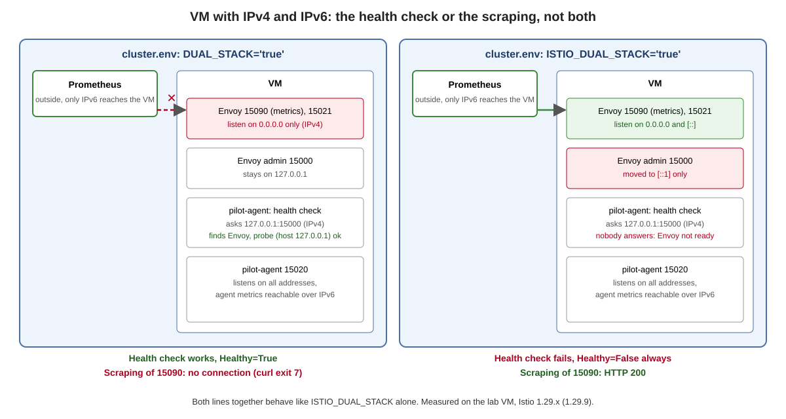
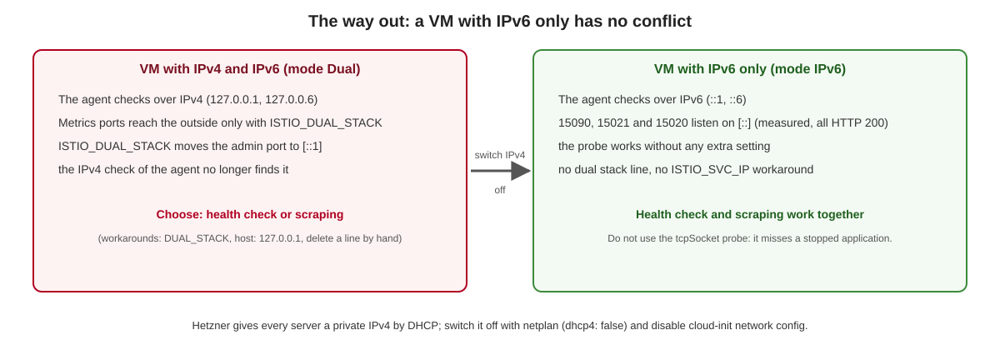

# Health check or scraping on a VM: why not both?

Short: on a dual stack VM the health check needs `DUAL_STACK`, and Prometheus can scrape the metrics of Envoy (`15090`) only with `ISTIO_DUAL_STACK`. The two names cannot be combined, so you get one or the other.

Version: measured with Istio 1.29.9, valid for the 1.29.x line (the code places named below are from 1.29.9; with another minor version check them again). The chain of reasons (all measured, tables in the [reference](00-dual-stack-switches-details.md)):

1. Prometheus scrapes from **outside** the VM. In our lab the private IPv4 address of the VM is not routed, so the only way in is IPv6. The port `15090` (metrics of Envoy) must therefore listen on `[::]`.
2. Only `ISTIO_DUAL_STACK` puts `15090` and `15021` on `[::]`. With `DUAL_STACK` they stay on `0.0.0.0` (IPv4 only): a pod without sidecar gets `no connection (curl exit 7)`.
3. `ISTIO_DUAL_STACK` also moves the Envoy admin port `15000` to `[::1]` only.
4. The health check is run by the `pilot-agent` on the VM, and on a dual stack VM it talks IPv4: it asks `http://127.0.0.1:15000/...` and uses `127.0.0.6` as source address. With the admin port on `[::1]` this fails, the check of Envoy never succeeds, the `WorkloadEntry` stays `Healthy=False`. Even `host: 127.0.0.1` in the `probe` does not help, and `DUAL_STACK` next to it does not undo the move.
5. So the `probe` needs `DUAL_STACK` without `ISTIO_DUAL_STACK`, and then point 2 applies: `15090` and `15021` are not reachable over IPv6, Prometheus cannot scrape the Envoy metrics (the job is `down`).

| You want | Setting | Scrape `15090` / `15021` | Health `probe` |
|---|---|---|---|
| Scraping | `ISTIO_DUAL_STACK` | works | `Healthy=False` always |
| Health check | `DUAL_STACK` + `host: 127.0.0.1` | no connection | works |

What still works with the health check: port `15020` of the `pilot-agent` answers over IPv6 with both names. It has the agent metrics (`istio_agent_cert_expiry_seconds`, see [certificate expiry](../observability/02-certificate-expiry.md)). We did not check whether it also returns the metrics of Envoy, so do not count on it for the request metrics.

The way out is not a setting but the address plan: **a VM with IPv6 only** has none of this (`::1` and `::6` are used for the checks, `15090`, `15021` and `15020` all listen on `[::]`, the `probe` works). Scraping and health check then work together. That is why the attention note on the short page says: switch the IPv4 address of the VM off.

## Why does it work like this?

* **Why does the agent check over IPv4 on a dual stack VM?** In the mode Dual the `pilot-agent` takes `127.0.0.1` for the admin port and `127.0.0.6` as source address (Istio 1.29.9, measured in the log). We did not find out why the Istio developers chose IPv4 here. It is the behavior we measured, not a decision we can explain.
* **Why does `ISTIO_DUAL_STACK` move the admin port?** With mixed addresses the agent takes the address family of the first address of the VM as the main family, and the first address is IPv6. Envoy then binds its admin port to `[::1]` (`pkg/bootstrap/config.go`). The health check of the agent does not follow that move.
* **Why not just scrape through the sidecar of a pod?** A pod with sidecar reaches all ports in both variants, because its own Envoy changes the path. But Prometheus in our lab has no sidecar, so it is the case without.

Reference with all measurements: [Dual stack on the VM: details](00-dual-stack-switches-details.md). Short rule: [what to set](00-dual-stack-switches.md).
