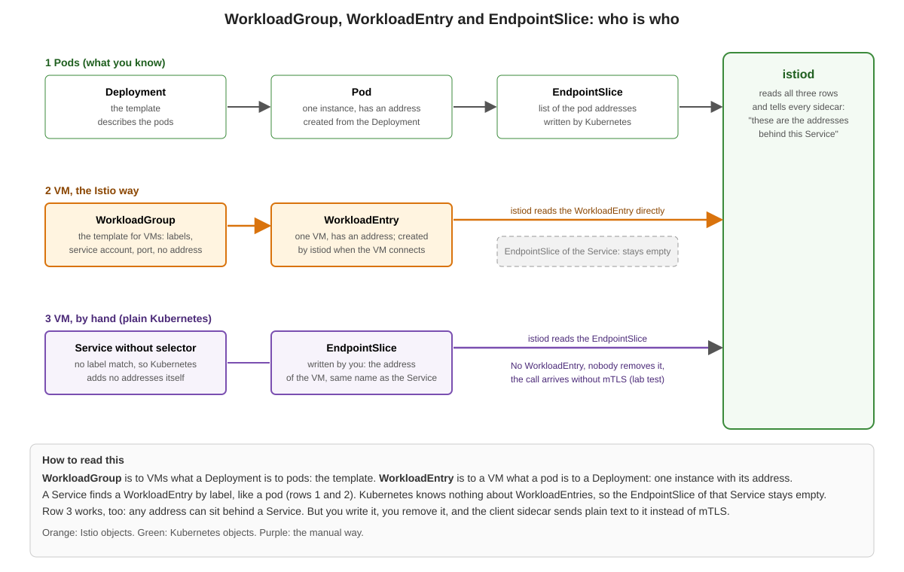

# WorkloadGroup, WorkloadEntry and EndpointSlice: who is who



## Background

For pods, Kubernetes does the bookkeeping: a Deployment describes the pods, the pods have addresses, and Kubernetes writes the addresses of the pods behind a Service into an `EndpointSlice`. `istiod` reads these and tells every sidecar where a Service lives.

A virtual machine is not a pod. Kubernetes does not know it. Istio adds two objects so that a VM can be a part of the mesh like a pod:

| Object | Compare to | What it is | Who creates it |
|---|---|---|---|
| `WorkloadGroup` | Deployment | The template for VMs: labels, service account, port, network. It has no address. | You |
| `WorkloadEntry` | Pod | One VM with its address, labels and service account. | `istiod`, when the VM connects (auto-registration). You can write one by hand, too. |
| `EndpointSlice` | - | Plain Kubernetes: the list of addresses behind a Service. | Kubernetes, for pods that a Service selects. For anything else: you. |

A `Service` finds a `WorkloadEntry` by label, exactly as it finds a pod. `istiod` reads the `WorkloadEntry` directly. Kubernetes does not turn it into an `EndpointSlice`, so the `EndpointSlice` of that Service stays empty. This is normal.

## Two ways to put a VM behind a Service

| | `WorkloadEntry` (Istio way) | Own `EndpointSlice` (manual way) |
|---|---|---|
| Created by | `istiod`, when the VM connects | you |
| Removed | by `istiod`, shortly after the VM has gone (in our test: within 10 seconds after we stopped the sidecar) | never, you do it (in our test it was still there) |
| Address | the one the sidecar reports (`ISTIO_SVC_IP`, if set) | the one you write |
| Service | with selector (label of the `WorkloadGroup`) | without selector, `EndpointSlice` with the label `kubernetes.io/service-name` |
| Call from a pod | mTLS (we saw `x-forwarded-client-cert`) | in our test: plain text, no `x-forwarded-client-cert` |

## Step 1: Look at the objects

Do this after you have finished the exercise [Add a virtual machine to the mesh](01-add-a-vm-to-the-mesh.md) (the VM is in the mesh, the pod `client` runs).

```
export CTX_A=cluster-a
kubectl --context $CTX_A -n vm get workloadgroup,workloadentry
```

```
NAME                                                 AGE
workloadgroup.networking.istio.io/diameter-adapter   29s

NAME                                                                           AGE   ADDRESS
workloadentry.networking.istio.io/diameter-adapter-2a01-4f8-c013-541--1-net1   23s   2a01:4f8:c013:541::1
```

The name of the `WorkloadEntry` is the name of the `WorkloadGroup` plus the address of the VM. Now the `EndpointSlice` of the same Service:

```
kubectl --context $CTX_A -n vm get endpointslice
```

```
NAME                     ADDRESSTYPE   PORTS     ENDPOINTS   AGE
diameter-adapter-jmpcj   IPv6          <unset>   <unset>     29s
```

It is empty. Still the call from the pod works, because `istiod` knows the address from the `WorkloadEntry`.

## Step 2: Put the same VM behind a second Service by hand

A `Service` without selector and an `EndpointSlice` with the address of the VM. `VM_IP` is the IPv6 address of your VM (see `ssh a-vm1 ip -6 -br a show eth0`).

```
export VM_IP=<IPv6 address of the VM>
```

```
# vi 03-manual-endpointslice.yml
apiVersion: v1
kind: Service
metadata:
  name: diameter-manual
  namespace: vm
spec:
  ipFamilyPolicy: SingleStack
  ipFamilies: [IPv6]
  ports:
    - name: http
      port: 8000
      targetPort: 8000
---
apiVersion: discovery.k8s.io/v1
kind: EndpointSlice
metadata:
  name: diameter-manual-1
  namespace: vm
  labels:
    kubernetes.io/service-name: diameter-manual
addressType: IPv6
ports:
  - name: http
    port: 8000
    protocol: TCP
endpoints:
  - addresses:
      - "<IPv6 address of the VM>"
```

Put your address into the file (`sed -i "s/<IPv6 address of the VM>/$VM_IP/" 03-manual-endpointslice.yml`), then:

```
kubectl --context $CTX_A apply -f 03-manual-endpointslice.yml
```

## Step 3: Compare the two calls

Both Services lead to the same VM:

```
istioctl --context $CTX_A proxy-config endpoint deploy/client | grep -E "ENDPOINT|diameter"
```

```
ENDPOINT                    STATUS      OUTLIER CHECK     CLUSTER
2a01:4f8:c013:541::1:8000   HEALTHY     OK                outbound|8000||diameter-adapter.vm.svc.cluster.local
2a01:4f8:c013:541::1:8000   HEALTHY     OK                outbound|8000||diameter-manual.vm.svc.cluster.local
```

Call both and look for the header `x-forwarded-client-cert`:

```
kubectl --context $CTX_A exec deploy/client -c curl -- curl -s -m 8 http://diameter-adapter.vm.svc.cluster.local:8000/ | grep -E "VM diameter|x-forwarded-client-cert"
kubectl --context $CTX_A exec deploy/client -c curl -- curl -s -m 8 http://diameter-manual.vm.svc.cluster.local:8000/ | grep -E "VM diameter|x-forwarded-client-cert"
```

The first call shows the line with `x-forwarded-client-cert` (mTLS, both identities). The second call shows only `VM diameter-adapter (IPv6) ...`: the request arrived, but without mTLS.

## What to take with you

* `WorkloadGroup` is the template, `WorkloadEntry` is the instance. You write the first, `istiod` writes the second.
* The `EndpointSlice` of a Service with a `WorkloadEntry` stays empty. Do not look for the VM there.
* A hand-made `EndpointSlice` is plain Kubernetes. It works, but it does not give the VM the properties of a mesh workload (automatic registration and removal, mTLS from the client). If you see both objects for a VM in a real environment, ask why the `EndpointSlice` exists.

## Clean up

```
kubectl --context $CTX_A -n vm delete -f 03-manual-endpointslice.yml
```
