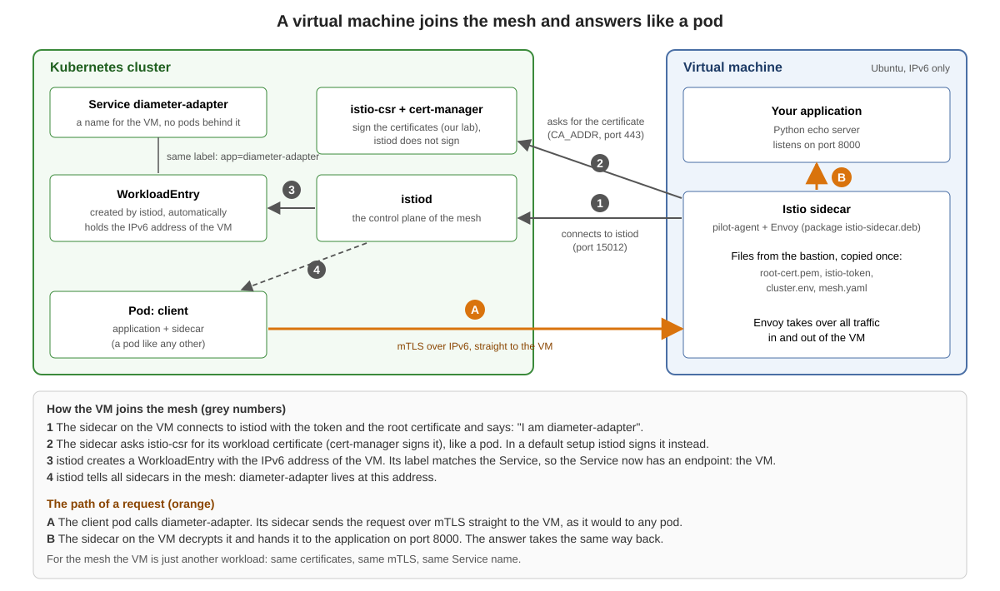

# Add a virtual machine to the mesh (IPv6 only)



> **Attention:** When you use IPv6 only on the VMs (Istio hybrid), be sure that the IPv4 address on the VM is disabled. That is the best and easiest way. Otherwise you need to fiddle around (dual stack switches, `ISTIO_SVC_IP`, health `probe` workarounds).

> **Hint:** This exercise is run by a script: [`vm-in-the-mesh.sh`](vm-in-the-mesh.sh). It is in the folder `~/virtual-machines` on your bastion host. You do not have to type every command: the script shows each step first, you press ENTER, and it runs exactly these commands. Read the commands, they are the exercise.

Theory first: [How a VM joins the mesh](00-how-a-vm-joins-the-mesh.md). This page is the exercise.

Prerequisite: the two clusters are connected (exercise [Connect cluster a and cluster b](../multi-cluster/00-connect-the-two-clusters.md)). Otherwise the last test (cluster b calls the VM) fails.

## What we do

We bring one virtual machine into the mesh with the Istio sidecar. Afterwards a pod calls the VM through a normal `Service`, with mTLS, and the VM calls a service in the cluster.

| Part | Name in this exercise |
|---|---|
| VM | `a-vm1` (reach it with `ssh a-vm1`) |
| Namespace, service account, workload group, service | `vm`, `diameter-adapter` |
| Application on the VM | a small Python echo server on port 8000 (`vm-echo-server.py`) |
| Address of `istiod` for the VM | a fixed `LoadBalancer` address (`istiod-lb`, port 15012) |
| Address of the certificate authority for the VM | a second fixed `LoadBalancer` address (`istio-csr-lb`, port 443), because in our lab cert-manager signs the certificates (see [cert-manager with istio-csr](../fundamentals/08-certificates-with-cert-manager-and-istio-csr.md)) |

The exercise has eight steps:

1. **Settings:** contexts, the name and the IPv6 address of the VM.
2. **Make `istiod` and the certificate authority ready for VMs:** auto-registration, DNS proxy, a fixed address for `istiod` and one for `istio-csr`.
3. **Create the objects for the VM:** namespace, service account, `WorkloadGroup` and `Service`.
4. **Create the files for the VM:** `istioctl` writes the files the VM needs.
5. **Install the sidecar on the VM and start it.**
6. **Check:** is the VM in the mesh?
7. **Test in three directions:** pod to VM, VM to pod, cluster b to VM.
8. **Check on the VM:** iptables rules and listeners.

## Before you start

The lab VM must have **no IPv4 address**. Check it on the VM:

```
ssh a-vm1 "ip -4 -br addr show eth0; ip -6 -br addr show eth0"
```

The first command prints nothing, the second the IPv6 address. If your VM has an IPv4 address, switch it off first. The file tells the VM not to ask for an IPv4 address by DHCP:

```
ssh a-vm1 "printf 'network:\n  version: 2\n  ethernets:\n    eth0:\n      dhcp4: false\n' > /etc/netplan/99-vm-no-ipv4.yaml && chmod 600 /etc/netplan/99-vm-no-ipv4.yaml && netplan apply"
```

(Or follow the optional page [with IPv4 and IPv6 (dual stack)](02-add-a-vm-to-the-mesh-dual-stack-optional.md).)

## How to do this exercise

We go through the steps one by one. For every step the trainer explains what happens and why. You do **not** type everything by hand: the script [`vm-in-the-mesh.sh`](vm-in-the-mesh.sh) (in the folder `virtual-machines` on your bastion host) runs the steps for you.

```
cd ~/virtual-machines
./vm-in-the-mesh.sh
```

For every step the script prints the commands first and waits:

```
... to continue press ENTER
```

Press ENTER and the script runs exactly the commands you see. You can copy any of them and type it yourself. The run itself takes about one minute, plus the time for the explanations.

## The steps

### Step 1: Settings

The script sets the contexts of both clusters, the name of the VM and the IPv6 address of the VM. It also reads the IPv4 address of the VM and stops if there is one.

```
export CTX_A=cluster-a
export CTX_B=cluster-b
export VM=a-vm1
export VM_IP=$(ssh $VM "ip -6 -o addr show dev eth0 scope global" | awk '{print $4}' | cut -d/ -f1 | head -1)
export VM_IP4=$(ssh $VM "ip -4 -o addr show dev eth0 scope global" | awk '{print $4}' | head -1)
```

### Step 2: Make `istiod` ready for VMs

The VM is outside the cluster and must reach `istiod` from outside. The script does two things:

* It switches on auto-registration (`PILOT_ENABLE_WORKLOAD_ENTRY_AUTOREGISTRATION`) and the DNS proxy with `helm upgrade istiod ... --reuse-values`.
* It creates the Service `istiod-lb` of type `LoadBalancer` with a fixed IPv6 address (MetalLB), port 15012.

If your lab is already prepared, the script says so and skips the step.

```
kubectl --context $CTX_A -n istio-system get svc istiod-lb
```

```
NAME        TYPE           CLUSTER-IP           EXTERNAL-IP               PORT(S)           AGE
istiod-lb   LoadBalancer   fd00:10:96::1:846d   2a01:4f8:c013:ff3b::2:2   15012:32516/TCP   60s
```

The VM uses the EXTERNAL-IP. The cluster IP (`fd00:...`) exists only inside the cluster.

**The certificate authority.** In our lab `istiod` does not sign certificates: the sidecar asks `istio-csr` (cert-manager). The VM must reach it, too. The script sees that `istio-csr` runs in the cluster and creates a second Service, `istio-csr-lb`, with the next fixed address (port 443):

```
kubectl --context $CTX_A -n cert-manager get svc istio-csr-lb
```

```
NAME           TYPE           CLUSTER-IP           EXTERNAL-IP               PORT(S)         AGE
istio-csr-lb   LoadBalancer   fd00:10:96::a:6242   2a01:4f8:c013:ff3b::2:3   443:32150/TCP   54s
```

Without this address the VM connects to `istiod`, but it never gets a certificate. The script shows this part as its own step.

### Step 3: Create the objects for the VM

Namespace `vm`, service account `diameter-adapter` and the Service `diameter-adapter` in **both** clusters (so that cluster b finds the VM, too). The `WorkloadGroup` (the template for the VM) only in cluster a. The Service finds the VM by the label `app=diameter-adapter`. The script writes the two files `01-vm-objects.yml` and `02-workloadgroup.yml` and shows their content.

```
kubectl --context $CTX_A apply -f 01-vm-objects.yml -f 02-workloadgroup.yml
kubectl --context $CTX_B apply -f 01-vm-objects.yml
```

### Step 4: Create the files for the VM

The command is `istioctl x workload entry configure` (`x` is short for `experimental`). It reads the `WorkloadGroup` and the mesh configuration of the cluster and writes everything the VM needs into a folder. Then the script copies the folder to the VM.

```
istioctl --context $CTX_A x workload entry configure -f 02-workloadgroup.yml -o vmfiles --clusterID cluster-a --ingressIP $ISTIOD_ADDR --autoregister
```

```
Warning: a security token for namespace "vm" and service account "diameter-adapter" has been generated and stored at "vmfiles/istio-token"
Configuration generation into directory vmfiles was successful
```

The warning is meant seriously: the folder contains a token. We take away the rights of everyone else and look at the folder:

```
chmod 600 vmfiles/istio-token
ls -la vmfiles
```

```
total 28
drwxr--r-- 2 tln12 tln12 4096 Nov 16 07:51 .
drwxrwxr-x 3 tln12 tln12 4096 Nov 16 07:51 ..
-rwxr--r-- 1 tln12 tln12  783 Nov 16 07:51 cluster.env
-rwxr--r-- 1 tln12 tln12   48 Nov 16 07:51 hosts
-rw------- 1 tln12 tln12  893 Nov 16 07:51 istio-token
-rwxr--r-- 1 tln12 tln12  780 Nov 16 07:51 mesh.yaml
-rwxr--r-- 1 tln12 tln12 1866 Nov 16 07:51 root-cert.pem
```

| Option | Meaning |
|---|---|
| `-f 02-workloadgroup.yml` | the `WorkloadGroup` of the VM (name, namespace, labels, service account, ports, network) |
| `-o vmfiles` | the folder for the files |
| `--clusterID cluster-a` | the name of the cluster the VM registers with |
| `--ingressIP $ISTIOD_ADDR` | the address of `istiod` that the VM can reach (our `istiod-lb`, see step 2) |
| `--autoregister` | `istiod` creates the `WorkloadEntry` when the VM connects. Without it the `WorkloadEntry` is missing |

Five files. Look at them one by one, but **not** at `istio-token`: it is a secret, we only look at its size.

```
cat vmfiles/hosts
```

```
2a01:4f8:c016:f27b::2:2 istiod.istio-system.svc
```

```
cat vmfiles/mesh.yaml
```

```
defaultConfig:
  discoveryAddress: istiod.istio-system.svc:15012
  meshId: mesh-tln12
  proxyMetadata:
    CANONICAL_REVISION: latest
    CANONICAL_SERVICE: diameter-adapter
    ISTIO_META_AUTO_REGISTER_GROUP: diameter-adapter
    ISTIO_META_CLUSTER_ID: cluster-a
    ISTIO_META_DNS_AUTO_ALLOCATE: "true"
    ISTIO_META_DNS_CAPTURE: "true"
    ISTIO_META_MESH_ID: mesh-tln12
    ISTIO_META_NETWORK: net1
    ISTIO_META_POD_PORTS: '[{"name":"http","containerPort":8000,"protocol":""}]'
    ISTIO_META_WORKLOAD_NAME: diameter-adapter
    ISTIO_METAJSON_LABELS: '{"app":"diameter-adapter","service.istio.io/canonical-name":"diameter-adapter","service.istio.io/canonical-revision":"latest"}'
    POD_NAMESPACE: vm
    SERVICE_ACCOUNT: diameter-adapter
    TRUST_DOMAIN: cluster.local
```

```
cat vmfiles/cluster.env
```

```
CANONICAL_REVISION='latest'
CANONICAL_SERVICE='diameter-adapter'
ISTIO_INBOUND_PORTS='8000'
ISTIO_LOCAL_EXCLUDE_PORTS='22,15090,15021,15020'
ISTIO_METAJSON_LABELS='{"app":"diameter-adapter","service.istio.io/canonical-name":"diameter-adapter","service.istio.io/canonical-revision":"latest"}'
ISTIO_META_AUTO_REGISTER_GROUP='diameter-adapter'
ISTIO_META_CLUSTER_ID='cluster-a'
ISTIO_META_DNS_AUTO_ALLOCATE='true'
ISTIO_META_DNS_CAPTURE='true'
ISTIO_META_MESH_ID='mesh-tln12'
ISTIO_META_NETWORK='net1'
ISTIO_META_POD_PORTS='[{"name":"http","containerPort":8000,"protocol":""}]'
ISTIO_META_WORKLOAD_NAME='diameter-adapter'
ISTIO_NAMESPACE='vm'
ISTIO_SERVICE='diameter-adapter.vm'
ISTIO_SERVICE_CIDR='*'
POD_NAMESPACE='vm'
SERVICE_ACCOUNT='diameter-adapter'
TRUST_DOMAIN='cluster.local'
```

The root certificate is the root certificate of the mesh, and the token is a JWT of the service account (we only look at the size):

```
openssl x509 -in vmfiles/root-cert.pem -noout -subject
wc -c vmfiles/istio-token
```

```
subject=O = Lab, CN = Lab Root CA tln12
893 vmfiles/istio-token
```

(Your output shows your own name instead of `tln12`.) Now the folder goes to the VM:

```
scp -q -r vmfiles vm-echo-server.py $VM:/root/
```

What the five files are and what is in them: [What the VM gets from `istioctl`](00-how-a-vm-joins-the-mesh.md#what-the-vm-gets-from-istioctl).

### Step 5: Install the sidecar on the VM and start it

The script logs in to the VM and does this: install `istio-sidecar.deb` (the download goes over IPv6), copy the files to the places the sidecar reads them from, start the sidecar and the echo server.

`istioctl` does not know about cert-manager. So the script adds two lines by hand: the address of `istio-csr` in `/etc/hosts`, and `CA_ADDR` in `cluster.env` (where the sidecar asks for its certificate). Afterwards the VM has:

```
ssh $VM "grep -E 'istiod|istio-csr' /etc/hosts; grep CA_ADDR /var/lib/istio/envoy/cluster.env"
```

```
2a01:4f8:c013:ff3b::2:2 istiod.istio-system.svc
2a01:4f8:c013:ff3b::2:3 cert-manager-istio-csr.cert-manager.svc
CA_ADDR='cert-manager-istio-csr.cert-manager.svc:443'
```

### Step 6: Is the VM in the mesh?

```
istioctl --context $CTX_A proxy-status | grep -E "NAME|vm"
kubectl --context $CTX_A get workloadentry -n vm
```

```
NAME                 CLUSTER       ISTIOD                     VERSION     SUBSCRIBED TYPES
v6-tln2-a-vm1.vm     cluster-a     istiod-bcfc6b467-f22j7     1.29.9      5 (CDS,LDS,EDS,RDS,NDS)

NAME                                          AGE   ADDRESS
diameter-adapter-2a01-4f8-c014-77c2--1-net1   10s   2a01:4f8:c014:77c2::1
```

The VM is connected to `istiod`, and the `WorkloadEntry` holds the IPv6 address of the VM. This does not show yet that traffic works.

The certificate of the VM lies in `/etc/certs`. It comes from cert-manager, is valid for ten minutes in our lab and carries the identity of the service account:

```
ssh $VM "openssl x509 -noout -issuer -dates -ext subjectAltName -in /etc/certs/cert-chain.pem"
```

```
issuer=O = Lab, CN = Intermediate CA tln2 a
notBefore=Nov 14 10:07:42 2026 GMT
notAfter=Nov 14 10:17:42 2026 GMT
X509v3 Subject Alternative Name: 
    URI:spiffe://cluster.local/ns/vm/sa/diameter-adapter
```

### Step 7: Test in three directions

From a pod to the VM:

```
kubectl --context $CTX_A exec deploy/client -c curl -- curl -s -m 8 -w "\nHTTP %{http_code}\n" http://diameter-adapter.vm.svc.cluster.local:8000/
```

```
VM diameter-adapter (IPv6), client=::6
x-forwarded-client-cert: By=spiffe://cluster.local/ns/vm/sa/diameter-adapter;Hash=...;URI=spiffe://cluster.local/ns/default/sa/default
HTTP 200
```

The header `x-forwarded-client-cert` shows the identities of both sides: mTLS between the pod and the VM.

From the VM to a service in the cluster (the sidecar of the VM resolves the name, DNS proxy):

```
ssh $VM 'curl -s -m 8 -o /dev/null -w "HTTP %{http_code}\n" http://productpage.default.svc.cluster.local:9080/productpage'
```

From a pod in **cluster b** to the VM (the VM is registered in cluster a, cluster b finds it through the mesh link):

```
kubectl --context $CTX_B exec deploy/client -c curl -- curl -s -m 8 -w "\nHTTP %{http_code}\n" http://diameter-adapter.vm.svc.cluster.local:8000/
```

All three answer `HTTP 200`.


### Step 8: Check on the VM

The sidecar sets iptables rules, and Envoy listens on the IPv6 wildcard address. This step is not part of the script: type the commands yourself on the VM (`ssh a-vm1`):

```
echo "IPv4 rules: $(iptables-save -t nat | grep -c ISTIO)  IPv6 rules: $(ip6tables-save -t nat | grep -c ISTIO)"
ss -lntp | grep -E ':1500[16] '
```

```
IPv4 rules: 23  IPv6 rules: 19
LISTEN 0      4096            [::]:15001         [::]:*    users:(("envoy",pid=4189,fd=33))
LISTEN 0      4096            [::]:15001         [::]:*    users:(("envoy",pid=4189,fd=34))
LISTEN 0      4096            [::]:15006         [::]:*    users:(("envoy",pid=4189,fd=35))
LISTEN 0      4096            [::]:15006         [::]:*    users:(("envoy",pid=4189,fd=36))
```

Every port shows twice. Both lines belong to the same `envoy` process (same `pid`, different `fd`): Envoy opens one socket per worker thread (`SO_REUSEPORT`), and our VMs have 2 vCPU. What matters is `[::]`, the IPv6 wildcard address. What the rules mean: [What the sidecar sets on the VM](00-how-a-vm-joins-the-mesh.md#what-the-sidecar-sets-on-the-vm).

## Clean up

```
./vm-in-the-mesh.sh cleanup
```

The script deletes the namespace `vm` in both clusters and the two test pods. On the VM it stops the sidecar and the echo server and removes the sidecar package, its files and the echo server. The VM is back in the state before the exercise. The settings of `istiod` and the two `LoadBalancer` Services stay.
