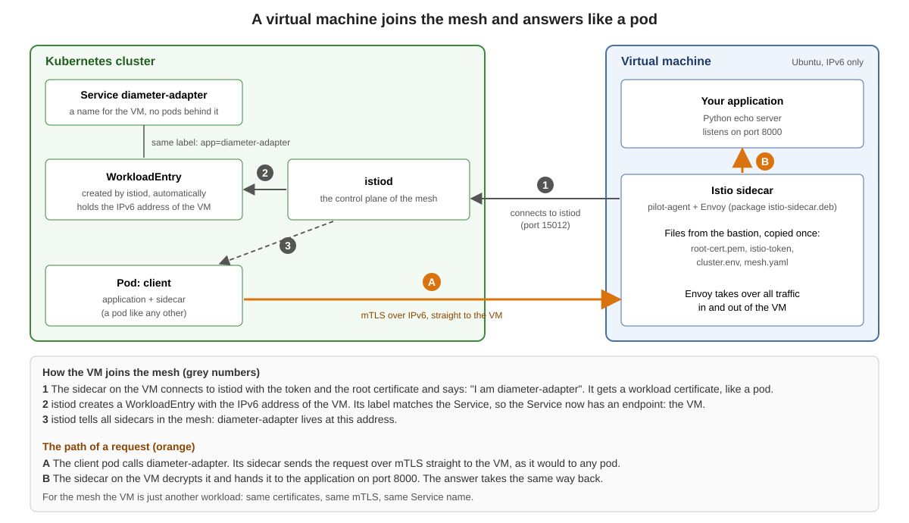

# Add a virtual machine to the mesh (IPv6 only)



> **Attention:** When you use IPv6 only on the VMs (Istio hybrid), be sure that the IPv4 address on the VM is disabled. That is the best and easiest way. Otherwise you need to fiddle around (dual stack switches, `ISTIO_SVC_IP`, health `probe` workarounds).

## Background

A virtual machine joins the mesh with the Istio sidecar package (`istio-sidecar.deb`). The sidecar connects to `istiod` and gets a workload certificate. The VM is **not** a pod and does not show up in `kubectl get pods`. `istiod` creates a `WorkloadEntry` for it automatically (auto-registration), and it appears in `istioctl proxy-status` like the sidecar of a pod. From then on a pod calls the VM through a normal Kubernetes `Service`, with mTLS.

What `WorkloadGroup`, `WorkloadEntry` and `EndpointSlice` are and how they differ: [who is who](00-workloadgroup-workloadentry-endpointslice.md).

Kubernetes, Istio and the VM run as IPv6 single stack. The lab VM has an IPv6 address and **no IPv4 address** (the private address `100.65.x.x` that the cloud gives it is switched off in the VM). Then Istio needs no dual stack switches and no extra settings on the VM. You can check it on the VM:

```
ssh a-vm1 "ip -4 -br addr show eth0; ip -6 -br addr show eth0"
```

The first command prints nothing, the second the IPv6 address. If your VM has an IPv4 address, switch it off first. The file tells the VM not to ask for an IPv4 address by DHCP:

```
ssh a-vm1 "printf 'network:\n  version: 2\n  ethernets:\n    eth0:\n      dhcp4: false\n' > /etc/netplan/99-vm-no-ipv4.yaml && chmod 600 /etc/netplan/99-vm-no-ipv4.yaml && netplan apply"
```

(Or follow the optional page [with IPv4 and IPv6 (dual stack)](02-add-a-vm-to-the-mesh-dual-stack-optional.md).)

| Part | Name in this exercise |
|---|---|
| VM | `a-vm1` (reach it with `ssh a-vm1`) |
| Namespace, service account, workload group, service | `vm`, `diameter-adapter` |
| Application on the VM | a small Python echo server on port 8000 (`vm-echo-server.py`) |
| Address of `istiod` for the VM | a fixed `LoadBalancer` address (`istiod-lb`, port 15012) |

## How to do this exercise

We go through the steps one by one. For every step the trainer explains what happens and why. You do **not** type everything by hand: the script `vm-in-the-mesh.sh` (in the folder `virtual-machines` on your bastion host) runs the steps for you.

```
cd ~/virtual-machines
./vm-in-the-mesh.sh
```

For every step the script prints the commands first and waits:

```
... to continue press ENTER
```

Press ENTER and the script runs exactly the commands you see. You can copy any of them and type it yourself. The run itself takes about one minute, plus the time for the explanations.

## The steps

### Step 1: Settings

The script sets the contexts of both clusters, the name of the VM and the IPv6 address of the VM. It also reads the IPv4 address of the VM and stops if there is one.

```
export CTX_A=cluster-a
export CTX_B=cluster-b
export VM=a-vm1
export VM_IP=$(ssh $VM "ip -6 -o addr show dev eth0 scope global" | awk '{print $4}' | cut -d/ -f1 | head -1)
export VM_IP4=$(ssh $VM "ip -4 -o addr show dev eth0 scope global" | awk '{print $4}' | head -1)
```

### Step 2: Make `istiod` ready for VMs

The VM is outside the cluster and must reach `istiod` from outside. The script does two things:

* It switches on auto-registration (`PILOT_ENABLE_WORKLOAD_ENTRY_AUTOREGISTRATION`) and the DNS proxy with `helm upgrade istiod ... --reuse-values`.
* It creates the Service `istiod-lb` of type `LoadBalancer` with a fixed IPv6 address (MetalLB), port 15012.

If your lab is already prepared, the script says so and skips the step.

```
kubectl --context $CTX_A -n istio-system get svc istiod-lb
```

```
NAME        TYPE           CLUSTER-IP          EXTERNAL-IP               PORT(S)
istiod-lb   LoadBalancer   fd00:10:96::d:ec63  2a01:4f8:1c17:5cbc::2:2   15012:32132/TCP
```

The VM uses the EXTERNAL-IP. The cluster IP (`fd00:...`) exists only inside the cluster.

### Step 3: Create the objects for the VM

Namespace `vm`, service account `diameter-adapter` and the Service `diameter-adapter` in **both** clusters (so that cluster b finds the VM, too). The `WorkloadGroup` (the template for the VM) only in cluster a. The Service finds the VM by the label `app=diameter-adapter`. The script writes the two files `01-vm-objects.yml` and `02-workloadgroup.yml` and shows their content.

```
kubectl --context $CTX_A apply -f 01-vm-objects.yml -f 02-workloadgroup.yml
kubectl --context $CTX_B apply -f 01-vm-objects.yml
```

### Step 4: Create the files for the VM

The command is `istioctl x workload entry configure` (`x` is short for `experimental`). It reads the `WorkloadGroup` and the mesh configuration of the cluster and writes everything the VM needs into a folder. Then the script copies the folder to the VM.

```
istioctl --context $CTX_A x workload entry configure -f 02-workloadgroup.yml -o vmfiles --clusterID cluster-a --ingressIP $ISTIOD_ADDR --autoregister
ls vmfiles
scp -q -r vmfiles vm-echo-server.py $VM:/root/
```

| Option | Meaning |
|---|---|
| `-f 02-workloadgroup.yml` | the `WorkloadGroup` of the VM (name, namespace, labels, service account, ports, network) |
| `-o vmfiles` | the folder for the files |
| `--clusterID cluster-a` | the name of the cluster the VM registers with |
| `--ingressIP $ISTIOD_ADDR` | the address of `istiod` that the VM can reach (our `istiod-lb`, see step 2) |
| `--autoregister` | `istiod` creates the `WorkloadEntry` when the VM connects. Without it the `WorkloadEntry` is missing |

The command writes five files:

```
cluster.env  hosts  istio-token  mesh.yaml  root-cert.pem
```

| File | Goes to (on the VM) | What is in it |
|---|---|---|
| `cluster.env` | `/var/lib/istio/envoy/cluster.env` | One `KEY='value'` line per setting. `istio-start.sh` reads it and every line becomes an environment variable of the sidecar. See below |
| `mesh.yaml` | `/etc/istio/config/mesh` | The mesh configuration for the agent: `discoveryAddress: istiod.istio-system.svc:15012`, `meshId`, and under `proxyMetadata` the same entries as in `cluster.env` |
| `hosts` | appended to `/etc/hosts` | One line: `<ISTIOD_ADDR> istiod.istio-system.svc`, so the VM finds `istiod` by name |
| `root-cert.pem` | `/etc/certs/root-cert.pem` | The root certificate of the mesh (in our lab `Lab Root CA tln1`), so the VM trusts `istiod` and the other workloads |
| `istio-token` | `/var/run/secrets/tokens/istio-token` | A token (JWT) of the service account `diameter-adapter` in the namespace `vm`. The agent uses it once to get its workload certificate. **Secret**, valid for a short time (one hour by default). Do not print it and do not commit it |

This is the `cluster.env` of our lab (lines in the order `istioctl` writes them). There is no dual stack line, because `istiod` has no `ISTIO_DUAL_STACK` setting:

```
CANONICAL_REVISION='latest'
CANONICAL_SERVICE='diameter-adapter'
ISTIO_INBOUND_PORTS='8000'
ISTIO_LOCAL_EXCLUDE_PORTS='22,15090,15021,15020'
ISTIO_METAJSON_LABELS='{"app":"diameter-adapter",...}'
ISTIO_META_AUTO_REGISTER_GROUP='diameter-adapter'
ISTIO_META_CLUSTER_ID='cluster-a'
ISTIO_META_DNS_AUTO_ALLOCATE='true'
ISTIO_META_DNS_CAPTURE='true'
ISTIO_META_MESH_ID='mesh-tln1'
ISTIO_META_NETWORK='net1'
ISTIO_META_POD_PORTS='[{"name":"http","containerPort":8000,"protocol":""}]'
ISTIO_META_WORKLOAD_NAME='diameter-adapter'
ISTIO_NAMESPACE='vm'
ISTIO_SERVICE='diameter-adapter.vm'
ISTIO_SERVICE_CIDR='*'
POD_NAMESPACE='vm'
SERVICE_ACCOUNT='diameter-adapter'
TRUST_DOMAIN='cluster.local'
```

Where the lines come from:

* **From the `WorkloadGroup`:** `ISTIO_NAMESPACE`, `POD_NAMESPACE`, `SERVICE_ACCOUNT`, `ISTIO_SERVICE`, `ISTIO_INBOUND_PORTS` (the ports of the `WorkloadGroup`), `ISTIO_METAJSON_LABELS` (its labels), `ISTIO_META_NETWORK` (its network), `ISTIO_META_POD_PORTS`.
* **From the options:** `ISTIO_META_CLUSTER_ID` (`--clusterID`), `ISTIO_META_AUTO_REGISTER_GROUP` (`--autoregister`).
* **From the mesh configuration of the cluster (`proxyMetadata` in the ConfigMap `istio` in `istio-system`):** every entry there, for example `ISTIO_META_DNS_CAPTURE` and `ISTIO_META_DNS_AUTO_ALLOCATE`. They appear in `mesh.yaml` and in `cluster.env`. (With the dual stack setting in `istiod`, `ISTIO_DUAL_STACK` would appear here, too: see the [optional dual stack page](02-add-a-vm-to-the-mesh-dual-stack-optional.md).)
* **Fixed by `istioctl`:** `ISTIO_LOCAL_EXCLUDE_PORTS='22,15090,15021,15020'`. These ports are not redirected to Envoy: SSH and the three ports of the sidecar itself.

The script does **not** change `cluster.env`: for a VM with IPv6 only, what `istioctl` wrote is enough.

### Step 5: Install the sidecar on the VM and start it

The script logs in to the VM and does this: install `istio-sidecar.deb` (the download goes over IPv6), copy the files to the places the sidecar reads them from, start the sidecar and the echo server.

### Step 6: Is the VM in the mesh?

```
istioctl --context $CTX_A proxy-status | grep -E "NAME|vm"
kubectl --context $CTX_A get workloadentry -n vm
```

```
NAME                 CLUSTER     ISTIOD                    VERSION   SUBSCRIBED TYPES
v6-tln1-a-vm1.vm     cluster-a   istiod-59c4f47fc9-b2vwb   1.29.9    5 (CDS,LDS,EDS,RDS,NDS)

NAME                                         AGE   ADDRESS
diameter-adapter-2a01-4f8-c013-541--1-net1   10s   2a01:4f8:c013:541::1
```

The VM is connected to `istiod`, and the `WorkloadEntry` holds the IPv6 address of the VM. This does not show yet that traffic works.

### Step 7: Test in three directions

From a pod to the VM:

```
kubectl --context $CTX_A exec deploy/client -c curl -- curl -s -m 8 -w "\nHTTP %{http_code}\n" http://diameter-adapter.vm.svc.cluster.local:8000/
```

```
VM diameter-adapter (IPv6), client=::6
x-forwarded-client-cert: By=spiffe://cluster.local/ns/vm/sa/diameter-adapter;Hash=...;URI=spiffe://cluster.local/ns/default/sa/default
HTTP 200
```

The header `x-forwarded-client-cert` shows the identities of both sides: mTLS between the pod and the VM.

From the VM to a service in the cluster (the sidecar of the VM resolves the name, DNS proxy):

```
ssh $VM 'curl -s -m 8 -o /dev/null -w "HTTP %{http_code}\n" http://productpage.default.svc.cluster.local:9080/productpage'
```

From a pod in **cluster b** to the VM (the VM is registered in cluster a, cluster b finds it through the mesh link):

```
kubectl --context $CTX_B exec deploy/client -c curl -- curl -s -m 8 -w "\nHTTP %{http_code}\n" http://diameter-adapter.vm.svc.cluster.local:8000/
```

All three answer `HTTP 200`.

## What to check on the VM

The sidecar sets iptables rules and Envoy listens on the IPv6 wildcard. On the VM (`ssh a-vm1`):

```
echo "IPv4 rules: $(iptables-save -t nat | grep -c ISTIO)  IPv6 rules: $(ip6tables-save -t nat | grep -c ISTIO)"
ss -lnt | grep -E ':1500[16] '
```

```
IPv4 rules: 23  IPv6 rules: 19
LISTEN 0      4096            [::]:15006         [::]:*
LISTEN 0      4096            [::]:15006         [::]:*
LISTEN 0      4096            [::]:15001         [::]:*
LISTEN 0      4096            [::]:15001         [::]:*
```

The tool always sets the IPv4 rules, and it sets the IPv6 rules because the first address of the VM is an IPv6 address. Nothing to configure. Every port shows twice in our lab; what matters is `[::]`, the IPv6 wildcard address.

If a VM has an IPv4 address, things change: the sidecar may register the IPv4 address (calls fail with `503`) and needs the dual stack switches. That is the topic of the [optional page](02-add-a-vm-to-the-mesh-dual-stack-optional.md) and of [DUAL_STACK and ISTIO_DUAL_STACK](00-dual-stack-switches.md).

## Good to know

* The sidecar service is not enabled at boot (`systemctl is-enabled istio` shows `disabled`). After a reboot of the VM the sidecar does not start by itself.
* While the sidecar redirects IPv6 traffic to a port where Envoy does not listen, the outgoing IPv6 traffic of the VM is disturbed, too (a download with `curl` fails). SSH keeps working (port 22 is excluded).
* The files in `vmfiles` contain a token. Do not share them.

## Clean up

```
./vm-in-the-mesh.sh cleanup
```

The script deletes the namespace `vm` in both clusters and the two test pods. On the VM it stops the sidecar and the echo server and removes the sidecar package, its files and the echo server. The VM is back in the state before the exercise. The settings of `istiod` stay.
