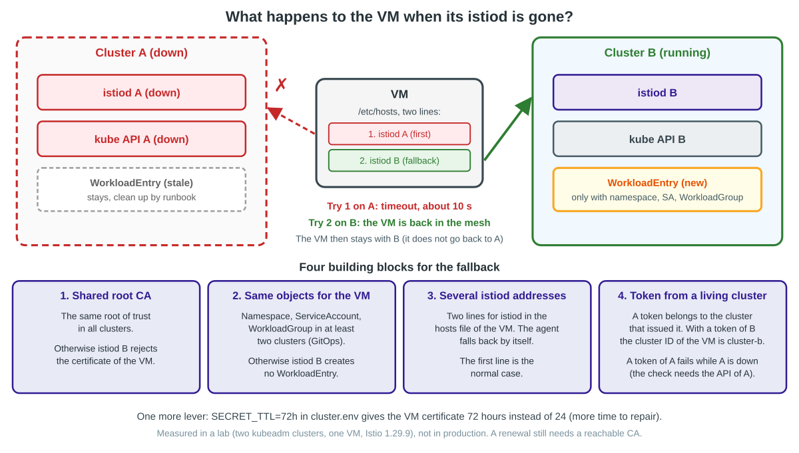

# Outage: what happens to the VM, and how it comes back



## What we do

The VM is registered with cluster a. You take away parts of cluster a, one after the other, and look at what the VM still can do. Then you bring the VM to cluster b, first by hand and then with a small script that stands in for an automation job (for example an AWX playbook).

| Stage | What is gone | Question |
|---|---|---|
| 1 | `istiod` of cluster a | Does traffic still work? |
| 2 | `istio-csr` of cluster a (the certificate authority) | What happens when the sidecar on the VM restarts? |
| 3 | both, the VM moves to cluster b | What does the VM need for that? |
| 4 | nothing, but time passes | Why does a VM drop out of the mesh after a while? |

Prerequisite: the exercises [Connect cluster a and cluster b](../multi-cluster/00-connect-the-two-clusters.md) and [Add a virtual machine to the mesh](01-add-a-vm-to-the-mesh.md). The VM is in the mesh, and the test pod `client` runs in both clusters.

Measured in our lab: Istio 1.29.9, IPv6 only, cert-manager with istio-csr, certificates valid for one hour.

All commands run on your bastion host as your lab user.

```
export CTX_A=cluster-a
export CTX_B=cluster-b
export VM=a-vm1
cd ~/vm-in-the-mesh
```

The three checks we repeat all the time. Is the VM connected, does a pod reach the VM, does the VM reach a pod:

```
istioctl --context $CTX_A proxy-status | grep -E "NAME|vm"
kubectl --context $CTX_A exec deploy/client -c curl -- curl -s -m 8 -o /dev/null -w "HTTP %{http_code}\n" http://diameter-adapter.vm.svc.cluster.local:8000/
ssh $VM 'curl -s -m 8 -o /dev/null -w "HTTP %{http_code}\n" http://productpage.default.svc.cluster.local:9080/productpage'
```

## Stage 1: istiod of cluster a is gone

```
kubectl --context $CTX_A -n istio-system scale deploy istiod --replicas=0
```

Both calls still answer:

```
HTTP 200
HTTP 200
```

The sidecar on the VM keeps the configuration it got last, and its certificate is still valid. What you lose is the view and every change (see [Outage: istiod is gone](../outage/01-istiod-is-gone.md)):

```
istioctl --context $CTX_A proxy-status | grep -E "NAME|vm"
```

```
Error: no running Istio pods in "istio-system"
```

Switch `istiod` on again:

```
kubectl --context $CTX_A -n istio-system scale deploy istiod --replicas=1
kubectl --context $CTX_A -n istio-system rollout status deploy/istiod
```

## Stage 2: the certificate authority of cluster a is gone

```
kubectl --context $CTX_A -n cert-manager scale deploy cert-manager-istio-csr --replicas=0
```

Nothing happens at first. Both calls answer `HTTP 200`, and the VM is in `proxy-status`: nobody needs a new certificate right now.

It hurts as soon as a sidecar starts. Restart the sidecar on the VM:

```
ssh $VM "systemctl restart istio"
```

After half a minute:

```
istioctl --context $CTX_A proxy-status | grep -E "NAME|vm"
```

```
NAME                                                    CLUSTER       ISTIOD                     VERSION     SUBSCRIBED TYPES
v6-tln2-a-vm1.vm                                        cluster-a     istiod-bcfc6b467-t2zxj     1.29.9      2 (CDS,EDS)
```

```
HTTP 503
HTTP 000
```

The VM is connected to `istiod`, but only with two of five types, and no call works in either direction. The log on the VM says why:

```
ssh $VM "tail -4 /var/log/istio/istio.log"
```

```
warn	ca	ca request failed, starting attempt 1 in 104.856341ms
warn	ca	ca request failed, starting attempt 2 in 196.422897ms
warn	ca	ca request failed, starting attempt 3 in 364.440266ms
warn	ca	ca request failed, starting attempt 4 in 839.208215ms
```

Without a certificate Envoy cannot build its listeners. The same happens to a pod: a pod that starts now stays in `Init:1/2`.

**Read `proxy-status` carefully:** a line with fewer types than usual (`2 (CDS,EDS)` instead of `5`) is a proxy without a certificate.

Switch the certificate authority on again:

```
kubectl --context $CTX_A -n cert-manager scale deploy cert-manager-istio-csr --replicas=1
kubectl --context $CTX_A -n cert-manager rollout status deploy/cert-manager-istio-csr
```

The VM recovers by itself (the log shows `generated new workload certificate`), and both calls answer `HTTP 200` again.

## Stage 3: the control plane of cluster a is gone, the VM moves to cluster b

### Prepare cluster b

Cluster b needs what cluster a got in the VM exercise: the settings in `istiod`, a fixed address for `istiod` and for `istio-csr`, and the `WorkloadGroup`.

```
export ISTIO_VERSION=$(istioctl version --remote=false | awk '{print $3}')
helm repo add istio https://istio-release.storage.googleapis.com/charts --force-update
helm --kube-context $CTX_B upgrade istiod istio/istiod -n istio-system --version $ISTIO_VERSION --reuse-values --wait \
  --set-string pilot.env.PILOT_ENABLE_WORKLOAD_ENTRY_AUTOREGISTRATION=true \
  --set-string meshConfig.defaultConfig.proxyMetadata.ISTIO_META_DNS_CAPTURE=true \
  --set-string meshConfig.defaultConfig.proxyMetadata.ISTIO_META_DNS_AUTO_ALLOCATE=true
```

```
export CP_NODE_B=$(kubectl --context $CTX_B get node -l node-role.kubernetes.io/control-plane -o jsonpath='{.items[0].metadata.name}')
export INGRESS_B=$(kubectl --context $CTX_B -n istio-ingress get svc istio-ingressgateway -o jsonpath='{.status.loadBalancer.ingress[0].ip}')
export ISTIOD_ADDR_B=${INGRESS_B%:*}:2
export CSR_ADDR_B=${INGRESS_B%:*}:3
cat > 03-cluster-b-addresses.yml <<YAML
apiVersion: metallb.io/v1beta1
kind: IPAddressPool
metadata: {name: istiod-vip, namespace: metallb-system}
spec: {addresses: ["$ISTIOD_ADDR_B/128", "$CSR_ADDR_B/128"], autoAssign: false}
---
apiVersion: metallb.io/v1beta1
kind: L2Advertisement
metadata: {name: istiod-vip, namespace: metallb-system}
spec:
  ipAddressPools: [istiod-vip]
  nodeSelectors: [{matchLabels: {kubernetes.io/hostname: $CP_NODE_B}}]
---
apiVersion: v1
kind: Service
metadata:
  name: istiod-lb
  namespace: istio-system
  annotations: {metallb.io/loadBalancerIPs: "$ISTIOD_ADDR_B", metallb.io/address-pool: istiod-vip}
spec:
  type: LoadBalancer
  ipFamilyPolicy: SingleStack
  ipFamilies: [IPv6]
  selector: {app: istiod, istio: pilot}
  ports: [{name: tls-istiod, port: 15012, targetPort: 15012}]
---
apiVersion: v1
kind: Service
metadata:
  name: istio-csr-lb
  namespace: cert-manager
  annotations: {metallb.io/loadBalancerIPs: "$CSR_ADDR_B", metallb.io/address-pool: istiod-vip}
spec:
  type: LoadBalancer
  ipFamilyPolicy: SingleStack
  ipFamilies: [IPv6]
  selector: {app: cert-manager-istio-csr}
  ports: [{name: grpc, port: 443, targetPort: 6443}]
YAML
kubectl --context $CTX_B apply -f 03-cluster-b-addresses.yml -f 02-workloadgroup.yml
kubectl --context $CTX_B get svc -A | grep -- -lb
```

```
cert-manager     istio-csr-lb                      LoadBalancer   fd00:10:96::f:f97    2a01:4f8:c014:8eb1::2:3   443:31420/TCP                                6s
istio-system     istiod-lb                         LoadBalancer   fd00:10:96::5:a7b    2a01:4f8:c014:8eb1::2:2   15012:30318/TCP                              6s
```

### Take the control plane of cluster a away

```
kubectl --context $CTX_A -n istio-system scale deploy istiod --replicas=0
kubectl --context $CTX_A -n cert-manager scale deploy cert-manager-istio-csr --replicas=0
```

The pods of cluster a keep running, and so does its API server. Only `istiod` and the certificate authority are gone. A control-plane node that is switched off is the harder case: then the API server of cluster a is gone, too.

### By hand: point the VM to cluster b

The VM needs four things from cluster b: the two addresses, a token, and the cluster ID.

```
ssh $VM "sed -i '/istiod.istio-system.svc/d; /cert-manager-istio-csr.cert-manager.svc/d' /etc/hosts
echo '$ISTIOD_ADDR_B istiod.istio-system.svc' >> /etc/hosts
echo '$CSR_ADDR_B cert-manager-istio-csr.cert-manager.svc' >> /etc/hosts"
kubectl --context $CTX_B create token diameter-adapter -n vm --audience istio-ca --duration 1h > token-b
scp -q token-b $VM:/var/run/secrets/tokens/istio-token
rm -f token-b
ssh $VM "chown istio-proxy: /var/run/secrets/tokens/istio-token
sed -i \"s/^ISTIO_META_CLUSTER_ID=.*/ISTIO_META_CLUSTER_ID='cluster-b'/\" /var/lib/istio/envoy/cluster.env
systemctl restart istio"
```

After half a minute the VM is registered with cluster b, with a certificate from the certificate authority of cluster b:

```
istioctl --context $CTX_B proxy-status | grep -E "NAME|vm"
ssh $VM "openssl x509 -noout -issuer -dates -in /etc/certs/cert-chain.pem"
```

```
NAME                                                    CLUSTER       ISTIOD                      VERSION     SUBSCRIBED TYPES
v6-tln2-a-vm1.vm                                        cluster-b     istiod-6bbfdb896b-spbrm     1.29.9      5 (CDS,LDS,EDS,RDS,NDS)
issuer=O = Lab, CN = Intermediate CA tln2 b
notBefore=Nov 13 15:45:57 2026 GMT
notAfter=Nov 13 16:45:57 2026 GMT
```

The pods of cluster a still reach the VM, although their own control plane is down (`HTTP 200`): both intermediate CAs have the same root.

**Why the token of cluster a does not help.** We tried it: with the token of cluster a the certificate authority of cluster b answers

```
error	citadelclient	failed to sign CSR: create certificate: rpc error: code = Unauthenticated desc = request authenticate failure
```

A token is checked by the API server of the cluster that created it. The certificate authority of cluster b asks its own API server, and that one does not know the token.

### With the script: the stand-in for an automation job

Typing this by hand during an outage is slow and error-prone. `vm-refresh-token.sh` (in the folder `virtual-machines`) does the same: it looks for the first cluster with a running control plane (first a, then b), gets a token there and points the VM to this cluster.

Switch the control plane of cluster a on again and run the script:

```
kubectl --context $CTX_A -n cert-manager scale deploy cert-manager-istio-csr --replicas=1
kubectl --context $CTX_A -n istio-system scale deploy istiod --replicas=1
kubectl --context $CTX_A -n istio-system rollout status deploy/istiod
~/virtual-machines/vm-refresh-token.sh
```

```
Token from: cluster-a
The VM was registered with cluster-b: point it to cluster-a (2a01:4f8:c013:ff3b::2:2, 2a01:4f8:c013:ff3b::2:3), set the cluster ID and restart the sidecar
```

The VM is back at cluster a. Run the script again: nothing changes, only the token is replaced.

```
Token from: cluster-a
The VM is registered with cluster-a already: token replaced, no restart
```

Now take the control plane of cluster a away again (the two `scale ... --replicas=0` commands from above) and run the script:

```
cluster-a: control plane not ready, trying the next cluster
Token from: cluster-b
The VM was registered with cluster-a: point it to cluster-b (2a01:4f8:c014:8eb1::2:2, 2a01:4f8:c014:8eb1::2:3), set the cluster ID and restart the sidecar
```

Check with the three commands from the top (use `$CTX_B` for `proxy-status`). At the end switch cluster a on again and run the script once more, so that the VM is back at cluster a.

## Stage 4: time passes

Nothing is broken, and still a VM can drop out of the mesh. We measured it in our lab:

| Time | What happened on the VM |
|---|---|
| 12:14 | VM joins the mesh, first certificate (valid for one hour) |
| 12:44, 13:14 | the agent renews the certificate, every time after half of its lifetime |
| 13:44 | the renewal fails: `Unauthenticated` |
| 14:14 | the certificate expires. The VM is not in `proxy-status` any more, calls answer `HTTP 503` |

The reason is in the log of istio-csr:

```
failed to authenticate request ... invalid bearer token, service account token has expired
```

The token that `istioctl` wrote at the beginning is valid for one hour, and nobody replaces it. With the default settings, istio-csr accepts **only a token** as proof of identity. So a VM can renew its certificate only as long as it has a valid token.

Two ways out:

| Way | How | Trade-off |
|---|---|---|
| Replace the token regularly | an automation job like `vm-refresh-token.sh`, more often than once per hour | the VM depends on the job |
| Let the VM prove its identity with its current certificate | istio-csr setting `app.server.authenticators.enableClientCert=true` | a VM that was offline longer than the lifetime of its certificate still needs a token |

We measured the second way, too: with `enableClientCert=true` the VM renewed its certificate 30 minutes after its token had expired, and stayed in the mesh. **Your lab is built with this setting**, so that your VM survives the training days. Look at it with `helm -n cert-manager get values cert-manager-istio-csr -a | grep -A1 authenticators`.

A fresh token is enough, the sidecar does not have to restart: the agent reads the file again at its next attempt (measured with `istiod` as the certificate authority).

## Why the VM has only one cluster in /etc/hosts

It is tempting to write the addresses of both clusters into `/etc/hosts`, so that the VM finds cluster b by itself. We tried it. With a valid certificate it works: when `istiod` of cluster a went away, the VM was connected to the `istiod` of cluster b within 30 seconds, without any action.

But the agent does **not** take the first line of the file. With both control planes running, our VM (`2a01:4f8:c014:...`) connected to cluster b (`2a01:4f8:c014:...`) although cluster a (`2a01:4f8:c013:...`) was the first line: it prefers the address that is most similar to its own (the name resolution of the agent sorts the addresses, RFC 6724). As soon as the VM needs a token, this matters, because a token only fits the cluster that created it. That is why the script writes exactly one cluster into the file.

## What to take away

| Symptom | Likely cause | Where to look |
|---|---|---|
| VM missing in `proxy-status`, traffic still works | `istiod` not reachable. This is an early warning | `istioctl proxy-status` |
| VM in `proxy-status` with `2 (CDS,EDS)`, `HTTP 503` | no certificate: certificate authority not reachable, or the token is not accepted | `/var/log/istio/istio.log` on the VM |
| `Unauthenticated` in the log of the VM | token expired, or token from another cluster than the one the VM talks to | log of istio-csr, `ISTIO_META_CLUSTER_ID` in `cluster.env`, `/etc/hosts` |
| Everything worked for two hours, then `HTTP 503` | the token from the setup has expired and the certificate could not be renewed | `openssl x509 -noout -dates -in /etc/certs/cert-chain.pem` on the VM |

## Clean up

The VM stays in the mesh for the next exercises. Make sure both control planes run and the VM is at cluster a:

```
kubectl --context $CTX_A -n cert-manager scale deploy cert-manager-istio-csr --replicas=1
kubectl --context $CTX_A -n istio-system scale deploy istiod --replicas=1
~/virtual-machines/vm-refresh-token.sh
```
